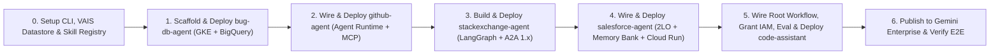
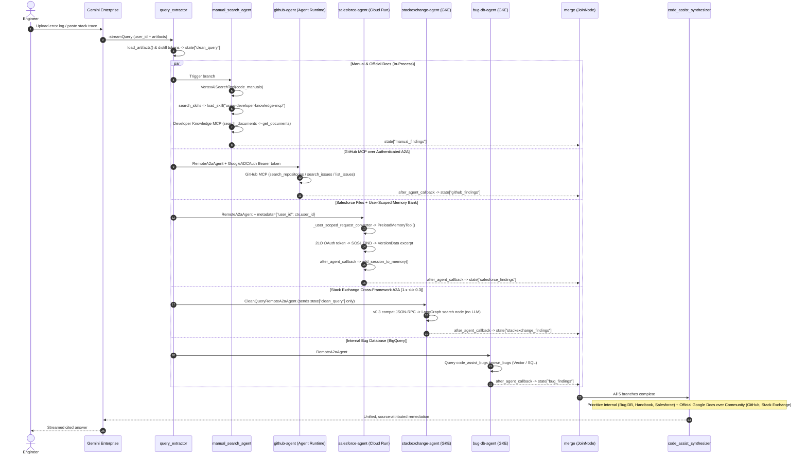

# Build Enterprise Agents ("Code Assist") — Lab Runbook

A step-by-step operational runbook, distributed multi-agent system architecture, cross-service authentication matrix, and end-to-end execution workflow for building, testing, deploying, and publishing the **Code Assist** enterprise incident-resolution platform across **Agent Runtime**, **Cloud Run**, **GKE Autopilot**, and **Gemini Enterprise**.

---

## 1. System Architecture

Code Assist separates **incident intake and synthesis** (an ADK 2.0 graph `Workflow` running on Agent Runtime) from **five parallel specialist branches** spanning heterogeneous frameworks (**ADK 2.0** and **LangGraph**), protocols (**A2A 0.3**, **A2A 1.x**, and **Streamable HTTP MCP**), and GCP compute targets (**Agent Runtime**, **Cloud Run**, and **GKE Autopilot**).

```mermaid
flowchart TB
    subgraph Client["Enterprise Entry Point"]
        User["Developer (Stack Trace / Log / Screenshot)"]
        GE["Gemini Enterprise App (Native ADK :streamQuery)"]
    end

    subgraph RootRuntime["Agent Runtime (us-central1) — Root Orchestrator (code-assistant)"]
        Intake["query_extractor (ADK Agent + load_artifacts)"]
        subgraph FanOut["5-Way Parallel Workflow Fan-Out"]
            Manual["manual_search_agent (In-Process ADK Agent)"]
            RemBug["bug_db_agent (RemoteA2aAgent)"]
            RemGH["github_agent (RemoteA2aAgent + GoogleADCAuth)"]
            RemSF["salesforce_agent (RemoteA2aAgent + user_id_meta_provider)"]
            RemSE["stackexchange_agent (CleanQueryRemoteA2aAgent)"]
        end
        Merge["merge (ADK Workflow JoinNode)"]
        Synth["code_assist_synthesizer (Source-Prioritized Citation Agent)"]
    end

    subgraph ManualSources["Managed Knowledge & Skills"]
        VAIS["Vertex AI Search Datastore (gs://PROJECT-bucket/code_manuals/*.pdf)"]
        SkillReg["GCP Skill Registry (using-developer-knowledge-mcp)"]
        DevMCP["Google Developer Knowledge MCP (developerknowledge.googleapis.com/mcp)"]
    end

    subgraph RemoteFleet["Distributed A2A Specialist Fleet"]
        subgraph GKEBug["GKE Autopilot — bug-db-agent (ADK + A2A 0.3)"]
            BugSvc["FastAPI + A2aAgentExecutor (/a2a/app)"]
            BQ["BigQuery: code_assist_bugs.known_bugs (768-dim text-embedding-004)"]
        end

        subgraph ARGitHub["Agent Runtime — github-agent (ADK + A2A 0.3)"]
            GHSvc["Authenticated Reasoning Engine (/api/a2a/app)"]
            GHMCP["GitHub Copilot MCP Server (Read-Only Tool Filter + PAT)"]
        end

        subgraph CRSalesforce["Cloud Run — salesforce-agent (ADK + A2A 0.3)"]
            SFSvc["FastAPI + _user_scoped_request_converter"]
            SFAPI["Salesforce Files REST/SOSL + VersionData (2LO client_credentials)"]
            MemBank["Vertex AI Memory Bank (Per-User Cross-Session Recall)"]
        end

        subgraph GKESE["GKE Autopilot / Cloud Run — stackexchange-agent (LangGraph)"]
            SESvc["Starlette + a2a-sdk 1.x Server (1.0 + 0.3 Dual Interface)"]
            SEGraph["Single-Node StateGraph (Deterministic StackExchangeTool)"]
        end
    end

    subgraph Obs["Enterprise Observability"]
        Telemetry["Cloud Trace + Cloud Logging + BigQuery Analytics"]
    end

    User --> GE
    GE -->|":streamQuery"| Intake
    Intake -->|"state['clean_query']"| Manual
    Intake -->|"state['clean_query']"| RemBug
    Intake -->|"state['clean_query']"| RemGH
    Intake -->|"state['clean_query']"| RemSF
    Intake -->|"clean_query only"| RemSE

    Manual --> VAIS
    Manual --> SkillReg
    Manual --> DevMCP

    RemBug -->|"A2A JSON-RPC"| BugSvc
    BugSvc --> BQ

    RemGH -->|"A2A + OAuth2 Bearer"| GHSvc
    GHSvc --> GHMCP

    RemSF -->|"A2A + metadata.user_id"| SFSvc
    SFSvc --> SFAPI
    SFSvc <--> MemBank

    RemSE -->|"A2A v0.3 Compat JSON-RPC"| SESvc
    SESvc --> SEGraph

    Manual -->|"output_key: manual_findings"| Merge
    RemBug -->|"callback: bug_findings"| Merge
    RemGH -->|"callback: github_findings"| Merge
    RemSF -->|"callback: salesforce_findings"| Merge
    RemSE -->|"callback: stackexchange_findings"| Merge

    Merge --> Synth
    Synth --> GE
    RootRuntime -.-> Telemetry
```



### 1.1 Specialist Fleet & Runtime Matrix

| Component | Directory | Framework | Deployment Target | Protocol & Card Path | Backing Data / Tooling |
|---|---|---|---|---|---|
| **Root Orchestrator** | `agents/code-assistant/` | ADK 2.0 `Workflow` (`google-adk 2.3.0`) | **Agent Runtime** | ADK `:streamQuery` + `/a2a/app/.well-known/agent-card.json` | `load_artifacts`, 4x `RemoteA2aAgent`, `JoinNode`, `Gemini` |
| **Manual & Docs Search** | `agents/code-assistant/app/agent.py` | ADK `Agent` (in-process) | Inside `code-assistant` | In-memory `Workflow` edge (`output_key="manual_findings"`) | `VertexAiSearchTool`, `GCPSkillRegistry` (`SkillToolset`), `McpToolset` |
| **Bug DB Specialist** | `agents/bug-db-agent/` *(scaffolded)* | ADK `Agent` | **GKE Autopilot** | `/a2a/app/.well-known/agent-card.json` (`use_legacy=False`) | BigQuery `code_assist_bugs.known_bugs` (`VECTOR_SEARCH` / SQL) |
| **GitHub Specialist** | `agents/github-agent/` | ADK `Agent` | **Agent Runtime** | `.../api/a2a/app/.well-known/agent-card.json` (`use_legacy=False`) | `McpToolset` -> `https://api.githubcopilot.com/mcp/` (3 read-only tools) |
| **Salesforce Specialist** | `agents/salesforce-agent/` | ADK `Agent` | **Cloud Run** | `/a2a/app/.well-known/agent-card.json` (`use_legacy=False`) | 2LO OAuth + SOSL `ContentVersion` + `.docx`/`.pdf` excerpting + Memory Bank |
| **Stack Exchange Specialist** | `agents/stackexchange-agent/` | **LangGraph** (`StateGraph`, no LLM) | **GKE Autopilot** *(or Cloud Run)* | `/.well-known/agent-card.json` (`a2a-sdk 1.1.0` w/ `v0.3` compat) | LangChain `StackExchangeTool` via `StackExchangeExecutor` |

### 1.2 Pre-Provisioned Lab Assets

| Resource | Identifier | Purpose |
|---|---|---|
| **GCS Bucket** | `gs://<PROJECT_ID>-bucket/` | Starter `agents/` code, `code_manuals/*.pdf` (16 engineering runbooks), `known_bugs.json`, and IDE `settings.json` |
| **BigQuery Dataset & Table** | `<PROJECT_ID>.code_assist_bugs.known_bugs` | Past production incidents (`bug_id`, `title`, `description`, `resolution`, 768-dim `description_embedding`) |
| **Artifact Registry** | `us-central1-docker.pkg.dev/<PROJECT_ID>/agents` | Docker repository for custom GKE / Cloud Run agent container images |

---

## 2. Workflows

### 2.1 Outer Loop: Enterprise Agent Engineering & Deployment Workflow

Because the root `code-assistant` container bakes specialist Agent Card URLs at deploy time and relies on IAM permissions across runtimes, build and deploy **bottom-up** (data stores and leaf specialists first, root orchestrator second, Gemini Enterprise registration last):



### 2.2 Inner Loop: Runtime Incident Resolution & A2A Protocol Sequence

When an engineer submits a stack trace or screenshot in Gemini Enterprise, the root `Workflow` executes a deterministic **Intake -> 5-Way Parallel Fan-Out -> Join -> Cited Synthesis** pipeline:



### 2.3 Cross-Service Authentication, Protocol & State Design Decisions

| Design Mechanism | Problem Solved | Implementation Pattern |
|---|---|---|
| **`GoogleADCAuth` (`httpx.Auth`)** | Agent Runtime endpoints reject unauthenticated calls with `401 CREDENTIALS_MISSING` | Attaches auto-refreshing OAuth2 bearer tokens from ADC locally and from `service-<PROJECT_NUMBER>@gcp-sa-aiplatform-re.iam.gserviceaccount.com` in production (`roles/aiplatform.user`) |
| **Dual `1.0` + `0.3` `AgentInterface`s** | `google-adk 2.3.0` pins `a2a-sdk<0.4` (`0.3.26`), while `stackexchange-agent` uses `a2a-sdk 1.1.0` | Advertising both `1.0` and `0.3` interfaces + `enable_v0_3_compat=True` causes `agent_card_to_dict` to emit legacy top-level `url` and `preferredTransport` fields |
| **`CleanQueryRemoteA2aAgent`** | Default `RemoteA2aAgent` wraps full session history (`For context: [query_extractor] said: ...`), breaking deterministic keyword search | Subclasses `RemoteA2aAgent` and overrides `_construct_message_parts_from_session` to send a single `Part(text=state["clean_query"])` |
| **End-to-End `user_id` Forwarding** | Default A2A execution scopes sessions to `A2A_USER_{context_id}`, isolating Memory Bank per conversation instead of per human user | Root sends `{"user_id": ctx.user_id}` via `a2a_request_meta_provider`; Salesforce agent's `_user_scoped_request_converter` sets `run_request.user_id` |
| **`capture_response_to_state` Callback** | `RemoteA2aAgent` is a `BaseAgent` (not an `LlmAgent`), so it has no `output_key` and `JoinNode` does not persist its text into template variables | `after_agent_callback` extracts the specialist's final text event and writes it to `callback_context.state[state_key]` for `{state_key?}` injection in `synthesizer` |
| **On-Demand Skill Registry (`SkillToolset`)** | Keeps system prompts lean while preventing off-corpus hallucinations on Developer Knowledge MCP | `manual_search_agent` discovers and loads `using-developer-knowledge-mcp` from `GCPSkillRegistry` only when an error involves a Google product |

---

## 3. Step-by-Step Lab Runbook

### Step 0: Environment Setup, Vertex AI Search Datastore & Skill Registry

#### 0.1 Configure Cloud Credentials, Project Variables & `agents-cli`

```bash
gcloud auth login
gcloud auth application-default login

export PROJECT_ID="$(gcloud config get-value project)"
export PROJECT_NUMBER="$(gcloud projects describe ${PROJECT_ID} --format='value(projectNumber)')"
export REGION="us-central1"

gcloud config set project "${PROJECT_ID}"

# Copy starter agents from the lab bucket (if starting in a fresh workspace)
gcloud storage cp -r "gs://${PROJECT_ID}-bucket/agents" ~/

# Install google-agents-cli and register IDE skills
export PATH="${HOME}/.local/bin:${PATH}"
uv tool install google-agents-cli
agents-cli setup
agents-cli info
```

Enable required Google Cloud APIs across all deployment targets:

```bash
gcloud services enable \
  aiplatform.googleapis.com \
  discoveryengine.googleapis.com \
  developerknowledge.googleapis.com \
  run.googleapis.com \
  container.googleapis.com \
  artifactregistry.googleapis.com \
  cloudbuild.googleapis.com \
  bigquery.googleapis.com \
  secretmanager.googleapis.com \
  --project="${PROJECT_ID}"
```

#### 0.2 Create the Engineering Handbook Datastore (Vertex AI Search)

1. In the Google Cloud Console, navigate to **AI Applications (Agent Builder / Gemini Enterprise) -> Data Stores -> Create Data Store**.
2. Choose **Cloud Storage** -> **Unstructured documents (PDF, HTML, TXT, DOCX)**.
3. Set location to **`global`**, point to **`gs://<PROJECT_ID>-bucket/code_manuals`** (16 operational PDFs such as `fastapi_error_handling.pdf`, `db_connection_pooling.pdf`, `cloud_run_runbook.pdf`, `gke_deployment.pdf`), and name the data store `code-manuals`.
4. Copy the generated **Data Store ID** (`DATASTORE_ID`) once indexing completes:
   ```bash
   export DATASTORE_ID="<YOUR_DATASTORE_ID>"
   ```

#### 0.3 Publish the `using-developer-knowledge-mcp` Skill to GCP Skill Registry

`manual_search_agent` discovers `using-developer-knowledge-mcp` dynamically from the regional Vertex AI Skill Registry (`us-central1`). Run the idempotent create-only publisher script in `agents/code-assistant`:

```bash
cd ~/agents/code-assistant
uv sync
uv run python scripts/publish_skill.py \
  --project "${PROJECT_ID}" \
  --location "${REGION}" \
  --skill-id using-developer-knowledge-mcp
```

> [!IMPORTANT]
> Updating an existing skill in GCP Skill Registry does not refresh its semantic search index. `publish_skill.py` is intentionally create-only; if you ever modify `SKILL.md`, delete the skill first and recreate it.

---

### Step 1: Build & Deploy the Internal Bug Database Specialist (`bug-db-agent`)

The internal incident table `<PROJECT_ID>.code_assist_bugs.known_bugs` contains historical production incidents (`bug_id`, `title`, `description`, `resolution`) pre-embedded with 768-dimension `text-embedding-004` vectors (`description_embedding`).

#### 1.1 Scaffold `bug-db-agent` with Built-In A2A Support

Do **not** `mkdir` the directory beforehand (`agents-cli` creates it with FastAPI + A2A wiring built in):

```bash
cd ~/agents
agents-cli create bug-db-agent \
  --agent adk_python \
  --deployment-target gke \
  --region "${REGION}" \
  --prototype \
  --skip-checks
```

#### 1.2 Implement BigQuery Incident Lookup (`agents/bug-db-agent/app/agent.py`)

Add `google-cloud-bigquery` (`cd ~/agents/bug-db-agent && uv add google-cloud-bigquery`) and implement a read-only BigQuery search tool over `code_assist_bugs.known_bugs`:

```python
import os
import dotenv
from google.adk.agents import Agent
from google.adk.apps import App
from google.adk.models import Gemini
from google.cloud import bigquery
from google.genai import types

dotenv.load_dotenv()

PROJECT_ID = os.environ["GOOGLE_CLOUD_PROJECT"]
MODEL = os.environ.get("MODEL", "gemini-3.5-flash")
BQ_DATASET = os.environ.get("BIGQUERY_DATASET", "code_assist_bugs")
BQ_TABLE = os.environ.get("BIGQUERY_TABLE", "known_bugs")


def search_known_bugs(query: str) -> dict:
    """Searches internal past bug incidents and fixes in BigQuery.

    Args:
        query: Error message, exception name, or symptom keywords.

    Returns:
        dict containing matching bug_id, title, description, and resolution rows.
    """
    client = bigquery.Client(project=PROJECT_ID)
    genai_client = genai.Client(vertexai=True, project=PROJECT_ID, location="us-central1")
    emb = genai_client.models.embed_content(
        model="text-embedding-004",
        contents=query,
    ).embeddings[0].values

    sql = f"""
        SELECT base.bug_id, base.title, base.description, base.resolution, distance
        FROM VECTOR_SEARCH(
            TABLE `{PROJECT_ID}.{BQ_DATASET}.{BQ_TABLE}`,
            'description_embedding',
            (SELECT @query_embedding AS embedding),
            top_k => 5,
            distance_type => 'COSINE'
        )
        ORDER BY distance ASC
    """
    job_config = bigquery.QueryJobConfig(
        query_parameters=[bigquery.ArrayQueryParameter("query_embedding", "FLOAT64", emb)]
    )
    rows = [dict(row) for row in client.query(sql, job_config=job_config).result()]
    return {"status": "success", "matches": rows}


root_agent = Agent(
    name="bug_db_agent",
    model=Gemini(model=MODEL, retry_options=types.HttpRetryOptions(attempts=3)),
    description="Searches the internal bug database in BigQuery for past incidents and fixes.",
    instruction=(
        "Search the internal BigQuery bug database using `search_known_bugs` for the "
        "reported error. Cite matching `bug_id`s, root causes, and verified resolutions."
    ),
    tools=[search_known_bugs],
)

app = App(root_agent=root_agent, name="app")
```

*(Note: Add `from google import genai` at top of file, or use ADK's `BigQueryToolset` with `WriteMode.BLOCKED`.)*

#### 1.3 Deploy `bug-db-agent` and Record `BQ_AGENT_URL`

Build and deploy `bug-db-agent` to GKE Autopilot (behind an external LoadBalancer with `APP_URL=http://<EXTERNAL_IP>` and Workload Identity granted `roles/bigquery.user` + `roles/aiplatform.user`) or via `agents-cli scaffold enhance . --deployment-target gke && agents-cli deploy`. Verify the A2A agent card:

```bash
export BQ_AGENT_URL="http://<BUG_DB_EXTERNAL_IP>/a2a/app/.well-known/agent-card.json"
curl -s "${BQ_AGENT_URL}" | python3 -m json.tool
```

---

### Step 2: Implement & Deploy the GitHub MCP Specialist (`github-agent`)

`github-agent` wraps the hosted GitHub Copilot MCP server (`https://api.githubcopilot.com/mcp/`) and deploys to **Agent Runtime**.

#### 2.1 Complete `TODO(challenge)` in `agents/github-agent/app/agent.py`

Replace `github_mcp_toolset = None` with a read-only `McpToolset` authenticated with `GITHUB_TOKEN`:

```python
github_mcp_toolset = McpToolset(
    connection_params=StreamableHTTPConnectionParams(
        url=GITHUB_MCP_URL,
        headers={"Authorization": f"Bearer {GITHUB_TOKEN}"},
    ),
    tool_filter=GITHUB_TOOL_FILTER,
)
```

#### 2.2 Run Offline Unit Tests

```bash
cd ~/agents/github-agent
uv sync
GITHUB_PERSONAL_ACCESS_TOKEN="test-pat" MODEL="gemini-3.5-flash" uv run pytest tests/unit
```

#### 2.3 Configure `.env`, Deploy to Agent Runtime & Verify over A2A

Create `~/agents/github-agent/.env` (never commit `.env` to Git):

```bash
cat <<EOF > ~/agents/github-agent/.env
GOOGLE_CLOUD_PROJECT=${PROJECT_ID}
GOOGLE_CLOUD_LOCATION=global
GOOGLE_GENAI_USE_VERTEXAI=True
MODEL=gemini-3.5-flash
GITHUB_PERSONAL_ACCESS_TOKEN=<YOUR_GITHUB_PAT>
GITHUB_MCP_URL=https://api.githubcopilot.com/mcp/
EOF
```

Deploy to **Agent Runtime** (takes ~5–10 minutes):

```bash
cd ~/agents/github-agent
agents-cli deploy --project "${PROJECT_ID}" --no-confirm-project \
  --update-env-vars "$(grep -v '^#' .env | grep -v '^$' | grep -v '^GOOGLE_CLOUD_PROJECT' | paste -sd,)"
```

Capture the deployed Agent Card URL from `deployment_metadata.json` / CLI output and smoke-test via A2A:

```bash
export GITHUB_ENGINE_ID="<ENGINE_ID_FROM_DEPLOY_OUTPUT>"
export GITHUB_AGENT_URL="https://${REGION}-aiplatform.googleapis.com/reasoningEngines/v1/projects/${PROJECT_NUMBER}/locations/${REGION}/reasoningEngines/${GITHUB_ENGINE_ID}/api/a2a/app/.well-known/agent-card.json"

curl -s -H "Authorization: Bearer $(gcloud auth print-access-token)" "${GITHUB_AGENT_URL}" | python3 -m json.tool

agents-cli run \
  --url "https://${REGION}-aiplatform.googleapis.com/v1/projects/${PROJECT_NUMBER}/locations/${REGION}/reasoningEngines/${GITHUB_ENGINE_ID}" \
  --mode a2a \
  "Search GitHub issues for FastAPI PydanticUserError model_rebuild"
```

---

### Step 3: Implement & Deploy the Cross-Framework Stack Exchange Specialist (`stackexchange-agent`)

`stackexchange-agent` is a deterministic (no-LLM) **LangGraph** agent self-served on Starlette with **`a2a-sdk` 1.1.0**, configured with dual `1.0` + `0.3` interfaces so `code-assistant` (`a2a-sdk 0.3.26`) can consume it seamlessly.

#### 3.1 Complete `StateGraph` in `agents/stackexchange-agent/app/agent.py`

```python
graph = (
    StateGraph(State)
    .add_node("search", search)
    .add_edge(START, "search")
    .add_edge("search", END)
    .compile()
)
```

#### 3.2 Complete `1.0` + `0.3` Backward Compatibility in `agents/stackexchange-agent/app/server.py`

In `build_agent_card(public_url: str)`, populate `supported_interfaces`:

```python
        supported_interfaces=[
            AgentInterface(
                url=rpc_url,
                protocol_binding="JSONRPC",
                protocol_version="1.0",
            ),
            AgentInterface(
                url=rpc_url,
                protocol_binding="JSONRPC",
                protocol_version="0.3",
            ),
        ],
```

#### 3.3 Run Offline Unit Tests

```bash
cd ~/agents/stackexchange-agent
uv sync
uv run pytest tests/unit
```

*(All 7 unit tests across `test_agent_config.py` and `test_server.py` — including `test_agent_card_is_0_3_compatible` — must pass.)*

#### 3.4 Build Container & Deploy to GKE Autopilot (or Cloud Run)

```bash
cd ~/agents/stackexchange-agent
export IMAGE="${REGION}-docker.pkg.dev/${PROJECT_ID}/agents/stackexchange-agent:latest"

# Build & push via Cloud Build
gcloud builds submit --tag "${IMAGE}" --region="${REGION}" --project="${PROJECT_ID}" .

# Create GKE Autopilot cluster (if not already running) & get credentials
gcloud container clusters create-auto stackexchange-cluster \
  --region="${REGION}" --project="${PROJECT_ID}"
gcloud container clusters get-credentials stackexchange-cluster \
  --region="${REGION}" --project="${PROJECT_ID}"

# Set project image in manifest and apply
sed -i "s/YOUR_PROJECT_ID/${PROJECT_ID}/g" deployment/k8s/deployment.yaml
kubectl apply -f deployment/k8s/deployment.yaml

# Wait for external LoadBalancer IP, then advertise PUBLIC_URL in the served Agent Card
kubectl rollout status deployment/stackexchange-agent --timeout=180s
export SE_EXTERNAL_IP="$(kubectl get svc stackexchange-agent -o jsonpath='{.status.loadBalancer.ingress[0].ip}')"
kubectl set env deployment/stackexchange-agent "PUBLIC_URL=http://${SE_EXTERNAL_IP}"
kubectl rollout status deployment/stackexchange-agent --timeout=180s

export STACKEXCHANGE_AGENT_URL="http://${SE_EXTERNAL_IP}/.well-known/agent-card.json"
curl -s "${STACKEXCHANGE_AGENT_URL}" | python3 -m json.tool
```

*(Cloud Run alternative: `gcloud run deploy stackexchange-agent --image "${IMAGE}" --region "${REGION}" --project "${PROJECT_ID}" --allow-unauthenticated --port 8080`, then update `PUBLIC_URL` to the Cloud Run HTTPS URL.)*

---

### Step 4: Implement & Deploy the Salesforce 2LO + Memory Bank Specialist (`salesforce-agent`)

`salesforce-agent` authenticates to Salesforce via **2-legged OAuth (`client_credentials`)**, searches org-wide **Salesforce Files** via SOSL (`ContentVersion`), enriches top hits with `.docx`/`.pdf` text excerpts, and maintains **per-user cross-session memory** in **Vertex AI Memory Bank**.

#### 4.1 Complete 2LO Client-Credentials Auth (`agents/salesforce-agent/app/salesforce_client.py`)

In `SalesforceClient.authenticate(self)`:

```python
        resp = requests.post(
            f"https://{self.domain}/services/oauth2/token",
            data={
                "grant_type": "client_credentials",
                "client_id": self.client_id,
                "client_secret": self.client_secret,
            },
            timeout=_TIMEOUT_SECONDS,
        )
        _raise_for_status(resp)
        return resp.json()
```

#### 4.2 Complete Idempotent Memory Bank Provisioning (`agents/salesforce-agent/scripts/create_memory_bank.py`)

```python
    for engine in client.agent_engines.list():
        if getattr(engine.api_resource, "display_name", None) == DISPLAY_NAME:
            engine_id = engine.api_resource.name.split("/")[-1]
            print(engine_id)
            return

    created = client.agent_engines.create(config={"display_name": DISPLAY_NAME})
    engine_id = created.api_resource.name.split("/")[-1]
    print(engine_id)
```

#### 4.3 Wire Memory Bank Tool & Callback (`agents/salesforce-agent/app/agent.py`)

1. In `generate_memories_callback(callback_context: CallbackContext)`:
   ```python
   async def generate_memories_callback(callback_context: CallbackContext) -> None:
       await callback_context.add_session_to_memory()
   ```
2. On `root_agent = Agent(...)`:
   ```python
       tools=[search_salesforce, PreloadMemoryTool()],
       after_agent_callback=generate_memories_callback,
   ```

#### 4.4 Wire User-Scoped A2A Request Converter (`agents/salesforce-agent/app/app_utils/a2a.py`)

In `_user_scoped_request_converter(request, part_converter=convert_a2a_part_to_genai_part)`:

```python
    run_request = convert_a2a_request_to_agent_run_request(request, part_converter)
    forwarded_user_id = (request.metadata or {}).get("user_id")
    if forwarded_user_id:
        run_request.user_id = forwarded_user_id
    return run_request
```

#### 4.5 Run Unit Tests, Provision Memory Bank & Deploy to Cloud Run

```bash
cd ~/agents/salesforce-agent
uv sync
uv run pytest tests/unit

# Provision regional Vertex AI Memory Bank in us-central1 (never global!)
export MEMORY_BANK_ID="$(GOOGLE_CLOUD_PROJECT=${PROJECT_ID} MEMORY_BANK_LOCATION=${REGION} uv run python scripts/create_memory_bank.py | tail -n 1)"
echo "MEMORY_BANK_ID=${MEMORY_BANK_ID}"
```

Create `~/agents/salesforce-agent/.env` and deploy to **Cloud Run**:

```bash
cat <<EOF > ~/agents/salesforce-agent/.env
GOOGLE_CLOUD_PROJECT=${PROJECT_ID}
GOOGLE_CLOUD_LOCATION=global
GOOGLE_GENAI_USE_VERTEXAI=True
MODEL=gemini-3.5-flash
MEMORY_BANK_ID=${MEMORY_BANK_ID}
MEMORY_BANK_LOCATION=${REGION}
SALESFORCE_DOMAIN=<YOUR_ORG>.develop.my.salesforce.com
SALESFORCE_CLIENT_ID=<YOUR_CONSUMER_KEY>
SALESFORCE_CLIENT_SECRET=<YOUR_CONSUMER_SECRET>
EOF

agents-cli deploy --project "${PROJECT_ID}" --region "${REGION}" --no-confirm-project

export SF_BASE_URL="$(gcloud run services describe salesforce-agent --region=${REGION} --project=${PROJECT_ID} --format='value(status.url)')"
export SALESFORCE_AGENT_URL="${SF_BASE_URL}/a2a/app/.well-known/agent-card.json"
```

> [!NOTE]
> If you upload new `.docx` / `.pdf` ADR files to Salesforce (**App Launcher -> Files -> Upload Files**), allow ~15 minutes for Salesforce's full-text SOSL index to catch up (`SELECT COUNT() FROM ContentVersion` confirms immediate upload).

---

### Step 5: Wire the Root Orchestrator (`code-assistant`), Grant IAM & Deploy

Now complete the five `TODO(challenge)` items in `agents/code-assistant` to connect auth, user-identity propagation, state capture, remote specialists, and the 5-branch `Workflow` graph.

#### 5.1 Implement `GoogleADCAuth._apply` (`agents/code-assistant/app/auth.py`)

```python
    def _apply(self, request: httpx.Request) -> None:
        self._creds.before_request(
            self._req, request.method, str(request.url), request.headers
        )
```

#### 5.2 Forward Real End-User ID Over A2A (`agents/code-assistant/app/app_utils/a2a.py`)

```python
def user_id_meta_provider(ctx: InvocationContext, a2a_message) -> dict[str, str]:
    return {"user_id": ctx.user_id}
```

#### 5.3 Capture `RemoteA2aAgent` Final Text Into Shared Session State (`agents/code-assistant/app/callbacks.py`)

```python
    async def _after_agent_callback(callback_context: CallbackContext):
        name = callback_context.agent_name
        for event in reversed(callback_context.session.events):
            if event.author == name and event.content and event.content.parts:
                texts = [p.text for p in event.content.parts if getattr(p, "text", None)]
                if texts:
                    callback_context.state[state_key] = "\n".join(texts)
                    break
        return None
```

#### 5.4 Wire Specialists & `Workflow` Graph Edges (`agents/code-assistant/app/agent.py`)

1. Configure `github_agent` (ADK A2A extension + `google_authed_client()`) and `stackexchange_agent` (`CleanQueryRemoteA2aAgent` using standard A2A client — **no** `use_legacy=False`):
   ```python
   github_agent = RemoteA2aAgent(
       name="github_agent",
       description="Searches GitHub repositories, issues, and pull requests via the GitHub MCP server.",
       agent_card=GITHUB_AGENT_URL,
       httpx_client=google_authed_client(),
       use_legacy=False,
       after_agent_callback=capture_response_to_state("github_findings"),
   )

   stackexchange_agent = CleanQueryRemoteA2aAgent(
       name="stackexchange_agent",
       description="Searches Stack Exchange for programming questions and error resolutions.",
       agent_card=STACKEXCHANGE_AGENT_URL,
       after_agent_callback=capture_response_to_state("stackexchange_findings"),
   )
   ```
   *(If `salesforce-agent` is deployed with `--no-allow-unauthenticated` on Cloud Run, also pass an ID-token-authenticated `httpx_client` or configure public ingress for lab testing.)*

2. Wire the diamond fan-out / fan-in `edges` on `root_agent = Workflow(...)`:
   ```python
   SPECIALISTS = (
       github_agent,
       stackexchange_agent,
       salesforce_agent,
       bug_db_agent,
       manual_search_agent,
   )

   root_agent = Workflow(
       name="code_assist_agent",
       description=(
           "Researches an error across GitHub, Stack Exchange, Salesforce, and a bug "
           "database (all over A2A) plus code manuals in parallel, then blends a "
           "cited answer."
       ),
       edges=[
           ("START", query_extractor),
           (query_extractor, SPECIALISTS),
           (SPECIALISTS, merge),
           (merge, synthesizer),
       ],
   )
   ```

#### 5.5 Grant Cross-Service IAM Permissions to the Agent Runtime Service Account

When `code-assistant` runs on Agent Runtime, it executes as the Reasoning Engine service agent (`service-<PROJECT_NUMBER>@gcp-sa-aiplatform-re.iam.gserviceaccount.com`). Grant it access to invoke `github-agent` on Agent Runtime, `salesforce-agent` on Cloud Run, Vertex AI Search, and Skill Registry:

```bash
export RE_SA="serviceAccount:service-${PROJECT_NUMBER}@gcp-sa-aiplatform-re.iam.gserviceaccount.com"

# Invoke github-agent on Agent Runtime + Vertex AI models & Skill Registry
gcloud projects add-iam-policy-binding "${PROJECT_ID}" \
  --member="${RE_SA}" \
  --role="roles/aiplatform.user"

# Query Vertex AI Search (Engineering Handbook datastore)
gcloud projects add-iam-policy-binding "${PROJECT_ID}" \
  --member="${RE_SA}" \
  --role="roles/discoveryengine.viewer"

# Invoke Cloud Run sub-agents (salesforce-agent)
gcloud run services add-iam-policy-binding salesforce-agent \
  --region="${REGION}" \
  --project="${PROJECT_ID}" \
  --member="${RE_SA}" \
  --role="roles/run.invoker"
```

#### 5.6 Run Unit Tests, Evaluation & Deploy `code-assistant` to Agent Runtime

```bash
cd ~/agents/code-assistant
uv sync
uv run pytest tests/unit

cat <<EOF > ~/agents/code-assistant/.env
GOOGLE_CLOUD_PROJECT=${PROJECT_ID}
GOOGLE_CLOUD_LOCATION=global
GOOGLE_GENAI_USE_VERTEXAI=True
MODEL=gemini-3.5-flash
DATASTORE_ID=${DATASTORE_ID}
GITHUB_AGENT_URL=${GITHUB_AGENT_URL}
STACKEXCHANGE_AGENT_URL=${STACKEXCHANGE_AGENT_URL}
SALESFORCE_AGENT_URL=${SALESFORCE_AGENT_URL}
BQ_AGENT_URL=${BQ_AGENT_URL}
DEVELOPER_KNOWLEDGE_MCP_URL=https://developerknowledge.googleapis.com/mcp
SKILL_REGISTRY_LOCATION=${REGION}
EOF

# Optional local playground & evaluation run
# agents-cli playground
# agents-cli eval run

# Deploy root orchestrator to Agent Runtime
agents-cli deploy --project "${PROJECT_ID}" --no-confirm-project \
  --update-env-vars "$(grep -v '^#' .env | grep -v '^$' | grep -v '^GOOGLE_CLOUD_PROJECT' | paste -sd,)"
```

---

### Step 6: Publish to Gemini Enterprise & Verify End-to-End

#### 6.1 Register `code-assistant` with Gemini Enterprise (Native ADK Mode)

Because `code-assistant` is an ADK app deployed on Agent Runtime (`deployment_metadata.json` present), register it using native **ADK registration** (`:streamQuery`):

```bash
cd ~/agents/code-assistant

# List available Gemini Enterprise apps in the project
agents-cli publish gemini --list

export GEMINI_APP_ID="projects/${PROJECT_NUMBER}/locations/global/collections/default_collection/engines/<YOUR_GEMINI_APP_ENGINE_ID>"

agents-cli publish gemini \
  --gemini-app-id "${GEMINI_APP_ID}" \
  --registration-type adk \
  --display-name "Code Assist" \
  --description "Enterprise incident resolution orchestrator across Bug DB, Handbook, Google Docs, Salesforce ADRs, GitHub, and Stack Exchange."
```

#### 6.2 End-to-End Verification Checklist

Test the following prompts in **Gemini Enterprise** (or via `agents-cli run` against the root Reasoning Engine URL):

1. **Internal Precedence & Multi-Source Synthesis:**
   > *"After upgrading pydantic from v1 to v2, our FastAPI service crashes on startup with 500 and `PydanticUserError: ... is not fully defined`. How should we fix this according to our standards?"*
   - Verify citations include **Bug Database (`BUG-1001`)**, **Engineering Handbook (`fastapi_error_handling.pdf`)**, **GitHub**, and **Stack Exchange**, prioritizing internal standards over community workarounds.
2. **Google Product Error (Dynamic Skill Registry + Developer Knowledge MCP):**
   > *"Our Cloud Run revision fails to connect to Cloud Spanner with `DEADLINE_EXCEEDED` during cold bursts. What do our handbook and official Google docs recommend?"*
   - Confirm in Cloud Trace that `manual_search_agent` calls `search_skills` -> `load_skill("using-developer-knowledge-mcp")` before invoking Developer Knowledge MCP tools.
3. **Cross-Session User Memory (A2A `user_id` Propagation + Salesforce Memory Bank):**
   - **Conversation 1:** State your team/service context (e.g., *"I maintain the payments-worker Python async service; what is our org-wide outbound timeout ADR policy?"*).
   - **Conversation 2 (new session, same user):** Ask a follow-up policy question without repeating your service name and verify `PreloadMemoryTool` recalls your context scoped to your real `user_id`.

---

### Step 7: Teardown & Cost Control

Avoid ongoing charges from GKE Autopilot LoadBalancers and Agent Runtime instances once lab validation is complete:

```bash
# Delete GKE clusters (releases external LoadBalancers)
gcloud container clusters delete stackexchange-cluster --region="${REGION}" --project="${PROJECT_ID}" --quiet

# Delete Cloud Run services
gcloud run services delete salesforce-agent --region="${REGION}" --project="${PROJECT_ID}" --quiet
```

---

## 4. Troubleshooting Quick Reference

| Symptom | Root Cause | Resolution |
|---|---|---|
| `curl` to Agent Runtime card returns `401 UNAUTHENTICATED (CREDENTIALS_MISSING)` | Agent Runtime endpoints are always IAM-authenticated | Expected for unauthenticated `curl`; pass `-H "Authorization: Bearer $(gcloud auth print-access-token)"` or use `agents-cli run --mode a2a` |
| Root `code-assistant` gets `403 PERMISSION_DENIED` resolving `github_agent` card | Root's Reasoning Engine SA lacks `aiplatform.reasoningEngines.query` or root omitted `google_authed_client()` | Grant `roles/aiplatform.user` to `service-<PROJECT_NUMBER>@gcp-sa-aiplatform-re.iam.gserviceaccount.com` and pass `httpx_client=google_authed_client()` on `github_agent` |
| Root fails parsing `stackexchange_agent` card: `ValidationError: url Field required` | `a2a-sdk 1.x` omits legacy top-level `url` unless a `0.3` `AgentInterface` is advertised | Advertise **both** `protocol_version="1.0"` and `"0.3"` in `supported_interfaces` (`app/server.py`) and do **not** set `use_legacy=False` on `stackexchange_agent` |
| `stackexchange_agent` returns zero hits on valid errors | Default `RemoteA2aAgent` sends `For context: [query_extractor] said: ...` wrapper | Use `CleanQueryRemoteA2aAgent` so only `state["clean_query"]` is sent to the deterministic Stack Exchange tool |
| `VertexAiMemoryBankService` returns `404` on memory read/write | `MEMORY_BANK_LOCATION` was set to `global` instead of a regional endpoint | Keep `GOOGLE_CLOUD_LOCATION=global` for Gemini models, but set `MEMORY_BANK_LOCATION=us-central1` |
| Salesforce Memory Bank forgets user facts in a new chat | `user_id` was not forwarded over A2A, defaulting to `A2A_USER_{context_id}` | Implement `user_id_meta_provider` on root (`{'user_id': ctx.user_id}`) and `_user_scoped_request_converter` in `salesforce-agent/app/app_utils/a2a.py` |
| Newly uploaded `.docx` ADRs in Salesforce return `0` SOSL hits | Salesforce Files full-text search index lags ~15 minutes after upload | Verify upload with SOQL `SELECT COUNT() FROM ContentVersion`, then wait ~15 minutes before SOSL testing |
| Root cannot reach `stackexchange-agent` even though pod is `READY 1/1` | Agent card still advertises default `http://localhost:8080/a2a/jsonrpc` | Set `PUBLIC_URL=http://${EXTERNAL_IP}` on the deployment and wait for `kubectl rollout status` |
| Edited `code-assistant/.env` locally, but deployed root still calls old sub-agent URLs | Agent Runtime bakes environment variables at deploy time | Re-run `agents-cli deploy --update-env-vars ...` after changing any specialist URL |
