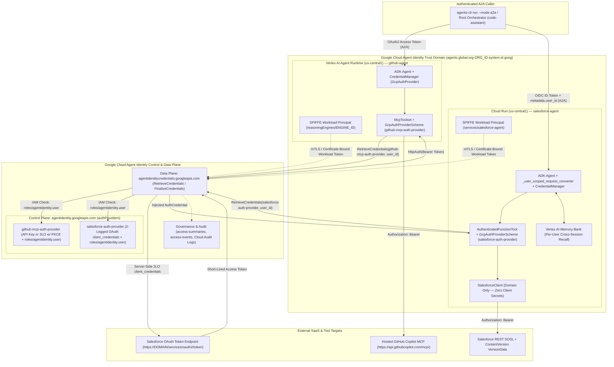
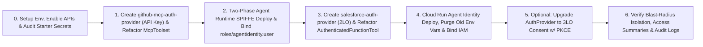
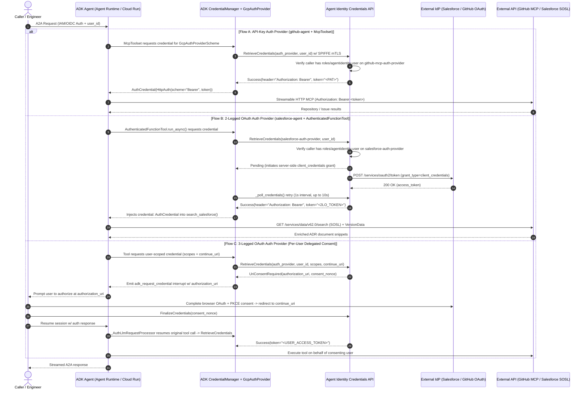

# Agent Identity Foundations (APEX009) — Lab Runbook

A step-by-step operational runbook, zero-standing-secret system architecture, SPIFFE workload attestation reference, and end-to-end credential-retrieval workflow for refactoring enterprise AI agents (**`github-agent`** on **Vertex AI Agent Runtime** and **`salesforce-agent`** on **Cloud Run**) onto **Google Cloud Agent Identity** and **Auth Manager (`authProviders`)**.

---

## 1. System Architecture

Lab 1 (*Build Enterprise Agents*) shipped working specialist agents with two classic prototype security liabilities:
1. **Shared, coarse-grained runtime identities:** Every Reasoning Engine shared `service-<PROJECT_NUMBER>@gcp-sa-aiplatform-re.iam.gserviceaccount.com` and Cloud Run services shared `<PROJECT_NUMBER>-compute@developer.gserviceaccount.com`, giving co-tenant agents an identical IAM blast radius.
2. **Standing plaintext secrets in container environment variables:** `GITHUB_PERSONAL_ACCESS_TOKEN`, `SALESFORCE_CLIENT_ID`, and `SALESFORCE_CLIENT_SECRET` lived inside `.env` files and deployment specs where any process dump, misconfigured log sink, or broad `viewer` role could read them.

Lab 2 replaces both anti-patterns with **platform-attested SPIFFE Workload Identities (`*.system.id.goog`)** and **centralized credential brokering (`agentidentity.googleapis.com` + `agentidentitycredentials.googleapis.com`)**:



### 1.1 Lab 1 vs. Lab 2 Security Posture Comparison

| Security Dimension | Lab 1 Starter State (Anti-Pattern) | Lab 2 Target State (Agent Identity Foundations) |
|---|---|---|
| **Agent Workload Identity** | Shared project-wide service accounts (`gcp-sa-aiplatform-re`, default Compute SA) | Unique, immutable **SPIFFE identity** per agent (`principal://agents.global.org-<ORG_ID>.system.id.goog/...`) |
| **Workload Credentials** | Standard bearer tokens vulnerable to replay if exfiltrated | X.509 certificate-bound / runtime-attested workload credentials issued automatically by Agent Runtime & Cloud Run |
| **External Tool Secrets** | Plaintext `GITHUB_PERSONAL_ACCESS_TOKEN`, `SALESFORCE_CLIENT_ID`, `SALESFORCE_CLIENT_SECRET` in `.env` & container specs | Stored exclusively in **Agent Identity Auth Providers** (`authProviders`); container holds only the non-secret resource URI |
| **OAuth Token Exchange** | Performed inside application code (`SalesforceClient.authenticate()`) with manual session-state TTL caching | Brokered server-side by `agentidentitycredentials.googleapis.com` (`RetrieveCredentials`) |
| **Blast-Radius Isolation** | Any Python module inside the container or co-tenant engine can read raw credentials | Per-provider IAM (`roles/agentidentity.user`) + optional `--workload-ids` allowlist isolates `github-agent` from Salesforce and `salesforce-agent` from GitHub |
| **Secret Rotation & Revocation** | Requires rebuilding/redeploying every consuming agent revision | Rotate once via `gcloud agent-identity auth-providers update` or revoke via `revoke-authorization` with zero agent downtime |
| **Governance & Forensics** | Opaque outbound HTTPS calls from container IPs | Centralized `access-summaries`, `access-events`, `query-workloads`, and Data Access Cloud Audit Logs per agent principal and `user_id` |

### 1.2 SPIFFE Principal & Resource URI Reference

| Resource | Canonical Identifier Format |
|---|---|
| **Trust Domain (Org-Scoped Project)** | `agents.global.org-${ORGANIZATION_ID}.system.id.goog` |
| **Trust Domain (Org-Less Project)** | `agents.global.proj-${PROJECT_NUMBER}.system.id.goog` *(Agent Runtime)* / `agents.global.project-${PROJECT_NUMBER}.system.id.goog` *(Cloud Run)* |
| **Agent Runtime SPIFFE Principal** | `principal://agents.global.org-${ORGANIZATION_ID}.system.id.goog/resources/aiplatform/projects/${PROJECT_NUMBER}/locations/${REGION}/reasoningEngines/${ENGINE_ID}` |
| **Cloud Run SPIFFE Principal** | `principal://agents.global.org-${ORGANIZATION_ID}.system.id.goog/resources/run/projects/${PROJECT_NUMBER}/locations/${REGION}/services/${SERVICE_NAME}` |
| **Auth Provider Resource URI** | `projects/${PROJECT_ID}/locations/${LOCATION}/authProviders/${AUTH_PROVIDER_ID}` |

---

## 2. End-to-End Workflows

### 2.1 Outer Loop: Zero-Standing-Secret Migration Workflow



### 2.2 Inner Loop: Runtime SPIFFE Attestation & Credential Brokerage Sequence

At runtime, ADK's `CredentialManager` dispatches `GcpAuthProviderScheme` to `GcpAuthProvider`, which calls `AuthProviderCredentialsServiceClient.retrieve_credentials` using the container's platform-attested SPIFFE identity across all three supported authentication flows (**API Key**, **2-Legged OAuth**, and **3-Legged OAuth**):



### 2.3 Key Engineering & SDK Design Decisions

| Mechanism | Problem Solved | Implementation Detail |
|---|---|---|
| **Two-Phase Agent Runtime Deployment (`deploy_with_identity.sh`)** | Sending `spec.identityType: "AGENT_IDENTITY"` in the same `POST` request as `sourceCodeSpec` causes the Reasoning Engine backend to fail startup (`failed to start and cannot serve traffic`) in `agents-cli <= 1.2.1` and `google-adk <= 2.5.0` | **Phase 1:** `POST /v1beta1/.../reasoningEngines` with `{"spec": {"identityType": "AGENT_IDENTITY"}}` only, polling until `effectiveIdentity` is provisioned and granting IAM roles. **Phase 2:** `PATCH` the engine with `sourceCodeSpec` and an `updateMask` that **excludes** `identityType`. |
| **Raw Secret in `--api-key` (No `"Bearer "` Prefix)** | Passing `--api-key="Bearer ghp_..."` produces a malformed `Authorization: Bearer Bearer ghp_...` header that GitHub rejects with `401 Bad credentials` | Agent Identity Credentials API returns `header="Authorization: Bearer"` alongside `token="<API_KEY>"`. ADK's `_construct_auth_credential` parses `header` and constructs `HttpAuth(scheme="Bearer", token=token)` automatically. |
| **`AuthenticatedFunctionTool` Parameter Masking** | Custom Python tools need the exchanged `AuthCredential` at runtime without confusing the Gemini model into hallucinating a `credential` JSON parameter | `AuthenticatedFunctionTool` appends `"credential"` to `self._ignore_params` when building the LLM `FunctionDeclaration`, fetches the token via `CredentialManager`, and injects `credential=credential` via `inspect.signature` before invoking `search_salesforce`. |
| **Domain-Only `SalesforceClient` (`instance_url` Derivation)** | Standard OAuth2 token brokers return `(header, token, expire_time, scopes)` in `RetrieveCredentialsResponse.Success`, omitting Salesforce's proprietary `instance_url` JSON field | Keep the non-secret `SALESFORCE_DOMAIN` (`<org>.my.salesforce.com`) in `.env` so `SalesforceClient` derives `https://${SALESFORCE_DOMAIN}` while `SALESFORCE_CLIENT_ID` and `SALESFORCE_CLIENT_SECRET` live solely in `salesforce-auth-provider`. |
| **Mandatory `user_id` Context (`_user_scoped_request_converter`)** | `GcpAuthProvider` raises `ValueError: GcpAuthProvider requires a context with a valid user_id` if `context.user_id` is `None` | ADK's A2A executor assigns `A2A_USER_{context_id}` by default, and `salesforce-agent`'s `_user_scoped_request_converter` overrides `run_request.user_id` with `request.metadata["user_id"]` so both Auth Manager auditing and Vertex AI Memory Bank track the real human caller. |
| **Purging Legacy Cloud Run Env Vars (`--set-env-vars`)** | Redeploying a Lab 1 Cloud Run service with `--update-env-vars` **merges** variables, leaving `SALESFORCE_CLIENT_ID` and `SALESFORCE_CLIENT_SECRET` exposed on the new revision | Deploy with `--set-env-vars` (or explicit `--remove-env-vars=SALESFORCE_CLIENT_ID,SALESFORCE_CLIENT_SECRET`) to wipe Lab 1 secrets from the revision spec. |

---

## 3. Step-by-Step Lab Runbook

### Step 0: Environment Setup, Lab Prerequisites & Starter Security Audit

#### 0.1 Authenticate & Export Project / Organization Metadata

```bash
gcloud auth login
gcloud auth application-default login

export PROJECT_ID="$(gcloud config get-value project)"
export LOCATION="us-central1"
export REGION="us-central1"

gcloud config set project "${PROJECT_ID}"

export PROJECT_NUMBER="$(gcloud projects describe "${PROJECT_ID}" --format='value(projectNumber)')"
export ORGANIZATION_ID="$(gcloud projects get-ancestors "${PROJECT_ID}" --format=json | jq -r '.[] | select(.type=="organization") | .id')"

echo "Project: ${PROJECT_ID} (${PROJECT_NUMBER}), Org: ${ORGANIZATION_ID}, Location: ${LOCATION}, Region: ${REGION}"
export PATH="${HOME}/.local/bin:${PATH}"
```

#### 0.2 (Fresh Lab Environment Only) Run `lab2_prereqs.sh` & Stage Starter Code

If starting in a fresh Qwiklabs project that does not yet have the End-of-Lab-1 starter deployments, pull and run `apex_labs/lab2_prereqs.sh`:

```bash
gcloud storage cp -r "gs://${PROJECT_ID}-bucket/apex_labs" ~/
bash ~/apex_labs/lab2_prereqs.sh

# Stage the Lab 2 agent directories if not already in ~/agents
gcloud storage cp -r "gs://${PROJECT_ID}-bucket/agents" ~/
```

#### 0.3 Enable Agent Identity & Supporting Google Cloud APIs

```bash
gcloud services enable \
  agentidentity.googleapis.com \
  agentidentitycredentials.googleapis.com \
  aiplatform.googleapis.com \
  run.googleapis.com \
  cloudbuild.googleapis.com \
  artifactregistry.googleapis.com \
  iam.googleapis.com \
  iamcredentials.googleapis.com \
  sts.googleapis.com \
  logging.googleapis.com \
  cloudtrace.googleapis.com \
  --project="${PROJECT_ID}"
```

#### 0.4 Audit the Starter Security Posture

Inspect the starter code and live Cloud Run revision before refactoring to confirm what secrets and shared service accounts exist:

```bash
# Starter Cloud Run service uses the default Compute SA and holds plaintext SF secrets:
gcloud run services describe salesforce-agent \
  --region="${REGION}" \
  --project="${PROJECT_ID}" \
  --format="yaml(spec.template.spec.serviceAccountName,spec.template.spec.containers[0].env)"
```

---

### Step 1: Provision GitHub Auth Provider & Refactor `github-agent` (`McpToolset`)

#### 1.1 Create `github-mcp-auth-provider` in Agent Identity Auth Manager

Capture your GitHub Personal Access Token without echoing it into shell history and create an **API Key** Auth Provider in `us-central1`:

```bash
read -rsp "GitHub Personal Access Token (ghp_...): " GITHUB_PERSONAL_ACCESS_TOKEN && echo

gcloud agent-identity auth-providers create github-mcp-auth-provider \
  --project="${PROJECT_ID}" \
  --location="${LOCATION}" \
  --api-key="${GITHUB_PERSONAL_ACCESS_TOKEN}" \
  --description="Managed API-key Auth Provider for GitHub Copilot MCP Server"

# Wipe the raw token from your shell session immediately
unset GITHUB_PERSONAL_ACCESS_TOKEN
```

> [!IMPORTANT]
> Pass the raw token (`ghp_...`) to `--api-key` — **do not** prefix it with `Bearer `. The Agent Identity Credentials service returns `header: "Authorization: Bearer"` automatically, and ADK's `GcpAuthProvider` constructs the `Bearer` header from that metadata.

Verify the Auth Provider is `ENABLED` and record its full resource URI:

```bash
gcloud agent-identity auth-providers list \
  --project="${PROJECT_ID}" \
  --location="${LOCATION}"

export GITHUB_AUTH_PROVIDER_URI="projects/${PROJECT_ID}/locations/${LOCATION}/authProviders/github-mcp-auth-provider"
```

#### 1.2 Replace Plaintext Secret in `agents/github-agent/.env`

Write a secret-free `.env` containing `GITHUB_AUTH_PROVIDER_URI` instead of `GITHUB_PERSONAL_ACCESS_TOKEN`:

```bash
cat <<EOF > ~/agents/github-agent/.env
GOOGLE_CLOUD_PROJECT=${PROJECT_ID}
GOOGLE_CLOUD_LOCATION=global
GOOGLE_GENAI_USE_VERTEXAI=True
MODEL=gemini-3.5-flash
GITHUB_MCP_URL=https://api.githubcopilot.com/mcp/
GITHUB_AUTH_PROVIDER_URI=${GITHUB_AUTH_PROVIDER_URI}
EOF
```

#### 1.3 Refactor `agents/github-agent/agent/agent.py` to Use `GcpAuthProvider`

Confirm `agents/github-agent/agent/requirements.txt` includes the `agent-identity` extra:

```text
google-adk[gcp,agent-identity,a2a,mcp]==2.4.0
python-dotenv>=1.2.2
```

Update `agents/github-agent/agent/agent.py` so `CredentialManager` registers `GcpAuthProvider()` and `McpToolset` authenticates via `GcpAuthProviderScheme` (removing the hardcoded `Authorization: Bearer ...` header):

```python
import os

from dotenv import load_dotenv
from google.adk.agents import Agent
from google.adk.apps import App
from google.adk.auth.credential_manager import CredentialManager
from google.adk.integrations.agent_identity import (
    GcpAuthProvider,
    GcpAuthProviderScheme,
)
from google.adk.models import Gemini
from google.adk.tools.mcp_tool import McpToolset, StreamableHTTPConnectionParams
from google.genai import types

load_dotenv()

MODEL = os.environ["MODEL"]
GITHUB_AUTH_PROVIDER_URI = os.environ["GITHUB_AUTH_PROVIDER_URI"]
GITHUB_MCP_URL = os.getenv("GITHUB_MCP_URL", "https://api.githubcopilot.com/mcp/")
GITHUB_TOOL_FILTER = ["search_repositories", "search_issues", "list_issues"]

_raw_scopes = os.getenv("GITHUB_OAUTH_SCOPES", "").strip()
GITHUB_OAUTH_SCOPES = [s.strip() for s in _raw_scopes.split(",") if s.strip()] or None
GITHUB_CONTINUE_URI = os.getenv("GITHUB_CONTINUE_URI", "").strip() or None

# 1. Register Google Cloud Agent Identity Auth Manager with ADK CredentialManager
CredentialManager.register_auth_provider(GcpAuthProvider())

# 2. Bind McpToolset to the GCP Auth Provider resource URI (zero secrets in code/env)
github_auth_scheme = GcpAuthProviderScheme(
    name=GITHUB_AUTH_PROVIDER_URI,
    scopes=GITHUB_OAUTH_SCOPES,
    continue_uri=GITHUB_CONTINUE_URI,
)

github_mcp_toolset = McpToolset(
    connection_params=StreamableHTTPConnectionParams(
        url=GITHUB_MCP_URL,
        headers={"Accept": "application/vnd.github.v3+json"},
    ),
    auth_scheme=github_auth_scheme,
    tool_filter=GITHUB_TOOL_FILTER,
)

root_agent = Agent(
    name="github_agent",
    model=Gemini(
        model=MODEL,
        retry_options=types.HttpRetryOptions(attempts=3),
    ),
    description=(
        "Specialized assistant for GitHub: searches repositories, issues, and "
        "pull requests via the GitHub MCP server."
    ),
    instruction=(
        "You are a specialized assistant for interacting with GitHub. "
        "Use the provided tools to search for repositories, find issues, and "
        "retrieve pull-request information, then answer with what you find. "
        "Be concise and cite the repository names / issue numbers you used."
    ),
    tools=[github_mcp_toolset],
)

app = App(root_agent=root_agent, name="app")
```

---

### Step 2: Deploy `github-agent` to Agent Runtime with SPIFFE Identity & Least-Privilege IAM

#### 2.1 Delete Any Pre-Existing Non-Identity `github-agent` Engine

An existing Reasoning Engine created *without* `identityType: "AGENT_IDENTITY"` cannot have federated SPIFFE identity retrofitted in place (`deploy_with_identity.sh` checks `effectiveIdentity` and aborts safely if `.system.id.goog` is absent). If `lab2_prereqs.sh` or Lab 1 deployed a service-account-backed `github-agent` engine, delete it first:

```bash
OLD_ENGINE="$(curl -s -H "Authorization: Bearer $(gcloud auth print-access-token)" \
  "https://${REGION}-aiplatform.googleapis.com/v1beta1/projects/${PROJECT_NUMBER}/locations/${REGION}/reasoningEngines" \
  | python3 -c "import json,sys; d=json.load(sys.stdin); print(next((e['name'] for e in d.get('reasoningEngines',[]) if e.get('displayName')=='github-agent' and 'system.id.goog' not in e.get('spec',{}).get('effectiveIdentity','')), ''))")"

if [[ -n "${OLD_ENGINE}" ]]; then
  echo "Deleting non-identity engine: ${OLD_ENGINE}"
  curl -s -X DELETE -H "Authorization: Bearer $(gcloud auth print-access-token)" \
    "https://${REGION}-aiplatform.googleapis.com/v1beta1/${OLD_ENGINE}?force=true" | jq .
fi
```

#### 2.2 Run Two-Phase SPIFFE Deployment & Bind `roles/agentidentity.user`

Execute `deploy_with_identity.sh` inside `agents/github-agent`. It performs:
1. **`POST /v1beta1/.../reasoningEngines`** with `{"displayName": "github-agent", "spec": {"identityType": "AGENT_IDENTITY"}}` only, waiting for `spec.effectiveIdentity` (`agents.global.org-<ORG_ID>.system.id.goog/...`).
2. **Project IAM bindings** on `principal://${EFFECTIVE_IDENTITY}` (`roles/aiplatform.user`, `roles/serviceusage.serviceUsageConsumer`, `roles/browser`, `roles/cloudapiregistry.viewer`, `roles/logging.logWriter`, `roles/monitoring.metricWriter`).
3. **Tarball upload & `PATCH`** with `updateMask` omitting `identityType` (and excluding `.env` from the source archive, injecting only non-reserved `.env` keys into `deploymentSpec.env`).
4. **Resource-scoped Auth Provider IAM binding** (`roles/agentidentity.user` on `github-mcp-auth-provider` when `AUTH_PROVIDER_NAME` is passed):

```bash
cd ~/agents/github-agent
chmod +x deploy_with_identity.sh

AUTH_PROVIDER_NAME="github-mcp-auth-provider" \
AUTH_PROVIDER_LOCATION="${LOCATION}" \
A2A_APP_NAME="agent" \
./deploy_with_identity.sh
```

*(If running the unpatched upstream `deploy_with_identity.sh`, bind `roles/agentidentity.user` explicitly using the printed `Effective identity`)*:

```bash
export GITHUB_ENGINE_ID="<PRINTED_REASONING_ENGINE_ID>"
export GITHUB_AGENT_PRINCIPAL="principal://agents.global.org-${ORGANIZATION_ID}.system.id.goog/resources/aiplatform/projects/${PROJECT_NUMBER}/locations/${REGION}/reasoningEngines/${GITHUB_ENGINE_ID}"

gcloud agent-identity auth-providers add-iam-policy-binding github-mcp-auth-provider \
  --project="${PROJECT_ID}" \
  --location="${LOCATION}" \
  --member="${GITHUB_AGENT_PRINCIPAL}" \
  --role="roles/agentidentity.user"
```

> [!NOTE]
> In `agents/github-agent/agent/main.py`, `APP_NAME = "agent"` mounts A2A routes at `/a2a/agent` (rather than `/a2a/app`). Always pass `--app-name agent` when invoking `github-agent` with `agents-cli run` from outside an `agents-cli` manifest project.

#### 2.3 Verify `github-agent` End-to-End over A2A

```bash
export GITHUB_AGENT_URL="https://${REGION}-aiplatform.googleapis.com/v1/projects/${PROJECT_NUMBER}/locations/${REGION}/reasoningEngines/${GITHUB_ENGINE_ID}"

agents-cli run \
  --url "${GITHUB_AGENT_URL}" \
  --mode a2a \
  --app-name agent \
  "Search GitHub for the google/adk-python repository and list 3 recent issues."
```

---

### Step 3: Provision Salesforce 2LO Auth Provider & Refactor `salesforce-agent` (`AuthenticatedFunctionTool`)

#### 3.1 Create `salesforce-auth-provider` (2-Legged OAuth `client_credentials`)

Capture your Salesforce My Domain and External Client App / Connected App credentials and register a **2-Legged OAuth** Auth Provider so Google Cloud brokers `/services/oauth2/token` exchanges server-side:

```bash
read -rp  "Salesforce My Domain (e.g. yourorg.my.salesforce.com, no https://): " SALESFORCE_DOMAIN
SALESFORCE_DOMAIN="${SALESFORCE_DOMAIN#https://}"; SALESFORCE_DOMAIN="${SALESFORCE_DOMAIN%%/}"

read -rp  "Salesforce Consumer Key (Client ID): " SALESFORCE_CLIENT_ID
read -rsp "Salesforce Consumer Secret: " SALESFORCE_CLIENT_SECRET && echo

gcloud agent-identity auth-providers create salesforce-auth-provider \
  --project="${PROJECT_ID}" \
  --location="${LOCATION}" \
  --two-legged-oauth-client-id="${SALESFORCE_CLIENT_ID}" \
  --two-legged-oauth-client-secret="${SALESFORCE_CLIENT_SECRET}" \
  --two-legged-oauth-token-url="https://${SALESFORCE_DOMAIN}/services/oauth2/token" \
  --description="Managed 2LO client_credentials Auth Provider for Salesforce Files"

# Wipe client credentials from shell memory immediately
unset SALESFORCE_CLIENT_ID SALESFORCE_CLIENT_SECRET

export SALESFORCE_AUTH_PROVIDER_URI="projects/${PROJECT_ID}/locations/${LOCATION}/authProviders/salesforce-auth-provider"
```

#### 3.2 Add `agent-identity` Extra & Update `agents/salesforce-agent/.env`

1. In `agents/salesforce-agent/pyproject.toml`, ensure `google-adk` includes the `agent-identity` extra (`>=2.4.0`) and refresh `uv.lock`:
   ```bash
   cd ~/agents/salesforce-agent
   uv add "google-adk[gcp,agent-identity]>=2.4.0,<3.0.0"
   ```
2. Write a clean `.env` keeping **only** the non-secret `SALESFORCE_DOMAIN` hostname and `SALESFORCE_AUTH_PROVIDER_URI` (removing `SALESFORCE_CLIENT_ID` and `SALESFORCE_CLIENT_SECRET`):
   ```bash
   cat <<EOF > ~/agents/salesforce-agent/.env
   GOOGLE_CLOUD_PROJECT=${PROJECT_ID}
   GOOGLE_CLOUD_LOCATION=global
   GOOGLE_GENAI_USE_VERTEXAI=True
   MODEL=gemini-3.5-flash
   SALESFORCE_DOMAIN=${SALESFORCE_DOMAIN}
   SALESFORCE_AUTH_PROVIDER_URI=${SALESFORCE_AUTH_PROVIDER_URI}
   EOF
   ```

#### 3.3 Refactor `SalesforceClient`, `app/tools.py`, and `app/agent.py`

1. **Make client secrets optional and expose `instance_url` in `app/salesforce_client.py`:**
   ```python
   class SalesforceClient:
       """Connector to search Salesforce Files using Agent Identity or 2LO tokens."""

       def __init__(
           self,
           domain: str,
           client_id: str | None = None,
           client_secret: str | None = None,
           api_version: str | None = None,
       ):
           self.domain = domain.replace("https://", "").replace("http://", "").strip("/")
           self.instance_url = f"https://{self.domain}"
           self.client_id = client_id
           self.client_secret = client_secret
           self.api_version = api_version or _DEFAULT_API_VERSION
   ```

2. **Replace manual 2LO caching with `AuthenticatedFunctionTool` in `app/tools.py`:**
   ```python
   from google.adk.auth.auth_credential import AuthCredential
   from google.adk.auth.auth_tool import AuthConfig
   from google.adk.integrations.agent_identity import GcpAuthProviderScheme
   from google.adk.tools.authenticated_function_tool import AuthenticatedFunctionTool

   from app.salesforce_client import SalesforceClient


   def _extract_access_token(credential: AuthCredential | None) -> str:
       if credential is None:
           raise ValueError("No AuthCredential returned by GcpAuthProvider.")
       if (
           credential.http
           and credential.http.credentials
           and credential.http.credentials.token
       ):
           return credential.http.credentials.token
       if credential.oauth2 and credential.oauth2.access_token:
           return credential.oauth2.access_token
       raise ValueError("AuthCredential did not contain a bearer access token.")


   def build_search_salesforce(
       client: SalesforceClient,
       auth_provider_uri: str,
   ) -> AuthenticatedFunctionTool:
       auth_config = AuthConfig(
           auth_scheme=GcpAuthProviderScheme(name=auth_provider_uri),
       )

       def search_salesforce(query: str, credential: AuthCredential) -> dict:
           """Searches the company's Salesforce document library (Files)."""
           try:
               access_token = _extract_access_token(credential)
           except Exception as e:
               return {"status": "error", "error_message": f"Salesforce auth failed: {e}"}

           try:
               documents = client.search_files(
                   access_token, client.instance_url, query
               )
           except Exception as e:
               return {"status": "error", "error_message": f"Salesforce search failed: {e}"}

           return {"status": "success", "query": query, "data": documents}

       return AuthenticatedFunctionTool(
           func=search_salesforce,
           auth_config=auth_config,
       )
   ```

3. **Register `GcpAuthProvider` in `app/agent.py`:**
   ```python
   from google.adk.auth.credential_manager import CredentialManager
   from google.adk.integrations.agent_identity import GcpAuthProvider

   MODEL = os.environ["MODEL"]
   SALESFORCE_DOMAIN = os.environ["SALESFORCE_DOMAIN"]
   SALESFORCE_AUTH_PROVIDER_URI = os.environ["SALESFORCE_AUTH_PROVIDER_URI"]

   CredentialManager.register_auth_provider(GcpAuthProvider())

   salesforce_client = SalesforceClient(
       domain=SALESFORCE_DOMAIN,
       api_version=os.environ.get("SALESFORCE_API_VERSION"),
   )
   search_salesforce = build_search_salesforce(
       client=salesforce_client,
       auth_provider_uri=SALESFORCE_AUTH_PROVIDER_URI,
   )
   ```

4. **Run offline unit tests before deploying:**
   ```bash
   cd ~/agents/salesforce-agent
   uv sync
   uv run pytest tests/unit -v
   ```

---

### Step 4: Deploy `salesforce-agent` to Cloud Run with SPIFFE Agent Identity & Grant Access

#### 4.1 Deploy with `--functional-type=agent`, `--identity-type=agent-identity` & Purge Old Secrets

Deploy `salesforce-agent` using `gcloud beta run deploy` so Cloud Run assigns a dedicated SPIFFE identity (`agents.global.org-<ORG_ID>.system.id.goog/resources/run/.../services/salesforce-agent`) and registers the service in Agent Registry:

```bash
cd ~/agents/salesforce-agent

export SALESFORCE_APP_URL="https://salesforce-agent-${PROJECT_NUMBER}.${REGION}.run.app"
SF_ENV_VARS="$(grep -v '^#' .env | grep -v '^$' | paste -sd,),APP_URL=${SALESFORCE_APP_URL}"

gcloud beta run deploy salesforce-agent \
  --source=. \
  --project="${PROJECT_ID}" \
  --region="${REGION}" \
  --functional-type=agent \
  --identity-type=agent-identity \
  --no-allow-unauthenticated \
  --no-iap \
  --no-cpu-throttling \
  --memory=4Gi \
  --cpu=2 \
  --min-instances=0 \
  --max-instances=4 \
  --set-env-vars="${SF_ENV_VARS}"
```

> [!WARNING]
> Always use `--set-env-vars` (not `--update-env-vars`) on this migration deploy! In Lab 1 (`lab2_prereqs.sh`), `salesforce-agent` was deployed with `SALESFORCE_CLIENT_ID` and `SALESFORCE_CLIENT_SECRET` on the Cloud Run service. `--update-env-vars` merges keys and leaves those Lab 1 secrets attached to the new revision, whereas `--set-env-vars` atomically replaces the entire env block and purges them.

*(Note: `--functional-type` is immutable once created on a Cloud Run resource. If an existing Lab 1 Cloud Run service rejects adding `--functional-type=agent` on update, either omit `--functional-type=agent` and pass `--identity-type=agent-identity` alone, or `gcloud run services delete salesforce-agent --region="${REGION}" --quiet` and run the `gcloud beta run deploy` command above.)*

#### 4.2 Grant Runtime & Auth Provider Roles to the Cloud Run SPIFFE Principal

Construct `SALESFORCE_AGENT_PRINCIPAL` and grant model/telemetry permissions at the project level plus `roles/agentidentity.user` **solely** on `salesforce-auth-provider`:

```bash
export SALESFORCE_AGENT_PRINCIPAL="principal://agents.global.org-${ORGANIZATION_ID}.system.id.goog/resources/run/projects/${PROJECT_NUMBER}/locations/${REGION}/services/salesforce-agent"

# 1. Grant Vertex AI (Gemini + Memory Bank) and observability roles to the SPIFFE identity
for ROLE in roles/aiplatform.user roles/logging.logWriter roles/cloudtrace.agent; do
  gcloud projects add-iam-policy-binding "${PROJECT_ID}" \
    --member="${SALESFORCE_AGENT_PRINCIPAL}" \
    --role="${ROLE}" \
    --condition=None >/dev/null
done

# 2. Grant least-privilege credential retrieval ONLY on salesforce-auth-provider
gcloud agent-identity auth-providers add-iam-policy-binding salesforce-auth-provider \
  --project="${PROJECT_ID}" \
  --location="${LOCATION}" \
  --member="${SALESFORCE_AGENT_PRINCIPAL}" \
  --role="roles/agentidentity.user"
```

#### 4.3 (Optional Defense-in-Depth) Restrict `--workload-ids` on Each Auth Provider

In addition to IAM policy bindings, lock each Auth Provider's `--workload-ids` allowlist so even a broad project-level `roles/agentidentity.user` grant cannot allow another workload to retrieve its tokens:

```bash
gcloud agent-identity auth-providers update github-mcp-auth-provider \
  --project="${PROJECT_ID}" \
  --location="${LOCATION}" \
  --workload-ids="${GITHUB_AGENT_PRINCIPAL}"

gcloud agent-identity auth-providers update salesforce-auth-provider \
  --project="${PROJECT_ID}" \
  --location="${LOCATION}" \
  --workload-ids="${SALESFORCE_AGENT_PRINCIPAL}"
```

#### 4.4 Verify `salesforce-agent` End-to-End over A2A

`agents-cli run` automatically mints an OIDC ID token for Cloud Run (`--no-allow-unauthenticated`) and queries `/a2a/app`:

```bash
export SALESFORCE_AGENT_URL="$(gcloud run services describe salesforce-agent --region="${REGION}" --project="${PROJECT_ID}" --format='value(status.url)')"

agents-cli run \
  --url "${SALESFORCE_AGENT_URL}" \
  --mode a2a \
  "What is our engineering policy for outbound async HTTP timeouts?"
```

---

### Step 5: Upgrading an Auth Provider to 3-Legged OAuth (Per-User Delegated Consent)

When an agent performs user-attributable actions (such as filing a GitHub issue as the logged-in developer or querying user-restricted records), replace shared app/API keys with **3-Legged OAuth (3LO) + PKCE**:

```bash
gcloud agent-identity auth-providers create github-3lo-auth-provider \
  --project="${PROJECT_ID}" \
  --location="${LOCATION}" \
  --three-legged-oauth-authorization-url="https://github.com/login/oauth/authorize" \
  --three-legged-oauth-token-url="https://github.com/login/oauth/access_token" \
  --three-legged-oauth-client-id="${GITHUB_OAUTH_CLIENT_ID}" \
  --three-legged-oauth-client-secret="${GITHUB_OAUTH_CLIENT_SECRET}" \
  --three-legged-oauth-default-continue-uri="https://<YOUR_WEB_HOST>/validateUserId" \
  --three-legged-oauth-enable-pkce \
  --allowed-scopes="read:user,repo" \
  --blocked-scopes="delete_repo,admin:org" \
  --workload-ids="${GITHUB_AGENT_PRINCIPAL}"
```

Because `agents/github-agent/agent/agent.py` already passes `GITHUB_OAUTH_SCOPES` and `GITHUB_CONTINUE_URI` into `GcpAuthProviderScheme`, switching from an API key to 3LO requires **zero code changes** — only updating `.env` (`GITHUB_AUTH_PROVIDER_URI`, `GITHUB_OAUTH_SCOPES`, `GITHUB_CONTINUE_URI`) and granting `roles/agentidentity.user` on the new provider.

---

### Step 6: Governance, Audit Verification & Teardown

#### 6.1 Confirm Zero Residual Plaintext Secrets in Live Deployments

```bash
# Verify Cloud Run container env contains ONLY non-secret URIs/config:
gcloud run services describe salesforce-agent \
  --region="${REGION}" \
  --project="${PROJECT_ID}" \
  --format="table(spec.template.spec.containers[0].env[].name,spec.template.spec.containers[0].env[].value)"

# Verify Agent Runtime env contains GITHUB_AUTH_PROVIDER_URI and NO GITHUB_PERSONAL_ACCESS_TOKEN:
curl -s -H "Authorization: Bearer $(gcloud auth print-access-token)" \
  "https://${REGION}-aiplatform.googleapis.com/v1beta1/projects/${PROJECT_NUMBER}/locations/${REGION}/reasoningEngines/${GITHUB_ENGINE_ID}" \
  | jq '{effectiveIdentity: .spec.effectiveIdentity, env: .spec.deploymentSpec.env}'
```

#### 6.2 Inspect Workload Bindings, Access Summaries & Access Events

```bash
# Inspect per-provider IAM policies (confirm strict least-privilege separation)
gcloud agent-identity auth-providers get-iam-policy github-mcp-auth-provider \
  --location="${LOCATION}" --project="${PROJECT_ID}"

gcloud agent-identity auth-providers get-iam-policy salesforce-auth-provider \
  --location="${LOCATION}" --project="${PROJECT_ID}"

# Query workloads actively bound to an Auth Provider
gcloud agent-identity auth-providers query-workloads github-mcp-auth-provider \
  --location="${LOCATION}" --project="${PROJECT_ID}"

# Review aggregated access summaries & granular credential-retrieval events
gcloud agent-identity access-summaries list \
  --location="${LOCATION}" --project="${PROJECT_ID}"

gcloud alpha agent-identity access-events list \
  --location="${LOCATION}" --project="${PROJECT_ID}"
```

#### 6.3 Teardown (Optional Cost Control)

```bash
# Delete Reasoning Engine
curl -s -X DELETE -H "Authorization: Bearer $(gcloud auth print-access-token)" \
  "https://${REGION}-aiplatform.googleapis.com/v1beta1/projects/${PROJECT_NUMBER}/locations/${REGION}/reasoningEngines/${GITHUB_ENGINE_ID}?force=true"

# Delete Cloud Run service
gcloud run services delete salesforce-agent --region="${REGION}" --project="${PROJECT_ID}" --quiet

# Delete Auth Providers
gcloud agent-identity auth-providers delete github-mcp-auth-provider --location="${LOCATION}" --project="${PROJECT_ID}" --quiet
gcloud agent-identity auth-providers delete salesforce-auth-provider --location="${LOCATION}" --project="${PROJECT_ID}" --quiet
```

---

## 4. Troubleshooting Quick Reference

| Symptom | Root Cause | Resolution |
|---|---|---|
| `Reasoning Engine resource [...] failed to start and cannot serve traffic` during `--agent-identity` deploy | Client sent `identityType: "AGENT_IDENTITY"` and `sourceCodeSpec` in the same `POST` request | Deploy with `./deploy_with_identity.sh`, which creates the bare identity engine first and patches `sourceCodeSpec` in a second call with `identityType` omitted from `updateMask` |
| `engine <ID> exists but has no federated identity (effectiveIdentity='')` | Pre-existing Lab 1 `github-agent` engine was created with service-account identity | Delete the old Reasoning Engine (`DELETE .../reasoningEngines/<ID>?force=true`) and re-run `./deploy_with_identity.sh` |
| `agents-cli run` against `github-agent` fails with `HTTP 404` fetching `/a2a/app/.well-known/agent-card.json` | `github-agent/agent/main.py` sets `APP_NAME = "agent"` (`/a2a/agent`), whereas `agents-cli` defaults to `app` | Pass `--app-name agent` to `agents-cli run` (and `A2A_APP_NAME=agent` to `deploy_with_identity.sh`) |
| GitHub MCP returns `401 Bad credentials` even though `RetrieveCredentials` succeeded | `--api-key` was created with `"Bearer ghp_..."`, producing `Authorization: Bearer Bearer ghp_...` | Update the provider with the raw token only: `gcloud agent-identity auth-providers update github-mcp-auth-provider --location=${LOCATION} --api-key="${RAW_PAT}"` |
| `RuntimeError: Failed to retrieve credential for user '...' on provider '...'` (`403 PERMISSION_DENIED`) | Agent's SPIFFE principal lacks `roles/agentidentity.user` on the target `authProvider` or is blocked by `--workload-ids` | Grant `roles/agentidentity.user` to `principal://agents.global.org-${ORGANIZATION_ID}.system.id.goog/...` on that specific `authProvider` and verify `--workload-ids` |
| `ValueError: GcpAuthProvider requires a context with a valid user_id` | Tool invoked with `context.user_id = None` in a custom harness | Ensure the ADK `Runner` / A2A `AgentRunRequest` supplies a non-empty `user_id` (`_user_scoped_request_converter` handles this automatically) |
| `FAILED_PRECONDITION: GOOGLE_CLOUD_PROJECT is reserved` on Agent Runtime | `GOOGLE_CLOUD_PROJECT` was included inside `spec.deploymentSpec.env` | Strip `GOOGLE_CLOUD_PROJECT` when constructing `deploymentSpec.env` (`deploy_with_identity.sh` and `agents-cli` filter it automatically) |
| `SALESFORCE_CLIENT_SECRET` still visible in `gcloud run services describe salesforce-agent` after redeploy | Used `--update-env-vars` instead of `--set-env-vars`, preserving Lab 1 env vars | Run `gcloud run services update salesforce-agent --region=${REGION} --remove-env-vars=SALESFORCE_CLIENT_ID,SALESFORCE_CLIENT_SECRET` |
| Cloud Run deploy fails with `--functional-type cannot be changed` | `salesforce-agent` was originally created in Lab 1 without `--functional-type=agent` | Either pass `--identity-type=agent-identity` without `--functional-type=agent` on update, or delete `salesforce-agent` once and recreate with both flags |
| Cloud Run deploy fails quota check `MemAllocPerProjectRegion` (`40Gi > 32Gi`) | Default `max-instances=10` at `4Gi`/instance exceeds Qwiklabs regional memory quota | Pass `--max-instances=4` (`16Gi` max allocation) |
