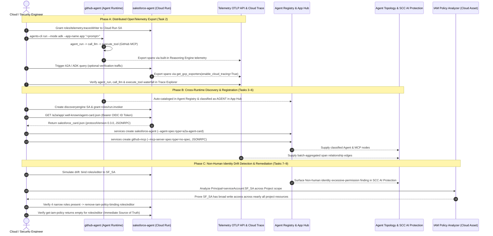

# Observe and Secure a Multi-Agent System (APEX014) — Challenge Lab Runbook

A step-by-step operational runbook, cross-runtime observability and discovery architecture, distributed tracing and security-posture workflow, and least-privilege remediation reference for making a heterogeneous multi-agent fleet (**`github_agent`** on **Vertex AI Agent Runtime**, **`salesforce_agent`** on **Cloud Run**, and the external **GitHub Copilot MCP Server**) observable and governed across **Cloud Trace (`telemetry.googleapis.com`)**, **App Hub**, **Agent Registry**, **Agent Topology**, **Security Command Center (SCC) AI Protection**, **IAM Policy Analyzer**, and **Agent Platform Threat Detection**.

---

## 1. System Architecture

Lab 1 (*Build Enterprise Agents*) deployed a multi-runtime specialist fleet communicating over **Agent2Agent (A2A)** and **Model Context Protocol (MCP)**. However, running distributed agents across heterogeneous compute targets (**Vertex AI Agent Runtime** and **Cloud Run**) without unified platform discovery and telemetry creates four operational and security blind spots:

1. **Silent Telemetry Drop on Custom Runtimes:** Even when an ADK agent includes `google-adk[otel-gcp]` and initializes OpenTelemetry OTLP exporters (`get_gcp_exporters(enable_cloud_tracing=True)`), **Cloud Run** service accounts silently fail to export GenAI spans (`agent_run`, `call_llm`, `execute_tool`) unless explicitly granted `roles/telemetry.tracesWriter` on `telemetry.googleapis.com`. Without spans, downstream topology graphs have zero relationship edges.
2. **Shadow Agents & Uncataloged MCP Endpoints:** While **Vertex AI Agent Runtime** workloads are auto-discovered and classified as `AGENT` by **App Hub** and **Agent Registry**, **Cloud Run** A2A agents (`salesforce-agent`) and external **MCP servers** (`https://api.githubcopilot.com/mcp/`) remain invisible to platform topology and security posture engines until registered as `Agent Registry` services with **App Hub** enabled.
3. **Unchecked Non-Human Identity Privilege Creep:** Developers troubleshooting permission errors frequently bind coarse primitive roles such as `roles/editor` to an agent's runtime service account (`<PROJECT_NUMBER>-compute@developer.gserviceaccount.com`), expanding a single prompt-injected specialist's blast radius to nearly every resource in the Google Cloud project.
4. **Runtime Compromise Blindness:** Without **Agent Platform Threat Detection**, container-level attacks inside an agent workload (such as dropping and executing foreign malicious binaries, reverse shells, or credential-harvesting scripts) go undetected in real time.

Lab 4 (`APEX014`) unifies **OpenTelemetry trace ingestion**, **App Hub + Agent Registry discovery**, **Agent Topology**, **SCC AI Protection**, and **IAM Policy Analyzer** over a single shared control plane:

```mermaid
flowchart TB
    subgraph Caller["Developer & Orchestrator Entry Point"]
        CLI["agents-cli run (--mode adk / --mode a2a) & Root A2A Caller"]
    end

    subgraph RuntimeFleet["Heterogeneous Multi-Agent Fleet (us-central1)"]
        subgraph ARPlane["Vertex AI Agent Runtime — github-agent"]
            GHAgent["ADK Agent (github_agent) + McpToolset"]
            GHOtel["Managed Agent Engine Telemetry (_default_instrumentor_builder)"]
            RESA["Managed Runtime Identity (service-PROJECT_NUMBER@gcp-sa-aiplatform-re)"]
        end

        subgraph CRPlane["Cloud Run — salesforce-agent"]
            SFAgent["ADK Agent (salesforce_agent) + search_salesforce + PreloadMemoryTool"]
            SFCard["Authenticated A2A Card (/a2a/app/.well-known/agent-card.json)"]
            SFOtel["ADK OTLP Exporter (get_gcp_exporters enable_cloud_tracing=True)"]
            CRSA["Workload SA (PROJECT_NUMBER-compute@developer + roles/telemetry.tracesWriter)"]
        end

        subgraph ExtMCP["External SaaS Tool Target"]
            GHMCP["Hosted GitHub Copilot MCP Server (https://api.githubcopilot.com/mcp/ — JSONRPC)"]
        end
    end

    subgraph TelemetryPlane["Google Cloud Observability & Telemetry Plane"]
        OTLP["Telemetry OTLP API (telemetry.googleapis.com)"]
        Trace["Cloud Trace (Spans: agent_run -> call_llm -> execute_tool)"]
        OptBQ["Optional GenAI Log Sink & GCS Completions View (BigQuery)"]
    end

    subgraph DiscoveryPlane["Unified Agent & MCP Discovery Plane"]
        DESA["Discovery Engine Service Agent (service-PROJECT_NUMBER@gcp-sa-discoveryengine)"]
        Registry["Agent Registry (v1alpha: Auto-Discovered Agents + Registered Services & MCP Servers)"]
        AppHub["App Hub Inventory (apphub.googleapis.com: discoveredWorkloads functionalType=AGENT)"]
    end

    subgraph ControlConsumers["Topology & AI Security Posture Consumers"]
        Topology["Agent Topology Graph (Nodes from App Hub/Registry + Edges from Trace Batches)"]
        SCC["SCC AI Protection (AI Inventory, Excessive Permissions & ~6h Attack Path Simulation)"]
        APTD["Agent Platform Threat Detection (Near-Real-Time Runtime & Control-Plane Detectors)"]
        PA["IAM Policy Analyzer + Cloud Asset Inventory (Immediate Blast-Radius Proof)"]
    end

    CLI -->|":streamQuery / A2A JSON-RPC"| GHAgent
    CLI -->|"OIDC Bearer + A2A JSON-RPC"| SFAgent
    GHAgent -->|"Streamable HTTP JSON-RPC"| GHMCP

    GHAgent --> GHOtel
    RESA -.->|"Built-in Telemetry Export"| OTLP
    GHOtel -->|"OTLP Spans"| OTLP

    SFAgent --> SFOtel
    CRSA -.->|"Authorized by roles/telemetry.tracesWriter"| OTLP
    SFOtel -->|"OTLP Spans"| OTLP

    OTLP --> Trace
    SFAgent -.-> OptBQ
    GHAgent -.-> OptBQ

    ARPlane -->|"Auto-Cataloged & Classified as AGENT"| Registry
    ARPlane -->|"Auto-Discovered Workload (AGENT)"| AppHub

    DESA -->|"roles/run.invoker -> Read A2A Card"| SFCard
    SFCard -->|"services create salesforce-agent (a2a-agent-card)"| Registry
    GHMCP -.->|"services create github-mcp (no-spec, JSONRPC)"| Registry

    Registry <--> AppHub
    Trace -->|"Batch Span Aggregation (Edges)"| Topology
    AppHub -->|"Classified Agent & MCP Inventory (Nodes)"| Topology
    AppHub -->|"AI Asset Inventory"| SCC
    Trace -->|"Usage Signals"| SCC
    ARPlane -->|"Runtime Process & Audit Telemetry"| APTD
    APTD -->|"MITRE ATT&CK Findings (e.g. EICAR)"| SCC
    CRSA -.->|"Evaluate Effective IAM Bindings"| PA
```



### 1.1 Unobserved Prototype vs. Lab 4 Governed Fleet Comparison

| Dimension | End-of-Lab-1 Baseline State | Lab 4 Target State (`APEX014` Observability & AI Security) |
|---|---|---|
| **OpenTelemetry Span Export** | Code instrumented (`google-adk[otel-gcp]`), but Cloud Run SA lacks OTLP write permission on `telemetry.googleapis.com` | Agent Runtime exports via built-in platform telemetry; Cloud Run SA explicitly holds `roles/telemetry.tracesWriter` and streams `agent_run`, `call_llm`, and `execute_tool` spans to **Cloud Trace** |
| **Agent Runtime Visibility** | Only visible inside Vertex AI Reasoning Engines list | Verified in **Agent Registry** (`agents list`) and classified as `functionalType.type = "AGENT"` in **App Hub** (`discoveredWorkloads`) |
| **Cloud Run Agent Discovery** | Generic Cloud Run service; invisible to Agent Topology and SCC AI Protection | Discovery Engine SA granted `roles/run.invoker`; A2A Agent Card (`/a2a/app/.well-known/agent-card.json`) registered in **Agent Registry** (`--agent-spec-type=a2a-agent-card`) |
| **External MCP Server Visibility** | Hardcoded URL inside `github-agent` `McpToolset`; opaque external HTTPS traffic | Explicitly cataloged in **Agent Registry** (`github-mcp`, `--mcp-server-spec-type=no-spec`, `protocolBinding=JSONRPC`) + **App Hub** |
| **Cross-Runtime System Graph** | Disconnected per-service logs across Vertex AI and Cloud Run | Unified **Agent Topology** graph rendering cross-runtime agent/MCP **nodes** and trace-derived interaction **edges** |
| **Non-Human Identity Governance** | Coarse service account roles (`roles/editor`) go unnoticed until exploited | Flagged under **SCC AI Protection** (*Agents with excessive permissions*), proven immediately via **IAM Policy Analyzer** (`cloudasset.googleapis.com`), and right-sized to a 4-role least-privilege baseline |
| **Runtime Attack Detection** | No container-level behavioral monitoring in user space | **Agent Platform Threat Detection** monitors Agent Runtime workloads in near real time for added malicious binaries (e.g., EICAR), reverse shells, container escapes, and suspicious token generation |

### 1.2 Runtime Discovery, Telemetry Identity & Resource Reference

| Component / Resource | Hosting / Type | Discovery Mechanism | Trace Export Mechanism & Identity | Canonical Identifier / Endpoint in Lab 4 |
|---|---|---|---|---|
| **`github-agent` (`github_agent`)** | **Vertex AI Agent Runtime** (`us-central1`) | **Automatic** in Agent Registry & App Hub (`functionalType: AGENT`) | Built-in managed telemetry (`GOOGLE_CLOUD_AGENT_ENGINE_ENABLE_TELEMETRY=true` via `service-${PROJECT_NUMBER}@gcp-sa-aiplatform-re.iam.gserviceaccount.com`) — **no per-agent grant needed** | `projects/${PROJECT_NUMBER}/locations/${LOCATION}/reasoningEngines/${ENGINE_ID}` |
| **`salesforce-agent` (`salesforce_agent`)** | **Cloud Run** (`us-central1`, `--no-allow-unauthenticated`) | **Manual registration** via `gcloud alpha agent-registry services create salesforce-agent --agent-spec-type=a2a-agent-card` | Direct OTLP export (`get_gcp_exporters(enable_cloud_tracing=True)`) as `${PROJECT_NUMBER}-compute@developer.gserviceaccount.com` — **requires `roles/telemetry.tracesWriter`** | `https://salesforce-agent-${PROJECT_NUMBER}.${LOCATION}.run.app` (A2A card: `/a2a/app/.well-known/agent-card.json`) |
| **`github-mcp`** | **External Hosted MCP** (GitHub Copilot) | **Manual registration** via `gcloud alpha agent-registry services create github-mcp --mcp-server-spec-type=no-spec` (requires `apphub.googleapis.com`) | Observed via caller-side `execute_tool` spans emitted by `github-agent` | `https://api.githubcopilot.com/mcp/` (`protocolBinding=JSONRPC`) |
| **Discovery Engine Service Agent** | Google-Managed Service Identity | Invokes private Cloud Run A2A endpoints during Agent Card inspection/registration | N/A | `service-${PROJECT_NUMBER}@gcp-sa-discoveryengine.iam.gserviceaccount.com` (`roles/run.invoker` on `salesforce-agent`) |
| **Least-Privilege Role Baseline (`salesforce-agent`)** | Project IAM Bindings | Audited via SCC AI Protection + IAM Policy Analyzer (`gcloud asset analyze-iam-policy`) | Enables Gemini inference, OTLP traces, Cloud Trace fallback, and structured logs | `roles/aiplatform.user`, `roles/telemetry.tracesWriter`, `roles/logging.logWriter`, `roles/cloudtrace.agent` |

---

## 2. End-to-End Workflows

### 2.1 Outer Loop: Challenge Lab Execution Workflow

```mermaid
flowchart LR
    T1["1. Setup Env, Stage Fleet & Enable 9 Observability/Discovery APIs"] --> T2["2. Verify OTel Code, Grant roles/telemetry.tracesWriter & Generate Spans"]
    T2 --> T3["3. Confirm Agent Runtime Auto-Discovery in Registry & App Hub"]
    T3 --> T4["4. Grant Discovery Engine Invoker, Fetch A2A Card & Register salesforce-agent"]
    T4 --> T5["5. Register github-mcp (no-spec, JSONRPC) in Agent Registry"]
    T5 --> T6["6. Inspect Unified Cross-Runtime Graph in Agent Topology"]
    T6 --> T7["7. Review SCC AI Protection & Inject Deliberate roles/editor Risk"]
    T7 --> T8["8. Prove Excessive Blast Radius w/ IAM Policy Analyzer"]
    T8 --> T9["9. Audit Narrow Roles, Revoke roles/editor & Verify Least Privilege"]
    T9 --> T10["10. Optional: Trigger EICAR Test & Triage Runtime Threat Finding"]
```



### 2.2 Inner Loop: Telemetry Ingestion, Multi-Runtime Discovery & Least-Privilege Remediation Sequence



### 2.3 Key Engineering & Operational Design Decisions

| Mechanism / Concept | Problem Solved | Architectural & Implementation Detail |
|---|---|---|
| **Three-Pillar OpenTelemetry Pipeline (`pyproject.toml` + `telemetry.py` + `roles/telemetry.tracesWriter`)** | Missing any one pillar results in zero spans in Cloud Trace and zero edges in Agent Topology | **(1) Library:** `google-adk[gcp,otel-gcp]` + `opentelemetry-instrumentation-google-genai` generates `agent_run`, `call_llm`, and `execute_tool` spans. **(2) Exporter:** `get_gcp_exporters(enable_cloud_tracing=True)` targets `telemetry.googleapis.com` (keeping raw prompt text out of spans via `ADK_CAPTURE_MESSAGE_CONTENT_IN_SPANS=false`). **(3) IAM:** `roles/telemetry.tracesWriter` authorizes OTLP ingestion (`roles/cloudtrace.agent` alone only covers the legacy Cloud Trace v1/v2 API, not the modern OTLP `telemetry.googleapis.com` endpoint). |
| **Runtime-Specific Telemetry Identity Split (`Agent Runtime` vs. `Cloud Run`)** | Avoids unnecessary manual IAM grants on managed Reasoning Engines while fixing silent drops on Cloud Run | `github-agent` on **Agent Runtime** activates `setup_agent_engine_telemetry()` (`GOOGLE_CLOUD_AGENT_ENGINE_ENABLE_TELEMETRY=true`), exporting via the platform-managed Reasoning Engine identity. `salesforce-agent` on **Cloud Run** calls `get_gcp_exporters()` directly as its container service account (`${PROJECT_NUMBER}-compute@developer.gserviceaccount.com`), requiring an explicit `roles/telemetry.tracesWriter` project binding. |
| **App Hub as the Shared Classification Backbone (`apphub.googleapis.com`)** | Without App Hub enabled, neither Agent Topology nor SCC AI Protection can distinguish AI agents and MCP servers from ordinary microservices | App Hub inventories running workloads (`discoveredWorkloads`) with `workloadProperties.functionalType.type = "AGENT"` and synchronizes MCP server catalogs registered in Agent Registry. |
| **Discovery Engine Service Agent Invoker Binding (`gcp-sa-discoveryengine`)** | `salesforce-agent` is deployed privately (`--no-allow-unauthenticated`), blocking platform A2A card inspection with `HTTP 403` | Provisioning `service-${PROJECT_NUMBER}@gcp-sa-discoveryengine.iam.gserviceaccount.com` via `gcloud beta services identity create --service=discoveryengine.googleapis.com` and granting `roles/run.invoker` on `salesforce-agent` allows Agent Platform / Gemini Enterprise to read its A2A Agent Card securely. |
| **Mutually Exclusive Spec Modes in `agent-registry services create`** | `a2a-agent-card` and `no-spec` handle endpoint URLs differently; passing `--interfaces` alongside `a2a-agent-card` fails schema validation | **`salesforce-agent` (`--agent-spec-type=a2a-agent-card`):** Pass `--agent-spec-content=salesforce_card.json` and **omit `--interfaces`** (Agent Registry extracts `url` and `preferredTransport: JSONRPC` directly from the card). **`github-mcp` (`--mcp-server-spec-type=no-spec`):** Omit `--mcp-server-spec-content` and explicitly pass `--interfaces="url=https://api.githubcopilot.com/mcp/,protocolBinding=JSONRPC"`. |
| **Batch Aggregation Windows vs. Real-Time Sources of Truth** | Waiting on 6-hour batch jobs blocks incident triage and lab verification | **Batch (~hours):** Agent Topology graph edges and SCC Attack Path Simulations (~6h cycle). **Near Real-Time (~1–2 min):** Cloud Trace Explorer (`call_llm` / `agent_run`), Cloud Asset Inventory / IAM Policy Analyzer, and Agent Platform Threat Detection. **Immediate (`0s`):** Live `gcloud projects get-iam-policy` and `gcloud alpha agent-registry` list APIs. |
| **Verify-Before-Revoke Least-Privilege Remediation** | Stripping `roles/editor` blindly can break an agent if its narrow operational roles were never granted explicitly | Before running `remove-iam-policy-binding --role=roles/editor`, audit `SF_SA` to guarantee all four narrow roles (`roles/aiplatform.user`, `roles/telemetry.tracesWriter`, `roles/logging.logWriter`, `roles/cloudtrace.agent`) are explicitly bound so inference and telemetry continue uninterrupted. |
| **Organization-Scoped SCC Tiers for Attack Paths & Runtime Threats** | Explains why certain SCC widgets are informational in project-scoped sandbox labs | **Attack Path Simulation** (requiring High-Value Resource Sets) and viewing **Agent Platform Threat Detection** findings (`AGENT_ENGINE_ADDED_MALICIOUS_BINARY_EXECUTED`) require **Security Command Center Premium/Enterprise** activated at the **Organization** level. |

---

## 3. Step-by-Step Challenge Lab Runbook

### Task 1: Prepare Your Environment

#### 1.1 Export Project, Location & Organization Metadata

Open Cloud Shell and configure your environment variables for `us-central1`:

```bash
export PROJECT_ID="$(gcloud config get-value project)"
export LOCATION="us-central1"

gcloud config set project "${PROJECT_ID}"

export PROJECT_NUMBER="$(gcloud projects describe "${PROJECT_ID}" \
  --format='value(projectNumber)')"

export ORGANIZATION_ID="$(gcloud projects get-ancestors "${PROJECT_ID}" \
  --format=json | jq -r '.[] | select(.type=="organization") | .id')"

echo "Project: ${PROJECT_ID} (${PROJECT_NUMBER}), Org: ${ORGANIZATION_ID}, Location: ${LOCATION}"
```

#### 1.2 Validate Leaf-Level `gcloud` CLI Syntax

Before executing alpha/beta discovery and IAM commands, validate leaf-level flag syntax on your installed Cloud SDK:

```bash
gcloud help services enable
gcloud help beta services identity create
gcloud help alpha agent-registry agents list
gcloud help alpha agent-registry services create
gcloud help alpha agent-registry mcp-servers list
gcloud help run services add-iam-policy-binding
gcloud help projects add-iam-policy-binding
gcloud help projects remove-iam-policy-binding
gcloud help asset analyze-iam-policy
```

#### 1.3 Copy Pre-Staged Lab Files & Deploy Baseline Fleet (If Not Yet Provisioned)

Copy `apex_labs/` from the project bucket and run `lab2_prereqs.sh` to deploy the baseline `github-agent` (Agent Runtime) and `salesforce-agent` (Cloud Run), then stage the clean `agents/` source code and IDE settings locally:

```bash
gcloud storage cp -r "gs://${PROJECT_ID}-bucket/apex_labs" .

# Deploys github-agent (Agent Runtime) and salesforce-agent (Cloud Run) (~10-15 min)
# Prompts interactively for your GitHub PAT and Salesforce Connected App credentials
bash apex_labs/lab2_prereqs.sh

# Stage agent source code (lab2_prereqs.sh cleans up ~/agents at completion)
gcloud storage cp -r "gs://${PROJECT_ID}-bucket/agents" .

mkdir -p ~/.vscode
gcloud storage cp -r "gs://${PROJECT_ID}-bucket/settings.json" ~/.vscode/
```

#### 1.4 Install & Upgrade `agents-cli`

```bash
export PATH="${HOME}/.local/bin:${PATH}"

uvx google-agents-cli setup
uv tool upgrade google-agents-cli

agents-cli info
```

#### 1.5 Confirm the Multi-Agent Fleet Is Running

Verify both `salesforce-agent` on **Cloud Run** and `github-agent` (`github_agent`) on **Vertex AI Agent Runtime** are active in `us-central1`:

```bash
# 1. Confirm salesforce-agent on Cloud Run
gcloud run services list \
  --project="${PROJECT_ID}" \
  --region="${LOCATION}" \
  --format="table(metadata.name)" \
  --quiet

# 2. Confirm github-agent on Agent Runtime
curl -s \
  -H "Authorization: Bearer $(gcloud auth print-access-token)" \
  "https://${LOCATION}-aiplatform.googleapis.com/v1/projects/${PROJECT_ID}/locations/${LOCATION}/reasoningEngines" \
  | jq -r '(.reasoningEngines // [])[] | "\(.displayName)\t\(.name)"'
```

**Expected Output:**
- Cloud Run lists `salesforce-agent`.
- Reasoning Engines lists `github-agent    projects/<PROJECT_NUMBER>/locations/us-central1/reasoningEngines/<ENGINE_ID>`.

#### 1.6 Enable Observability & Discovery APIs *(Scored Checkpoint 1)*

Enable all nine required observability, OTLP telemetry, App Hub, Agent Topology, Agent Registry, and Cloud Asset Inventory APIs:

```bash
gcloud services enable \
  observability.googleapis.com \
  cloudtrace.googleapis.com \
  telemetry.googleapis.com \
  apphub.googleapis.com \
  apptopology.googleapis.com \
  agentregistry.googleapis.com \
  cloudasset.googleapis.com \
  monitoring.googleapis.com \
  logging.googleapis.com \
  --project="${PROJECT_ID}" \
  --quiet
```

> [!IMPORTANT]
> **App Hub (`apphub.googleapis.com`) is mandatory.** Both Agent Topology and Security Command Center AI Protection rely on App Hub to classify running workloads as `AGENT` and catalog MCP servers. Without `apphub.googleapis.com`, neither graph nodes nor AI Protection inventory items populate.

✅ *Click **Check my progress** in Qwiklabs to verify: **Enable the observability and discovery APIs**.*

---

### Task 2: Export Traces to Cloud Trace

#### 2.1 Inspect the OpenTelemetry Instrumentation in `salesforce-agent`

Verify the first two traceability pillars (**instrumentation library** and **OTLP exporter setup**) inside `~/agents/salesforce-agent`:

1. **Check `pyproject.toml`** (`~/agents/salesforce-agent/pyproject.toml`):
   ```toml
   dependencies = [
       "google-adk[gcp,otel-gcp]>=2.0.0,<3.0.0",
       ...
       "opentelemetry-instrumentation-google-genai>=0.1.0,<1.0.0",
   ]
   ```
2. **Check `app/app_utils/telemetry.py`** (`~/agents/salesforce-agent/app/app_utils/telemetry.py`):
   ```python
   # Set up OpenTelemetry exporters for Cloud Trace and Cloud Logging
   credentials, project_id = google.auth.default()
   otel_hooks = get_gcp_exporters(
       enable_cloud_tracing=True,
       enable_cloud_metrics=False,
       enable_cloud_logging=True,
       google_auth=(credentials, project_id),
   )
   otel_resource = get_gcp_resource(project_id)
   maybe_set_otel_providers(
       otel_hooks_to_setup=[otel_hooks],
       otel_resource=otel_resource,
   )

   # Set up GenAI SDK instrumentation
   _setup_instrumentation_lib_if_installed()
   ```
   *(By comparison, `~/agents/github-agent/app/app_utils/telemetry.py` delegates to `setup_agent_engine_telemetry()`, which invokes `_default_instrumentor_builder(project_id, enable_tracing=True, enable_logging=True)` when `GOOGLE_CLOUD_AGENT_ENGINE_ENABLE_TELEMETRY=true` on Agent Runtime.)*

#### 2.2 Grant `roles/telemetry.tracesWriter` to the Cloud Run Service Account *(Scored Checkpoint 2)*

Retrieve the service account attached to `salesforce-agent` (the Compute Engine default service account `${PROJECT_NUMBER}-compute@developer.gserviceaccount.com`) and grant **Cloud Telemetry Traces Writer** (`roles/telemetry.tracesWriter`) so its OTLP exporter can write spans to `telemetry.googleapis.com`:

```bash
export SF_SA="$(gcloud run services describe salesforce-agent \
  --region="${LOCATION}" \
  --project="${PROJECT_ID}" \
  --format='value(spec.template.spec.serviceAccountName)' \
  --quiet)"

echo "Granting roles/telemetry.tracesWriter to: ${SF_SA}"

gcloud projects add-iam-policy-binding "${PROJECT_ID}" \
  --member="serviceAccount:${SF_SA}" \
  --role="roles/telemetry.tracesWriter" \
  --condition=None \
  --quiet
```

✅ *Click **Check my progress** in Qwiklabs to verify: **Grant the trace-writer role to an agent's service account**.*

#### 2.3 Generate Traffic Across the Fleet to Produce Spans

Derive the Agent Runtime base URL for `github-agent` (equivalent to copying the Query URL in **Agent Platform → Runtimes** and stripping `:query` from the end) and send live ADK traffic using `agents-cli run`:

```bash
# 1. Derive github-agent Reasoning Engine URL (without :query suffix)
export GITHUB_ENGINE_NAME="$(curl -s \
  -H "Authorization: Bearer $(gcloud auth print-access-token)" \
  "https://${LOCATION}-aiplatform.googleapis.com/v1/projects/${PROJECT_ID}/locations/${LOCATION}/reasoningEngines" \
  | jq -r '.reasoningEngines[] | select(.displayName=="github-agent" or .displayName=="github_agent") | .name' \
  | head -n 1)"

export GITHUB_AGENT_URL="https://${LOCATION}-aiplatform.googleapis.com/v1/${GITHUB_ENGINE_NAME}"
echo "Querying Agent Runtime URL: ${GITHUB_AGENT_URL}"

# 2. Send ADK traffic to github-agent (generates agent_run -> call_llm -> execute_tool MCP spans)
agents-cli run \
  --url "${GITHUB_AGENT_URL}" \
  --mode adk \
  --app-name app \
  "Search for open issues in the google/adk-python repository and summarize the top 2."
```

Optionally, also send a query to `salesforce-agent` on Cloud Run to exercise its newly granted `roles/telemetry.tracesWriter` OTLP pipeline:

```bash
export SF_URL="$(gcloud run services describe salesforce-agent \
  --region="${LOCATION}" \
  --project="${PROJECT_ID}" \
  --format='value(status.url)' \
  --quiet)"

agents-cli run \
  --url "${SF_URL}" \
  --mode a2a \
  --app-name app \
  "Search Salesforce documents for architecture decision records or authentication guidelines."
```

#### 2.4 Confirm Spans Arrived in Cloud Trace Explorer

1. In the Google Cloud Console, navigate to **Monitoring → Trace Explorer** (`https://console.cloud.google.com/traces/explorer?project=${PROJECT_ID}`).
2. Set the time-range selector to **Last hour**.
3. In the **Span name / filter** bar, filter by `call_llm` or `agent_run`.
4. Click a recent trace to inspect the **waterfall view**:
   - **Top-level `invocation` / `agent_run`:** Entry-point agent handling the user request.
   - **Nested `agent_run`:** Downstream A2A specialist agent invocations (when called via an orchestrator).
   - **`call_llm`:** Gemini inference calls issued by the agent (`gemini-3.5-flash`).
   - **`execute_tool`:** Outbound tool / MCP invocations (such as `search_issues` / `search_repositories` against `https://api.githubcopilot.com/mcp/`, or `search_salesforce`).

> [!NOTE]
> Spans ingested via the OTLP `telemetry.googleapis.com` API typically take **1–2 minutes** to index in Trace Explorer. Refresh the query window if spans do not appear immediately.

---

### Task 3: Confirm Agent Runtime Agents Are Discovered

Unlike Cloud Run services, agents deployed to **Vertex AI Agent Runtime** are automatically cataloged in **Agent Registry** and classified as `AGENT` workloads in **App Hub**.

#### 3.1 Verify `github-agent` Appears in Agent Registry

```bash
gcloud alpha agent-registry agents list \
  --location="${LOCATION}" \
  --project="${PROJECT_ID}" \
  --format="table(displayName)" \
  --quiet
```

**Expected Output:**
```text
DISPLAY_NAME
github-agent
```

#### 3.2 Verify App Hub Classifies the Workload as `AGENT`

Query the App Hub `discoveredWorkloads` REST endpoint and confirm `workloadProperties.functionalType.type` resolves to `AGENT` for the Reasoning Engine URI:

```bash
export TOKEN="$(gcloud auth print-access-token)"

curl -s \
  -H "Authorization: Bearer ${TOKEN}" \
  -H "x-goog-user-project: ${PROJECT_ID}" \
  "https://apphub.googleapis.com/v1/projects/${PROJECT_ID}/locations/${LOCATION}/discoveredWorkloads" \
  | jq -r '(.discoveredWorkloads // [])[] | "\(.workloadProperties.functionalType.type // "-")\t\(.workloadReference.uri)"'
```

**Expected Output:**
```text
AGENT	//aiplatform.googleapis.com/projects/<PROJECT_NUMBER>/locations/us-central1/reasoningEngines/<ENGINE_ID>
```

---

### Task 4: Register the Cloud Run Agent (`salesforce-agent`)

Because `salesforce-agent` runs as a generic container on **Cloud Run**, it is not auto-discovered as an agent until you grant the **Discovery Engine service agent** invoker access, download its **A2A Agent Card**, and register it in **Agent Registry**.

#### 4.1 Provision Discovery Engine Service Identity & Grant `roles/run.invoker` *(Scored Checkpoint 3)*

```bash
# 1. Create the Discovery Engine Google-managed service agent in the project
gcloud beta services identity create \
  --service=discoveryengine.googleapis.com \
  --project="${PROJECT_ID}" \
  --quiet

# 2. Grant roles/run.invoker on salesforce-agent to the Discovery Engine service agent
export DISCOVERY_ENGINE_SA="service-${PROJECT_NUMBER}@gcp-sa-discoveryengine.iam.gserviceaccount.com"

gcloud run services add-iam-policy-binding salesforce-agent \
  --region="${LOCATION}" \
  --project="${PROJECT_ID}" \
  --member="serviceAccount:${DISCOVERY_ENGINE_SA}" \
  --role="roles/run.invoker" \
  --quiet
```

✅ *Click **Check my progress** in Qwiklabs to verify: **Grant the Discovery Engine service agent invoker access**.*

#### 4.2 Download & Inspect the Salesforce A2A Agent Card

Authenticate with an OIDC identity token (`gcloud auth print-identity-token`) and download `/a2a/app/.well-known/agent-card.json` to `salesforce_card.json`:

```bash
export SF_URL="$(gcloud run services describe salesforce-agent \
  --region="${LOCATION}" \
  --project="${PROJECT_ID}" \
  --format='value(status.url)' \
  --quiet)"

export ID_TOKEN="$(gcloud auth print-identity-token)"

curl -sS -f \
  -H "Authorization: Bearer ${ID_TOKEN}" \
  "${SF_URL}/a2a/app/.well-known/agent-card.json" \
  -o salesforce_card.json

jq '{name, protocolVersion, preferredTransport, url, skills: [.skills[].name]}' salesforce_card.json
```

**Expected Output:**
```json
{
  "name": "salesforce_agent",
  "protocolVersion": "0.3.0",
  "preferredTransport": "JSONRPC",
  "url": "https://salesforce-agent-<PROJECT_NUMBER>.us-central1.run.app/a2a/app",
  "skills": [
    "model",
    "search_salesforce",
    "preload_memory"
  ]
}
```

#### 4.3 Register `salesforce-agent` in Agent Registry *(Scored Checkpoint 4)*

Register the Cloud Run agent as a writable Agent Registry service named `salesforce-agent` using `--agent-spec-type=a2a-agent-card` and `--agent-spec-content=salesforce_card.json`:

```bash
gcloud alpha agent-registry services create salesforce-agent \
  --location="${LOCATION}" \
  --project="${PROJECT_ID}" \
  --display-name="salesforce-agent" \
  --description="Cloud Run Salesforce Specialist A2A Agent" \
  --agent-spec-type=a2a-agent-card \
  --agent-spec-content=salesforce_card.json \
  --quiet
```

> [!TIP]
> - Do **not** pass `--interfaces` when `--agent-spec-type=a2a-agent-card` is used — the Agent Registry API requires `interfaces` to be empty and extracts the endpoint URL and `JSONRPC` binding directly from `salesforce_card.json`.
> - `gcloud`'s `ArgJSON` parser automatically loads any path ending in `.json` or `.yaml` (`salesforce_card.json`), or accepts inline JSON (`--agent-spec-content="$(cat salesforce_card.json)"`). If updating an existing service on certain SDK versions that return `ALREADY_EXISTS`, use `gcloud alpha agent-registry services update salesforce-agent --location="${LOCATION}" --project="${PROJECT_ID}" --agent-spec-content=salesforce_card.json`.

Confirm both `github-agent` and `salesforce_agent` now appear in Agent Registry:

```bash
gcloud alpha agent-registry agents list \
  --location="${LOCATION}" \
  --project="${PROJECT_ID}" \
  --format="table(displayName,name.basename())" \
  --quiet
```

✅ *Click **Check my progress** in Qwiklabs to verify: **Register the Cloud Run agent in Agent Registry**.*

---

### Task 5: Register the GitHub MCP Server

Registering the external GitHub Copilot MCP endpoint (`https://api.githubcopilot.com/mcp/`) allows **Agent Topology** to render it as a downstream MCP server node connected to `github-agent` and allows **SCC AI Protection** to inventory it as an external tool dependency.

#### 5.1 Create the `github-mcp` Service in Agent Registry *(Scored Checkpoint 5)*

Use `--mcp-server-spec-type=no-spec` and bind the `JSONRPC` interface URL:

```bash
gcloud alpha agent-registry services create github-mcp \
  --location="${LOCATION}" \
  --project="${PROJECT_ID}" \
  --display-name="github-mcp" \
  --description="Hosted GitHub Copilot MCP Server used by github-agent" \
  --mcp-server-spec-type=no-spec \
  --interfaces="url=https://api.githubcopilot.com/mcp/,protocolBinding=JSONRPC" \
  --quiet
```

#### 5.2 Confirm the MCP Server Is Cataloged

```bash
gcloud alpha agent-registry mcp-servers list \
  --location="${LOCATION}" \
  --project="${PROJECT_ID}" \
  --format="table(displayName,interfaces[0].url,interfaces[0].protocolBinding)" \
  --quiet
```

**Expected Output:**
```text
DISPLAY_NAME  URL                                  PROTOCOL_BINDING
github-mcp    https://api.githubcopilot.com/mcp/   JSONRPC
```

✅ *Click **Check my progress** in Qwiklabs to verify: **Register the GitHub MCP server in Agent Registry**.*

---

### Task 6: View the Agent Topology Graph

1. In the Google Cloud Console, navigate to **Agent Platform → Agent Registry** (`https://console.cloud.google.com/agent-platform/agent-registry?project=${PROJECT_ID}`).
2. Confirm your lab project (`${PROJECT_ID}`) is selected in the project picker.
3. On the **Agents** tab, verify both **`github-agent`** (Agent Runtime) and **`salesforce_agent`** (Cloud Run) are listed, then click **`github-agent`**.
4. Select the **Topology** tab and inspect the system graph:
   - **Cross-runtime nodes:** `github-agent` (Agent Runtime), `salesforce_agent` (Cloud Run), and `github-mcp` (MCP Server) appear in a unified inventory despite running on separate platforms.
   - **Trace-derived edges:** Directed edges connect `github-agent` $\rightarrow$ `github-mcp` (and root orchestrator $\rightarrow$ specialists when multi-agent A2A traffic has been aggregated).

> [!NOTE]
> **Preview Batch Aggregation Cadence:** Agent Topology aggregates Cloud Trace spans into graph edges in periodic background batches. If nodes or edges have not finished rendering during your timed session, verify `call_llm` and `execute_tool` spans in **Monitoring → Trace Explorer** — once spans and Agent Registry/App Hub entries are in place, the topology pipeline has all required inputs.

---

### Task 7: Review SCC AI Protection & Introduce an Over-Privileged Identity Risk

#### 7.1 Review the Agent Platform Security (SCC AI Protection) Dashboard

1. In the Google Cloud Console, open **Agent Platform → Agents → Security** (or go directly to `https://console.cloud.google.com/agent-platform/security?project=${PROJECT_ID}`).
2. Review the AI inventory widgets (discovered agents, MCP servers, models) and current posture findings.

#### 7.2 Simulate Privilege Creep by Granting `roles/editor` to `salesforce-agent`

Retrieve the Cloud Run service account (`SF_SA`) and deliberately bind the overly broad `roles/editor` role (unless a **Non-human identity** excessive-permission finding is already active for `salesforce-agent`):

```bash
export SF_SA="$(gcloud run services describe salesforce-agent \
  --region="${LOCATION}" \
  --project="${PROJECT_ID}" \
  --format='value(spec.template.spec.serviceAccountName)' \
  --quiet)"

echo "Simulating over-privilege on: ${SF_SA}"

gcloud projects add-iam-policy-binding "${PROJECT_ID}" \
  --member="serviceAccount:${SF_SA}" \
  --role="roles/editor" \
  --condition=None \
  --quiet
```

> [!WARNING]
> Binding `roles/editor` to an agent workload identity grants write/modify/delete permissions across thousands of Google Cloud APIs. If the agent suffers an indirect prompt injection or SSRF flaw, an attacker can pivot from tool execution into project-wide infrastructure modification. You will prove this blast radius in Task 8 and revoke it in Task 9.

#### 7.3 Architectural Context: Organization-Level Attack-Path Simulation

In production environments with **Security Command Center Premium or Enterprise** enabled at the **Organization** level:
- Adding agent workloads to the **High-Value Resource Set** (**Security Command Center → Settings → Attack path simulation**) enables SCC to compute **Attack Exposure Scores** (~6-hour batch cycle) and surface **toxic combinations** (for example, an internet-reachable agent running with an over-privileged service account).
- Because Qwiklabs student accounts are project-scoped without Org-level SCC activation, you will prove the exact blast radius immediately in Task 8 using **IAM Policy Analyzer**.

---

### Task 8: Identify the Security Finding & Prove Blast Radius with Policy Analyzer

#### 8.1 Locate the Finding in SCC AI Protection

1. Return to **Agent Platform → Agents → Security** (`https://console.cloud.google.com/agent-platform/security?project=${PROJECT_ID}`).
2. Inspect the **Agents with excessive permissions** and **AI risks by severity** widgets to locate `salesforce_agent` (`Non-human identity` excessive-permission posture risk).

#### 8.2 Prove Exact Resource Reach with IAM Policy Analyzer (Console + CLI)

Print the service account email in Cloud Shell:

```bash
echo "${SF_SA}"
```

**Option A — Google Cloud Console (IAM Policy Analyzer UI):**
1. Open **IAM & Admin → Policy Analyzer** (`https://console.cloud.google.com/iam-admin/analyzer?project=${PROJECT_ID}`).
2. Click **Create custom query**.
3. Confirm **Scope** is set to your current project (`${PROJECT_ID}`).
4. Set **Parameter 1** to **Principal** and enter `serviceAccount:${SF_SA}` (or select `${SF_SA}`). Click **Continue**.
5. Expand **Advanced options** and check **List resources within resource(s) matching your query**.
6. Click **Analyze → Run query**.

**Option B — Equivalent Cloud Asset Inventory CLI Verification (`gcloud asset analyze-iam-policy`):**

```bash
gcloud asset analyze-iam-policy \
  --project="${PROJECT_ID}" \
  --identity="serviceAccount:${SF_SA}" \
  --expand-resources \
  --format="table(ACLs.resources.fullResourceName,ACLs.accesses.role)" \
  --limit=30 \
  --quiet
```

**Observation:** Both the Console query and CLI analysis show `roles/editor` expanding access across nearly every resource in the project (Cloud Storage buckets, BigQuery datasets, Cloud Run services, Artifact Registry repositories, Compute resources) — vastly exceeding what a document-search specialist requires.

> [!NOTE]
> Policy Analyzer queries **Cloud Asset Inventory**, which can lag live IAM mutations by up to ~60 seconds. If `roles/editor` does not appear on the first run, wait 30–60 seconds and re-run the query.

#### 8.3 Define the Least-Privilege Role Baseline

`salesforce-agent` requires **only** four narrow roles to operate and emit telemetry:
1. `roles/aiplatform.user` — Invoke Gemini (`gemini-3.5-flash`) and Vertex AI Memory Bank.
2. `roles/telemetry.tracesWriter` — Export OpenTelemetry spans via OTLP (`telemetry.googleapis.com`).
3. `roles/logging.logWriter` — Write structured application and feedback logs to Cloud Logging.
4. `roles/cloudtrace.agent` — Supporting Cloud Trace agent permission.

Everything granted by `roles/editor` beyond those four narrow roles is unnecessary attack surface.

---

### Task 9: Fix the Risk & Verify Least Privilege

#### 9.1 Audit & Ensure Narrow Operational Roles Before Revoking `roles/editor`

Inspect all roles currently bound to `${SF_SA}` on the project:

```bash
gcloud projects get-iam-policy "${PROJECT_ID}" \
  --flatten="bindings[].members" \
  --filter="bindings.members:serviceAccount:${SF_SA}" \
  --format="value(bindings.role)" \
  --quiet
```

Ensure all four narrow roles are explicitly present before removing `roles/editor` so `salesforce-agent` experiences zero downtime:

```bash
for role in \
  roles/aiplatform.user \
  roles/telemetry.tracesWriter \
  roles/logging.logWriter \
  roles/cloudtrace.agent; do
  gcloud projects add-iam-policy-binding "${PROJECT_ID}" \
    --member="serviceAccount:${SF_SA}" \
    --role="${role}" \
    --condition=None \
    --quiet >/dev/null
done
```

#### 9.2 Remove the Over-Broad `roles/editor` Binding *(Scored Checkpoint 6)*

```bash
gcloud projects remove-iam-policy-binding "${PROJECT_ID}" \
  --member="serviceAccount:${SF_SA}" \
  --role="roles/editor" \
  --condition=None \
  --quiet
```

#### 9.3 Verify Immediate Remediation Against the Live IAM Policy

```bash
# 1. Confirm roles/editor returns NO output (immediate source of truth)
gcloud projects get-iam-policy "${PROJECT_ID}" \
  --flatten="bindings[].members" \
  --filter="bindings.members:serviceAccount:${SF_SA} AND bindings.role:roles/editor" \
  --format="value(bindings.role)" \
  --quiet

# 2. Confirm only the right-sized least-privilege roles remain
gcloud projects get-iam-policy "${PROJECT_ID}" \
  --flatten="bindings[].members" \
  --filter="bindings.members:serviceAccount:${SF_SA}" \
  --format="table(bindings.role)" \
  --quiet
```

**Expected Output:**
- Query 1 prints **nothing** (empty output), confirming `roles/editor` is completely removed.
- Query 2 lists only the four narrow operational roles (`roles/aiplatform.user`, `roles/cloudtrace.agent`, `roles/logging.logWriter`, `roles/telemetry.tracesWriter`).

✅ *Click **Check my progress** in Qwiklabs to verify: **Remediate the over-privileged agent**.*

---

### Task 10 (Optional): Trigger & View Runtime Attacks with Agent Platform Threat Detection

**Agent Platform Threat Detection** monitors **Vertex AI Agent Runtime** workloads in near real time across two telemetry streams:
- **Runtime detectors:** Kernel/container process monitoring for foreign malicious binaries (`Execution: Added Malicious Binary Executed` / `AGENT_ENGINE_ADDED_MALICIOUS_BINARY_EXECUTED`), reverse shells (`socat`, `nc`), base64-encoded payload execution, cryptomining, and container escape attempts.
- **Control-plane detectors:** Audit and runtime log analysis for credential harvesting (`AGENT_ENGINE_FIND_GCP_CREDENTIALS`) and suspicious cross-project token minting.

#### 10.1 Review the AI Threats Widget

In **Agent Platform → Agents → Security**, locate the **AI threats** widget where active runtime and control-plane findings surface.

#### 10.2 Safe EICAR Validation Workflow (Conceptual / Org-SCC Environments)

To validate the runtime detector pipeline end-to-end without introducing real malware, Google Cloud's documented **Test Agent Platform Threat Detection** procedure deploys a temporary test Reasoning Engine with a tool that writes and executes the harmless industry-standard **EICAR** test string in `/tmp`, triggers the tool once, and immediately deletes the temporary Reasoning Engine:

```python
# Illustrative EICAR detector validation tool used in temporary Agent Runtime test agents
import os
import stat
import subprocess
import tempfile

# Standard 68-byte harmless EICAR antivirus test signature (split to avoid static scanners)
EICAR_HEAD = r"X5O!P%@AP[4\PZX54(P^)7CC)7}"
EICAR_TAIL = r"$EICAR-STANDARD-ANTIVIRUS-TEST-FILE!$H+H*"


def trigger_eicar_runtime_detector() -> dict[str, str]:
    """Drops and attempts to execute the harmless EICAR test file in /tmp."""
    path = os.path.join(tempfile.gettempdir(), "eicar_test_bin")
    with open(path, "w", encoding="ascii") as f:
        f.write(EICAR_HEAD + EICAR_TAIL)
    os.chmod(path, stat.S_IRWXU)
    try:
        subprocess.run([path], check=False, capture_output=True, timeout=5)
    except OSError as exc:
        # Expected Exec format error on Linux; kernel execve() still fires the runtime detector
        return {"status": "triggered", "detail": str(exc)}
    finally:
        if os.path.exists(path):
            os.remove(path)
    return {"status": "triggered"}
```

#### 10.3 Triage the Resulting Security Command Center Finding

In an Organization-enabled **Security Command Center → Findings** console:
1. Filter findings by category **`Execution: Added Malicious Binary Executed`** (`AGENT_ENGINE_ADDED_MALICIOUS_BINARY_EXECUTED`).
2. Inspect the finding payload:
   - **Affected Resource:** `//aiplatform.googleapis.com/projects/${PROJECT_NUMBER}/locations/${LOCATION}/reasoningEngines/<TEMP_ENGINE_ID>`
   - **MITRE ATT&CK Mapping:** `Execution` (`T1204` / `T1059`) — *binary executed was not part of the original container image*.
   - **Recommended Remediation:** Isolate or delete the compromised Reasoning Engine revision, audit outbound network/MCP calls in Cloud Trace & Cloud Logging, rotate any exposed credentials, and redeploy from a clean, immutable container image.

---

## 4. All 6 Scored Challenge Checkpoints Summary

Run the bundled read-only posture verifier at any point to audit all six graded objectives in one pass:

```bash
chmod +x scripts/verify_lab4_posture.sh
./scripts/verify_lab4_posture.sh
```

| # | Qwiklabs Scored Objective | Task | Exact Verification Condition |
|---|---|---|---|
| **1** | **Enable the observability and discovery APIs** | Task 1.6 | `observability`, `cloudtrace`, `telemetry`, `apphub`, `apptopology`, `agentregistry`, `cloudasset`, `monitoring`, and `logging` APIs enabled on `${PROJECT_ID}` |
| **2** | **Grant the trace-writer role to an agent's service account** | Task 2.2 | `roles/telemetry.tracesWriter` bound to `serviceAccount:${SF_SA}` (`${PROJECT_NUMBER}-compute@developer.gserviceaccount.com`) on `${PROJECT_ID}` |
| **3** | **Grant the Discovery Engine service agent invoker access** | Task 4.1 | `roles/run.invoker` bound to `serviceAccount:service-${PROJECT_NUMBER}@gcp-sa-discoveryengine.iam.gserviceaccount.com` on Cloud Run service `salesforce-agent` |
| **4** | **Register the Cloud Run agent in Agent Registry** | Task 4.3 | `gcloud alpha agent-registry services create salesforce-agent` completed with `--agent-spec-type=a2a-agent-card` and `salesforce_card.json` in `us-central1` |
| **5** | **Register the GitHub MCP server in Agent Registry** | Task 5.1 | `gcloud alpha agent-registry services create github-mcp` completed with `--mcp-server-spec-type=no-spec` and `url=https://api.githubcopilot.com/mcp/,protocolBinding=JSONRPC` |
| **6** | **Remediate the over-privileged agent** | Task 9.2 | `roles/editor` removed from `serviceAccount:${SF_SA}` while narrow operational roles (`aiplatform.user`, `telemetry.tracesWriter`, `logging.logWriter`, `cloudtrace.agent`) remain intact |

---

## 5. Troubleshooting Quick Reference

| Symptom | Root Cause | Resolution |
|---|---|---|
| `salesforce-agent` runs queries without errors, but **zero spans** appear for it in Cloud Trace Explorer | Cloud Run SA has `roles/cloudtrace.agent` from Lab 1, which does **not** authorize OTLP writes to `telemetry.googleapis.com` (`telemetry.traces.write`) | Grant `roles/telemetry.tracesWriter` to `${SF_SA}` on `${PROJECT_ID}` (Task 2.2) and send a fresh request |
| `agents-cli run --url ...` fails with `404 Not Found` or `400 Bad Request` against `github-agent` | Passed the full `:query` URL copied from the Console instead of the base Reasoning Engine resource URL, or omitted `--mode adk --app-name app` | Strip `:query` so `--url` ends with `/reasoningEngines/<ENGINE_ID>` and include `--mode adk --app-name app` |
| `curl` to `${SF_URL}/a2a/app/.well-known/agent-card.json` returns `403 Forbidden` or HTML error | Used an OAuth2 **access token** (`gcloud auth print-access-token`) instead of an OIDC **identity token**, or fetched `/.well-known/agent-card.json` instead of `/a2a/app/.well-known/agent-card.json` | Use `gcloud auth print-identity-token` in `Authorization: Bearer ...` and request `/a2a/app/.well-known/agent-card.json` |
| `gcloud alpha agent-registry services create salesforce-agent` fails with `interfaces must be empty` or invalid JSON | Passed `--interfaces` alongside `--agent-spec-type=a2a-agent-card`, or `salesforce_card.json` contains an error HTML page instead of valid JSON | Validate `jq . salesforce_card.json` first and omit `--interfaces` when `--agent-spec-type=a2a-agent-card` |
| `gcloud alpha agent-registry services create` returns `ALREADY_EXISTS` on re-run | Service ID `salesforce-agent` or `github-mcp` was already created in `us-central1` | Run `gcloud alpha agent-registry services update <SERVICE_ID> --location="${LOCATION}" --project="${PROJECT_ID}" ...` to update it in place |
| `github-mcp` is listed in `mcp-servers list`, but never appears in Agent Topology or SCC AI Protection | `apphub.googleapis.com` or `apptopology.googleapis.com` was not enabled in Task 1.6 | Enable `apphub.googleapis.com` and `apptopology.googleapis.com` via `gcloud services enable` |
| Agent Topology tab shows nodes (`github-agent`, `salesforce_agent`, `github-mcp`) but **no connecting edges** | Either no live traffic was sent (`call_llm` / `execute_tool` spans missing) OR Preview batch aggregation has not yet run | Verify `call_llm` spans exist in **Monitoring → Trace Explorer**; if spans are present, wait for the next Topology batch cycle |
| IAM Policy Analyzer still displays `roles/editor` right after Task 9.2 `remove-iam-policy-binding` | Cloud Asset Inventory (`cloudasset.googleapis.com`) has an eventual-consistency lag of ~30–60 seconds behind live Resource Manager IAM | Check `gcloud projects get-iam-policy` for immediate verification, then wait ~60 seconds and re-run Policy Analyzer |
| `gcloud projects add-iam-policy-binding` prompts interactively for condition selection and hangs | Existing conditional IAM bindings exist in the project and `--condition=None` was omitted | Always pass `--condition=None --quiet` when adding or removing project-level unconditional IAM bindings |
| `service-${PROJECT_NUMBER}@gcp-sa-discoveryengine.iam.gserviceaccount.com` does not exist when binding `roles/run.invoker` | Discovery Engine service identity has not been initialized in the project yet | Run `gcloud beta services identity create --service=discoveryengine.googleapis.com --project="${PROJECT_ID}"` first (Task 4.1) |
