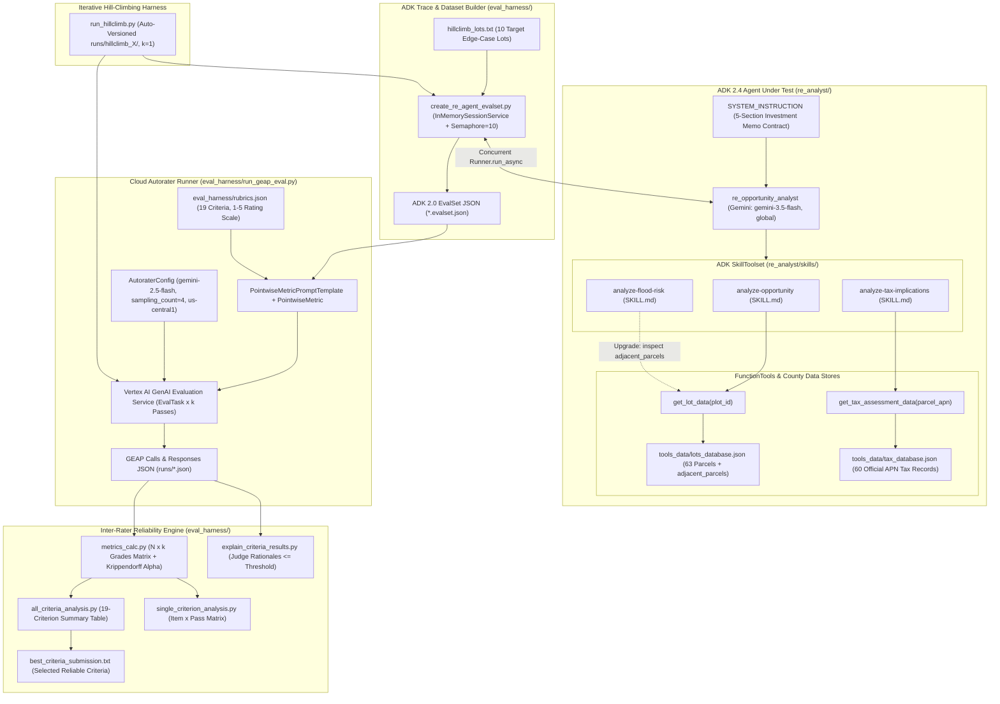

# Hillclimbing with Autoraters — Lab Runbook

A step-by-step operational runbook, system architecture, inter-rater reliability audit reference, and dual-loop hill-climbing workflow for evaluating and improving a **Google ADK 2.4 Real Estate Investment Opportunity Analysis Agent (`re_analyst`)** using custom pointwise **LLM-as-a-Judge Autoraters** on the **Vertex AI GenAI Evaluation Service (`GEAP`)** and **Krippendorff's Alpha (`α`)** statistical calibration.

---

## 1. System Architecture

Hill-climbing an AI agent on open-ended analytical deliverables (such as multi-section real estate investment memoranda) is fundamentally harder than hill-climbing against deterministic unit tests. Without rigorous autorater validation, engineering teams fall into four evaluation traps:

1. **Ceiling Saturation (Zero Discriminative Signal):** Rubrics such as `general-tone`, `professionalism`, `readability`, and `logical-flow` award `5/5` on every single report across every evaluation pass (`mean = 5.0000`, `sd_report_means = 0.0000`). Despite reporting `100%` agreement, they provide zero gradient for hill-climbing.
2. **Subjective "Vibe-Check" Noise:** Unanchored rubrics (`report-length`, `document-formatting`, `analyst-insight`, `vocabulary-choice`) use vague descriptors (*"quite long"*, *"smart comments"*, *"fancy jargon"*), causing the LLM judge to oscillate across passes (`alpha = 0.55–0.64`) even on identical text.
3. **The Krippendorff's Alpha Prevalence Paradox:** Near-ceiling criteria (`data-density` at `mean = 4.9979`, `professional-tone` at `mean = 4.9958`) exhibit `>99%` pairwise agreement yet drop to `alpha ≈ 0.50` because when `479/480` ratings are `5`, a single `4` matches random chance expectation.
4. **Rubric Boundary Ambiguity vs. True Agent Capability Gaps:** On `cost-per-acre` (`mean = 1.3771`, `alpha = 0.5650`), baseline judge passes split between Rating `1` (*"calculation is entirely omitted"*) and Rating `2` (*"alludes to land cost relative to size"*) whenever the agent prints raw `last_sale_price` and `acreage` without dividing them. Meanwhile, on `neighboring-flood-risk` (`mean = 1.0316`, `alpha = 1.0000`) and `monthly-tax-holding` (`mean = 2.2764`, `alpha = 0.9970`), rock-solid Behaviorally Anchored Rating Scales (BARS) expose genuine multi-hop tool and calculation omissions in `re_analyst`.

Lab 5 separates the **ADK Agent Under Test (`re_analyst/`)**, **Concurrent ADK Trace Generation (`create_re_agent_evalset.py`)**, **Cloud Autorater Execution (`run_geap_eval.py`)**, **Statistical Agreement Analytics (`metrics_calc.py` + analysis CLIs)**, and **Automated Hill-Climbing (`run_hillclimb.py`)**:



### 1.1 Repository & Component Reference

| Path | Role |
|---|---|
| `re_analyst/agent.py` | Defines `re_opportunity_analyst` (`gemini-3.5-flash`), the 5-section memorandum `SYSTEM_INSTRUCTION`, `SkillToolset`, and `app = App(name="re_analyst", ...)` |
| `re_analyst/skills/analyze-opportunity/SKILL.md` | Orchestrator skill unlocking `get_lot_data` and coordinating flood-risk and tax-implication reviews |
| `re_analyst/skills/analyze-flood-risk/SKILL.md` | Environmental/hydrological skill (baseline inspects only subject `flood_zone`, omitting `adjacent_parcels`) |
| `re_analyst/skills/analyze-tax-implications/SKILL.md` | Financial carrying-cost skill unlocking `get_tax_assessment_data(parcel_apn)` |
| `re_analyst/tools/lot_tool.py` | Cached lookup (`get_lot_data`) against `tools_data/lots_database.json` (acreage, zoning, flood_zone, last_sale_price, `adjacent_parcels`, easements, ESA status) |
| `re_analyst/tools/tax_tool.py` | Cached lookup (`get_tax_assessment_data`) against `tools_data/tax_database.json` keyed by `parcel_apn` (`annual_tax_amount`, assessed values) |
| `eval_harness/rubrics.json` | 19 pointwise evaluation criteria (`criterion_id`, `name`, `criterion`, `1`–`5` `rating_scale`) |
| `eval_harness/create_re_agent_evalset.py` | Runs `re_analyst` concurrently (`max_concurrency=10`) over a Lot ID list and exports ADK 2.0 `.evalset.json` traces |
| `eval_harness/run_geap_eval.py` | Compiles `PointwiseMetric` templates, runs `--dry-run` or `k`-pass cloud `EvalTask` evaluations (`sampling_count=4`), and saves assembled prompts + scores |
| `eval_harness/metrics_calc.py` | Pivots ratings into an $N \times k$ matrix and calculates `mean`, `sd_report_means`, `sd_pass_means`, pairwise `%_agree`, and interval **Krippendorff's Alpha (`α`)** |
| `eval_harness/all_criteria_analysis.py` | Prints the aligned 19-criterion reliability and score summary table |
| `eval_harness/single_criterion_analysis.py` | Prints the full $N \times k$ `eval_id × pass` grades matrix and summary metrics for a single criterion |
| `eval_harness/explain_criteria_results.py` | Filters and prints judge rationale text per lot and pass (`--max_score_to_show`) to diagnose rubric vs. agent failures |
| `eval_harness/run_hillclimb.py` | End-to-end iteration runner (`runs/hillclimb_1/`, `runs/hillclimb_2/`, ...) over `eval_harness/hillclimb_lots.txt` scoring `cost-per-acre` and `neighboring-flood-risk` |
| `runs/geap_calls_and_responses_for_analysis.json` | Pre-staged multi-pass evaluation log (`N = 32` property reports × `19` criteria × `k = 15` passes = `9,120` judge evaluations) |
| `best_criteria_submission.txt` | Comma-separated submission file for the selected top hill-climbing criteria |

### 1.2 Baseline 19-Criterion Statistical Audit (`N = 32` Reports × `k = 15` Passes)

Evaluating `runs/geap_calls_and_responses_for_analysis.json` reveals five distinct statistical regimes across the 19 candidate rubrics:

| Criterion ID | Mean | Min–Max | `sd_report_means` | Pairwise `%_agree` | Krippendorff's `α` | Diagnostic Regime & Hill-Climbing Suitability |
|---|---:|---:|---:|---:|---:|---|
| **`neighboring-flood-risk`** | **1.0316** | 1–2 | 0.1768 | **100.00%** | **1.0000** | **Ideal Target #1 (High `α` + Huge Headroom):** Deterministic BARS rubric; exposes missing `adjacent_parcels` lookup |
| **`monthly-tax-holding`** | **2.2764** | 2–5 | 0.8872 | **99.17%** | **0.9970** | **Ideal Target #2 (High `α` + Huge Headroom):** Deterministic BARS rubric; exposes missing `annual_tax_amount / 12` math |
| **`environmental-esa`** | **4.2772** | 2–5 | 0.7042 | **79.10%** | **0.8970** | **Ideal Target #3 (High `α ≥ 0.80` + Moderate Headroom):** Reliable BARS rubric; penalizes superficial clean-Phase-I notes |
| **`cost-per-acre`** | **1.3771** | 1–3 | 0.2163 | 58.97% | 0.5650 | **High Headroom + Noisy Boundary:** Agent omits `last_sale_price / acreage`, while Rating `1` vs `2` wording splits judges `50/50` |
| `flood-zone-flagging` | 4.8447 | 3–5 | 0.3357 | 94.41% | 0.8970 | Reliable (`α = 0.897`), but baseline agent already scores near ceiling (`4.84/5.00`) |
| `risk-assessment` | 4.9532 | 3–5 | 0.1843 | 96.25% | 0.8030 | Reliable (`α = 0.803`), but already ceiling-saturated (`4.95/5.00`) |
| `utility-topography` | 4.7756 | 4–5 | 0.3081 | 82.57% | 0.7510 | Tentative agreement (`0.667 ≤ α < 0.80`) and limited headroom (`4.78`) |
| `persuasiveness` | 4.8840 | 4–5 | 0.2022 | 86.51% | 0.6720 | Subjective "vibe" rubric (`α = 0.672`) near ceiling |
| `analyst-insight` | 4.7294 | 4–5 | 0.2570 | 71.59% | 0.6390 | Subjective "vibe" rubric (*"deep, smart comments"*, `α < 0.667`) |
| `vocabulary-choice` | 4.9349 | 4–5 | 0.1365 | 90.83% | 0.6230 | Subjective jargon rubric (*"fancy terminology"*, `α < 0.667`) |
| `core-specifications` | 4.3623 | 4–5 | 0.2648 | 65.05% | 0.6210 | Moderate headroom (`4.36`), but Rating `4` vs `5` summary-table preference is noisy (`α = 0.621`) |
| `report-length` | 4.7622 | 4–5 | 0.1715 | 67.20% | 0.5490 | Unanchored length rubric (*"quite long"*, `α = 0.549`) |
| `document-formatting` | 4.8361 | 4–5 | 0.1488 | 75.22% | 0.5480 | Stylistic formatting jitter between `4` and `5` (`α = 0.548`) |
| `data-density` | 4.9979 | 4–5 | 0.0118 | 99.58% | 0.4990 | **Prevalence Paradox + Ceiling:** `479/480` scores are `5`; one `4` collapses `α` to `0.499` |
| `professional-tone` | 4.9958 | 4–5 | 0.0164 | 99.17% | 0.4980 | **Prevalence Paradox + Ceiling:** Near-constant `5`s; zero hill-climbing headroom |
| `general-tone` | 5.0000 | 5–5 | 0.0000 | 100.00% | 1.0000 | **Ceiling Saturated (`sd = 0`):** Every pass on every lot is `5`; zero signal |
| `logical-flow` | 5.0000 | 5–5 | 0.0000 | 100.00% | 1.0000 | **Ceiling Saturated (`sd = 0`):** Every pass on every lot is `5`; zero signal |
| `professionalism` | 5.0000 | 5–5 | 0.0000 | 100.00% | 1.0000 | **Ceiling Saturated (`sd = 0`):** Every pass on every lot is `5`; zero signal |
| `readability` | 5.0000 | 5–5 | 0.0000 | 100.00% | 1.0000 | **Ceiling Saturated (`sd = 0`):** Every pass on every lot is `5`; zero signal |

---

## 2. End-to-End Workflows

### 2.1 Outer Loop: Autorater Calibration & Agent Hill-Climbing Workflow

Before modifying agent prompts, skills, or tools, you must first **validate and calibrate your measurement instrument** (`rubrics.json`), then iterate on the **agent under test** (`re_analyst/`) against edge-case parcels:

```mermaid
flowchart LR
    P1["1. Configure Vertex AI (.env) & Smoke-Test via adk web"] --> P2["2. Build ADK EvalSet & Inspect GEAP Prompts (--dry-run / -k)"]
    P2 --> P3["3. Audit 19 Criteria Across N=32 x k=15 (all_criteria_analysis)"]
    P3 --> P4["4. Drill Into Matrix & Rationales (single_criterion + explain)"]
    P4 --> P5["5. Select Reliable High-Headroom Criteria & Calibrate Noisy Rubrics"]
    P5 --> P6["6. Run Baseline Hill-Climb (runs/hillclimb_1/)"]
    P6 --> P7["7. Upgrade ADK Skills, Tools & Prompt in re_analyst/"]
    P7 --> P8["8. Re-Run Hill-Climb (runs/hillclimb_2/) & Verify Score Lift"]
    P8 -->|"Remaining edge-case drops"| P4
    P8 -->|"Mean -> ~5.0 on target criteria"| P9["9. Finalize Submission & Commit"]
```



### 2.2 Inner Loop: ADK `SkillToolset` Execution & Multi-Pass GEAP Evaluation Sequence

```mermaid
sequenceDiagram
    autonumber
    participant H as Eval / Hill-Climb Harness
    participant R as ADK Runner (re_analyst)
    participant ST as SkillToolset & FunctionTools
    participant G as GeapEvalRunner (us-central1)
    participant V as Vertex AI EvalTask (gemini-2.5-flash)
    participant M as Metrics Engine (metrics_calc.py)

    H->>R: Prompt: "Please evaluate investment suitability for lot LOT-8473..."
    R->>ST: Load skill: analyze-opportunity -> call get_lot_data("LOT-8473")
    ST-->>R: Subject JSON (Zone X, 1.5 ac, $520k, APN 049-382-012-000, adjacent: ["LOT-8472"])
    R->>ST: Load skill: analyze-flood-risk -> call get_lot_data("LOT-8472") [After Upgrade]
    ST-->>R: Neighbor JSON (LOT-8472: Zone AE High Risk -> Runoff spillover warning!)
    R->>ST: Load skill: analyze-tax-implications -> call get_tax_assessment_data("049-382-012-000")
    ST-->>R: Official Tax JSON ($11,600/yr -> $966.67/mo; vs stale $9,200 lot estimate)
    R-->>H: 5-Section Markdown Memorandum -> Saved in *.evalset.json

    H->>G: Pass *.evalset.json + eval_harness/rubrics.json
    G->>G: Build PointwiseMetricPromptTemplate & PointwiseMetric
    loop pass_idx = 1 .. k_passes
        G->>V: EvalTask.evaluate(dataset_df, AutoraterConfig(sampling_count=4))
        V-->>G: metrics_table ("{criterion_id}/score" & "{criterion_id}/explanation")
    end
    G-->>M: Save assembled prompts + responses JSON
    M->>M: Pivot N x k matrix -> Compute Mean, SD, Pairwise %_agree & Krippendorff's Alpha
```

### 2.3 Key Statistical & Architectural Design Decisions

| Mechanism / Concept | Problem Solved | Architectural & Implementation Detail |
|---|---|---|
| **Dual-Region Vertex Configuration (`global` vs. `us-central1`)** | `gemini-3.5-flash` preview endpoints use `global`, while Vertex AI GenAI Evaluation Service (`EvalTask`) is regional | `.env` sets `GOOGLE_CLOUD_LOCATION=global` and `MODEL=gemini-3.5-flash` for `re_analyst`, whereas `run_geap_eval.py` initializes `vertexai.init(location="us-central1")` with `autorater_model="gemini-2.5-flash"`. |
| **Two-Level Stochastic Sampling (`sampling_count=4` × `k_passes`)** | Single-shot LLM judge calls suffer from decoding variance | Inside each `EvalTask` pass, `AutoraterConfig(sampling_count=4)` aggregates 4 internal judge samples per `(report, criterion)` pair; `run_geap_eval.py` then repeats `EvalTask.evaluate()` across `k` independent passes to measure inter-pass reliability (`alpha`) before trusting single-pass (`k=1`) scores in `run_hillclimb.py`. |
| **Interval Krippendorff's Alpha (`krippendorff-aleph-alpha`)** | Raw `%_agree` treats a `1 vs 5` disagreement identically to `4 vs 5` and ignores chance agreement | `metrics_calc.py` transposes `grades_df` (`passes × items`) and computes `krippendorff_alpha(df.T, DataTypeEnum.INTERVAL)`, penalizing wide ordinal jumps quadratically while accounting for marginal score distributions (`α ≥ 0.80` = reliable; `0.667–0.80` = tentative; `< 0.667` = noisy). |
| **mTLS Disablement & Fresh `EvalTask` Instantiation** | `pyOpenSSL` raises `"Context has already been used to create a Connection"` under concurrent `EvalTask` threads | Both `run_geap_eval.py` and `run_hillclimb.py` set `GOOGLE_API_USE_MTLS="never"` and `GOOGLE_API_USE_CLIENT_CERTIFICATE="false"` before importing `vertexai`, and instantiate a fresh `EvalTask` object on every pass. |
| **`PointwiseMetricPromptTemplate` `.variables` Workaround** | Vertex AI SDK's `_MetricPromptTemplate` omits `super().__init__()`, breaking `.assemble()` | `GeapEvalRunner._build_pointwise_metrics()` explicitly sets `template.variables = template._get_variables()` so `assemble_and_save_records()` can reconstruct the exact prompt sent to GEAP for auditability. |
| **Hidden Edge Cases in `hillclimb_lots.txt` & County Databases** | Naive prompts pass easy lots (`LOT-1000`) while failing multi-hop hydrological and APN tax mismatches | **(1) Hydrological Spillover:** `LOT-8473`, `LOT-1001`, `LOT-1004`, and `LOT-1005` sit in `Zone X (Minimal Risk)` yet border `Zone AE` or `Zone VE` parcels in `adjacent_parcels`. **(2) Stale Tax Estimates:** `LOT-8471`, `LOT-8472`, and `LOT-8473` carry outdated `estimated_annual_taxes` in `lots_database.json` (`$7,900`, `$8,500`, `$9,200`) vs. official reassessment amounts in `tax_database.json` (`$14,000`, `$23,600`, `$11,600`). **(3) Repeating Decimals:** `$680,000 / 4.4 ac` (`LOT-1002`) and `$450,000 / 1.7 ac` (`LOT-1006`) require exact division (`$154,545.45/ac`, `$264,705.88/ac`). |

---

## 3. Step-by-Step Lab Runbook

### Step 1: Prepare Environment, Python 3.13 & Vertex AI Configuration

#### 1.1 Authenticate & Stage the `autoraters` Workspace (Cloud Shell)

```bash
gcloud auth application-default login

export PROJECT_ID="$(gcloud config get-value project)"
gcloud config set project "${PROJECT_ID}"

gcloud storage cp -r "gs://${PROJECT_ID}-bucket/autoraters" ~/autoraters
cd ~/autoraters
```

#### 1.2 Set Up Python 3.13 (or Virtual Environment) & Install Dependencies

`google-adk==2.4.0` and `pandas==3.0.3` require Python 3.11+ (Python 3.13 in Cloud Shell via `pyenv` or local `.venv`):

```bash
# Option A: Using pyenv Python 3.13 (if not yet installed)
pyenv global 3.13 2>/dev/null || true

# Option B: Create an isolated virtual environment (recommended)
python3 -m venv .venv
source .venv/bin/activate

pip install -r requirements.txt
```

Verify core packages:

```bash
python -c "import google.adk, vertexai, krippendorff_alpha, pandas; print('ADK:', google.adk.__version__, '| Pandas:', pandas.__version__)"
```

#### 1.3 Create `~/autoraters/.env`

Configure the ADK agent to call `gemini-3.5-flash` via Vertex AI on the `global` endpoint:

```bash
cat << EOF > ~/autoraters/.env
GOOGLE_GENAI_USE_VERTEXAI=TRUE
GOOGLE_CLOUD_PROJECT=$(gcloud config get-value project)
GOOGLE_CLOUD_LOCATION=global
MODEL=gemini-3.5-flash
EOF
```

> [!IMPORTANT]
> Never commit `.env` to Git. Keep `GOOGLE_CLOUD_LOCATION=global` in `.env` for `gemini-3.5-flash` agent inference; `eval_harness/run_geap_eval.py` and `eval_harness/run_hillclimb.py` automatically target `us-central1` for the Vertex AI GenAI Evaluation Service (`gemini-2.5-flash` autorater).

---

### Step 2: Inspect `re_analyst` & Smoke-Test Interactively with `adk web`

Launch the ADK Developer UI from `~/autoraters`:

```bash
cd ~/autoraters
adk web --allow_origins "regex:https://.*\.cloudshell\.dev"
```

Open the Cloud Shell Web Preview on port `8000`, select **`re_analyst`**, and test prompt:

```text
Please evaluate investment suitability for lot LOT-8472 and generate a report.
```

**Baseline Observations in the Trace & Generated Memorandum:**
1. The agent loads `analyze-opportunity`, calls `get_lot_data("LOT-8472")`, loads `analyze-tax-implications`, and calls `get_tax_assessment_data("049-382-011-000")`.
2. **Gap 1 (`cost-per-acre`):** The memo lists `Last Sale Price: $450,000` and `Acreage: 1.2 acres`, but never computes `$450,000 / 1.2 = $375,000.00 per acre`.
3. **Gap 2 (`monthly-tax-holding`):** The memo cites annual taxes (`$23,600.00`), but never divides by 12 (`$1,966.67/month`) to quantify monthly pre-development carrying burn.
4. **Gap 3 (`neighboring-flood-risk`):** Even though `get_lot_data("LOT-8472")` returned `"adjacent_parcels": ["LOT-8471", "LOT-8473"]`, the agent never calls `get_lot_data` on `LOT-8471` (`Zone AE`) or `LOT-8473` (`Zone X` with a `Drainage Easement`) to analyze cross-boundary hydrology.

Stop `adk web` (`Ctrl+C`) once verified.

---

### Step 3: Build an ADK `EvalSet` & Test the GEAP Autorater Pipeline

#### 3.1 Generate ADK Evaluation Traces (`create_re_agent_evalset.py`)

Run `re_analyst` concurrently across the 10 target lots in `eval_harness/hillclimb_lots.txt` to produce an ADK 2.0 `.evalset.json` trace file:

```bash
cd ~/autoraters
python -m eval_harness.create_re_agent_evalset \
  --lots-file eval_harness/hillclimb_lots.txt \
  --out re_analyst/baseline_lots.evalset.json \
  --agent-dir ./re_analyst
```

#### 3.2 Inspect Assembled Judge Prompts Offline (`--dry-run`)

Verify how `GeapEvalRunner` maps `eval_harness/rubrics.json` into `PointwiseMetricPromptTemplate` prompts without making billable API calls:

```bash
python -m eval_harness.run_geap_eval \
  --traces re_analyst/baseline_lots.evalset.json \
  --rubric-file eval_harness/rubrics.json \
  --out runs/dry_run_check.json \
  --dry-run

jq '.[0] | {eval_id, criterion_id, is_dry_run, prompt_preview: (.prompt_made_to_service[:450])}' runs/dry_run_check.json
```

*(Optional)* To execute a live `k`-pass cloud evaluation on a small trace set:

```bash
python -m eval_harness.run_geap_eval \
  --traces re_analyst/baseline_lots.evalset.json \
  --rubric-file eval_harness/rubrics.json \
  --out runs/live_sample_eval.json \
  -k 2 \
  --location us-central1
```

---

### Step 4: Audit All 19 Autoraters & Select Reliable Hill-Climbing Criteria

Because running `N = 32` lots × `19` criteria × `k = 15` stochastic passes (`9,120` evaluations) takes significant wall-clock time, use the pre-staged multi-pass dataset `runs/geap_calls_and_responses_for_analysis.json`.

#### 4.1 Compute Global Summary & Agreement Metrics (`all_criteria_analysis.py`)

```bash
cd ~/autoraters
python -m eval_harness.all_criteria_analysis \
  --run_geap_eval_out runs/geap_calls_and_responses_for_analysis.json
```

Apply the **Two-Gate Autorater Selection Filter**:
- **Gate 1 — Inter-Rater Reliability (`Krippendorff's α ≥ 0.80`):** Reject subjective/noisy rubrics (`α < 0.80`), including `professional-tone` (`0.498`), `data-density` (`0.499`), `document-formatting` (`0.548`), `report-length` (`0.549`), `cost-per-acre` (`0.565` prior to rubric calibration), `core-specifications` (`0.621`), `vocabulary-choice` (`0.623`), `analyst-insight` (`0.639`), `persuasiveness` (`0.672`), and `utility-topography` (`0.751`).
- **Gate 2 — Meaningful Headroom & Non-Zero Variance (`mean < 4.50` and `sd_report_means > 0`):** Reject ceiling-saturated rubrics where the agent already scores ~`5.0` (`general-tone`, `logical-flow`, `professionalism`, `readability` all at `mean = 5.0000, sd_report_means = 0`; plus `risk-assessment` at `4.9532` and `flood-zone-flagging` at `4.8447`).

#### 4.2 Drill Into Individual Criteria (`single_criterion_analysis.py` & `explain_criteria_results.py`)

Inspect both reliable high-headroom criteria and noisy low-mean criteria:

```bash
# 1. Inspect N=32 x k=15 Grades Matrix for reliable high-headroom criteria
python -m eval_harness.single_criterion_analysis \
  --run_geap_eval_out runs/geap_calls_and_responses_for_analysis.json \
  --criterion neighboring-flood-risk

python -m eval_harness.single_criterion_analysis \
  --run_geap_eval_out runs/geap_calls_and_responses_for_analysis.json \
  --criterion monthly-tax-holding

python -m eval_harness.single_criterion_analysis \
  --run_geap_eval_out runs/geap_calls_and_responses_for_analysis.json \
  --criterion environmental-esa

# 2. Diagnose WHY cost-per-acre has low alpha (0.5650) despite objective math
python -m eval_harness.single_criterion_analysis \
  --run_geap_eval_out runs/geap_calls_and_responses_for_analysis.json \
  --criterion cost-per-acre

python -m eval_harness.explain_criteria_results \
  --run_geap_eval_out runs/geap_calls_and_responses_for_analysis.json \
  --criterion cost-per-acre \
  --max_score_to_show 2.0
```

**Key Diagnostic Finding from `explain_criteria_results.py`:**
- On `LOT-1000`, `p1/p3/p5/p8/p9/p10/p11` assign **Score `2.0`** (*"provides last sale price ($310,000) and acreage (3.1 acres), thereby alluding to land cost relative to size"*), while `p2/p4/p6/p7/p12/p13/p14/p15` assign **Score `1.0`** (*"completely omits the calculation and statement of the acquisition cost-per-acre"*). The noise is caused by **ambiguous boundary wording between Rating `1` and Rating `2` in `rubrics.json`**, not random judge hallucination!

#### 4.3 Update `best_criteria_submission.txt`

The three criteria satisfying **both** strict statistical reliability (`α ≥ 0.80`) **and** meaningful hill-climbing headroom (`mean < 4.50`, `sd_report_means > 0`) are:
- `neighboring-flood-risk` (`α = 1.0000`, `mean = 1.0316`)
- `monthly-tax-holding` (`α = 0.9970`, `mean = 2.2764`)
- `environmental-esa` (`α = 0.8970`, `mean = 4.2772`)

Write the comma-separated IDs (no spaces) to `best_criteria_submission.txt`:

```bash
echo -n "neighboring-flood-risk,monthly-tax-holding,environmental-esa" > ~/autoraters/best_criteria_submission.txt
cat ~/autoraters/best_criteria_submission.txt && echo
```

---

### Step 5: Run the Baseline Hill-Climbing Harness (`runs/hillclimb_1`)

Execute `eval_harness/run_hillclimb.py` before making any rubric or agent edits to record your baseline `hillclimb_1` scores across the 10 edge-case parcels (`LOT-8472`, `LOT-8471`, `LOT-8473`, `LOT-1000`–`LOT-1006`) on `cost-per-acre` and `neighboring-flood-risk`:

```bash
cd ~/autoraters
python -m eval_harness.run_hillclimb
```

**Expected Baseline Output (`hillclimb_1`):**
- `cost-per-acre`: Mean Score ≈ **`1.20` – `1.50`**
- `neighboring-flood-risk`: Mean Score ≈ **`1.00` – `1.10`**

Inspect low-scoring explanations on `hillclimb_1`:

```bash
python -m eval_harness.explain_criteria_results \
  --run_geap_eval_out runs/hillclimb_1/geap_calls_and_responses_hillclimb_1.json \
  --criterion neighboring-flood-risk \
  --max_score_to_show 4.0
```

---

### Step 6: Calibrate Noisy Rubric Anchors in `eval_harness/rubrics.json` (If Permitted by Lab Rules)

> [!NOTE]
> Check whether your specific lab checkpoint grades against the stock `eval_harness/rubrics.json` or asks you to refine noisy rubrics first. Even if `rubrics.json` is kept fixed, tightening `re_analyst` to always output an explicit formula, exact dollar-per-acre figure, and valuation benchmark pushes `cost-per-acre` directly to Rating `5`, bypassing the `1 vs 2` boundary entirely.

When calibrating `cost-per-acre` in `eval_harness/rubrics.json` to eliminate the `1 vs 2` ambiguity, make every rating anchor mutually exclusive and observable:
- **`1`:** States raw sale price and/or acreage separately (or omits them) with **no** cost-per-acre mention, comparison, or calculation, OR states a mathematically incorrect figure.
- **`2`:** Explicitly discusses land price relative to parcel size in prose (e.g., *"high price for a small lot"*), without computing a dollar-per-acre number or formula.
- **`3`:** States an approximate/rounded cost-per-acre figure without showing the division formula (`last_sale_price / acreage`).
- **`4`:** Accurately computes exact `last_sale_price / acreage` (`$/acre`) with explicit formula, but does not interpret or benchmark it as a valuation metric.
- **`5`:** Accurately computes exact `last_sale_price / acreage` (`$/acre`, rounded to 2 decimals) with explicit formula, prominently displayed in summary tables/text and analyzed as a core acquisition valuation metric.

---

### Step 7: Hill-Climb the ADK Agent (`re_analyst/`) & Verify Score Lift

To drive `cost-per-acre`, `neighboring-flood-risk`, `monthly-tax-holding`, and `environmental-esa` toward `5.0000` without floating-point mental-math errors, upgrade **both** the tools/skills and `SYSTEM_INSTRUCTION` in `re_analyst/`.

#### 7.1 Enrich or Add Deterministic Financial & Neighbor Lookups (Optional Tool Upgrade)

LLM mental division on repeating decimals such as `LOT-1002` (`$680,000 / 4.4 = $154,545.45/acre`) or `LOT-1006` (`$450,000 / 1.7 = $264,705.88/acre`) can occasionally drift by pennies and trigger a Rating `1` (*"mathematically incorrect"*). You can either add a lightweight calculation helper tool or pre-attach exact derived metrics in `lot_tool.py` / `tax_tool.py` while keeping all raw JSON fields intact, **and/or** upgrade the three `SKILL.md` files and `SYSTEM_INSTRUCTION` as shown below.

#### 7.2 Upgrade `re_analyst/skills/analyze-flood-risk/SKILL.md`

Declare `get_lot_data` in `adk_additional_tools` and mandate inspecting **every** parcel listed in `adjacent_parcels`:

```markdown
---
name: analyze-flood-risk
description: Investigates subject and neighboring parcel flood zone designations, drainage easements, and hydrological spillover risks for real estate investment opportunity analysis.
metadata:
  adk_additional_tools:
    - get_lot_data
---
# Analyze Flood Risk Skill

When evaluating environmental, flood, or hydrological risks for a subject lot:
1. Check the subject parcel's exact FEMA `flood_zone`, `topography`, `soil_classification`, and `easement_type` from `get_lot_data`.
   - Detail exact vertical construction and insurance impacts: for Special Flood Hazard Areas (`Zone AE`, `Zone A`, `Zone VE`), specify Base Flood Elevation (BFE) compliance, structural fill dirt or deep pilings/breakaway walls (for `Zone VE` coastal velocity hazard), and mandatory NFIP flood insurance carrying costs; for `Zone X (Minimal Risk)`, note reduced baseline insurance requirements while checking runoff exposure.
2. **Mandatory Neighboring Parcel Hydrological Investigation:**
   - Inspect the `adjacent_parcels` list from the subject parcel's record.
   - Call `get_lot_data` for **every** Lot ID in `adjacent_parcels` to retrieve each neighbor's exact `flood_zone`, `topography`, `soil_classification`, and `easement_type`.
   - Explicitly report each neighboring Lot ID and its exact FEMA flood zone classification in a comparative table and prose.
   - Critically analyze cross-boundary drainage, stormwater runoff, water-table spillover, and shared hydrological impacts on the subject parcel's grading, retention pond sizing, and civil engineering feasibility—especially when a `Zone X` subject lot borders a high-risk `Zone AE` or `Zone VE` neighbor!
3. Evaluate `environmental_status` (`Phase I ESA - Clean`, `REC flagged`, or `Phase II ESA Required`), prescribing concrete environmental due diligence next steps (e.g., Phase II subsurface soil/groundwater vapour testing, UST decommissioning budget, or standard representation warranties if Clean).
```

#### 7.3 Upgrade `re_analyst/skills/analyze-tax-implications/SKILL.md`

Mandate exact `cost-per-acre` (`last_sale_price / acreage`) and `monthly-tax-holding` (`annual_tax_amount / 12`) derivations using authoritative APN assessment data:

```markdown
---
name: analyze-tax-implications
description: Investigates acquisition cost-per-acre valuation and official property tax monthly/annual holding costs for a parcel.
metadata:
  adk_additional_tools:
    - get_tax_assessment_data
---
# Analyze Tax Implications Skill

When investigating acquisition basis, financial carrying costs, or tax implications for a lot:
1. **Exact Acquisition Cost-Per-Acre Calculation:**
   - Using `last_sale_price` and `acreage` from the lot record, compute and display the exact mathematical formula and result to 2 decimal places:
     `Acquisition Cost-Per-Acre = Last Sale Price / Acreage = $X / Y acres = $Z/acre`.
   - Highlight and benchmark Cost-Per-Acre as a core land valuation metric relative to the parcel's zoning density (`R-3`, `R-2`, `M-1`) and site-prep requirements.
2. **Official County Tax Lookup & Monthly Tax Holding Cost Calculation:**
   - Locate `parcel_apn` from the lot record and call `get_tax_assessment_data(parcel_apn)`.
   - Always use the official `annual_tax_amount` from `get_tax_assessment_data` as the authoritative tax figure (explicitly noting any reassessment discrepancy if the lot record's `estimated_annual_taxes` differs).
   - Explicitly compute and display the exact monthly tax carrying cost to 2 decimal places with its formula:
     `Monthly Tax Holding Cost = Official Annual Tax Amount / 12 = $A / 12 = $M/month`.
   - Analyze how this `$/month` tax burn impacts pre-construction permitting, entitlement, and holding-period cash-flow reserves.
```

#### 7.4 Upgrade `re_analyst/skills/analyze-opportunity/SKILL.md` & `re_analyst/agent.py`

Update `re_analyst/skills/analyze-opportunity/SKILL.md` so step-by-step orchestration enforces calling `get_lot_data` on both the subject lot and **all** `adjacent_parcels`, calling `get_tax_assessment_data(parcel_apn)`, and verifying exact `$/acre` and `$/month` math. Reinforce these required tables and formulas inside `SYSTEM_INSTRUCTION` in `re_analyst/agent.py` while keeping the required 5-heading memorandum structure (`# Initial Site Evaluation Memorandum: [Lot ID]`, `## Executive Summary`, `## Acquisition Basis and Holding Costs`, `## Zoning and Infrastructure Readiness`, `## Risk Assessment`, `## Recommendation`).

#### 7.5 Re-Run the Hill-Climbing Harness (`runs/hillclimb_2`)

```bash
cd ~/autoraters
python -m eval_harness.run_hillclimb
```

**Expected Upgraded Output (`hillclimb_2`):**
```text
=========================================
📊 Hill Climbing Results: hillclimb_2
=========================================
 • cost-per-acre             Mean Score: 5.0000
 • neighboring-flood-risk    Mean Score: 5.0000
=========================================
```

If any single edge-case lot scores `< 5.0`, inspect the exact judge rationale immediately:

```bash
python -m eval_harness.explain_criteria_results \
  --run_geap_eval_out runs/hillclimb_2/geap_calls_and_responses_hillclimb_2.json \
  --criterion cost-per-acre \
  --max_score_to_show 4.0

python -m eval_harness.explain_criteria_results \
  --run_geap_eval_out runs/hillclimb_2/geap_calls_and_responses_hillclimb_2.json \
  --criterion neighboring-flood-risk \
  --max_score_to_show 4.0
```

---

## 4. Troubleshooting Quick Reference

| Symptom | Likely Cause | Remediation |
|---|---|---|
| `KeyError: 'MODEL'` or `'GOOGLE_CLOUD_PROJECT'` when importing `re_analyst` | Missing `~/autoraters/.env` or running outside `~/autoraters` | Create `~/autoraters/.env` with `GOOGLE_GENAI_USE_VERTEXAI=TRUE`, `GOOGLE_CLOUD_PROJECT`, `GOOGLE_CLOUD_LOCATION=global`, and `MODEL=gemini-3.5-flash` |
| `Context has already been used to create a Connection` SSL error | `pyOpenSSL` mTLS conflict during concurrent `EvalTask` threads | Ensure `GOOGLE_API_USE_MTLS="never"` and `GOOGLE_API_USE_CLIENT_CERTIFICATE="false"` are set before importing `vertexai` (built into `run_geap_eval.py` and `run_hillclimb.py`) |
| `404 Model not found` during `run_geap_eval.py` | Passing `global` as `--location` to `EvalTask` | Keep `--location us-central1` (the default) for `run_geap_eval.py` / `run_hillclimb.py`; only `re_analyst` uses `global` |
| `cost-per-acre` drops to `1.0` on `LOT-1002` or `LOT-1006` | Repeating-decimal division error (`$680,000 / 4.4` or `$450,000 / 1.7`) | Add a deterministic Python division helper tool or pre-computed `cost_per_acre` field in `get_lot_data` so the LLM never guesses repeating decimals |
| `neighboring-flood-risk` stalls at `2.0` or `3.0` | Agent names `adjacent_parcels` IDs without calling `get_lot_data` on them | Add `adk_additional_tools: [get_lot_data]` to `analyze-flood-risk/SKILL.md` and explicitly require calling `get_lot_data` for every ID in `adjacent_parcels` |
| Wrong monthly tax figure on `LOT-8471`, `LOT-8472`, or `LOT-8473` | Agent divided stale `estimated_annual_taxes` from `lots_database.json` instead of official `annual_tax_amount` | Instruct `analyze-tax-implications` to always use `annual_tax_amount` returned by `get_tax_assessment_data(parcel_apn)` |
| `all_criteria_analysis.py` exits with dry-run info message | Passed a `--dry-run` JSON file containing `"is_dry_run": true` | Pass a live GEAP output JSON or `runs/geap_calls_and_responses_for_analysis.json` |
