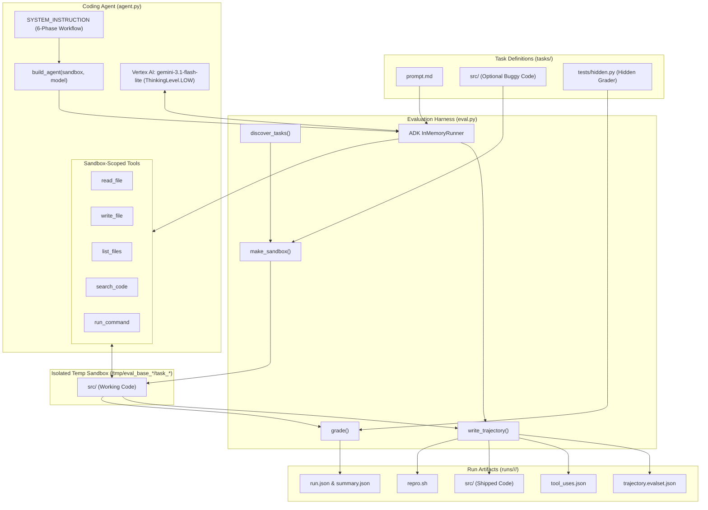
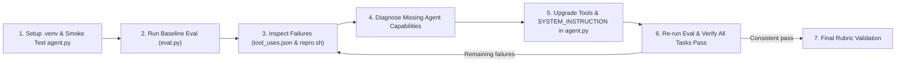
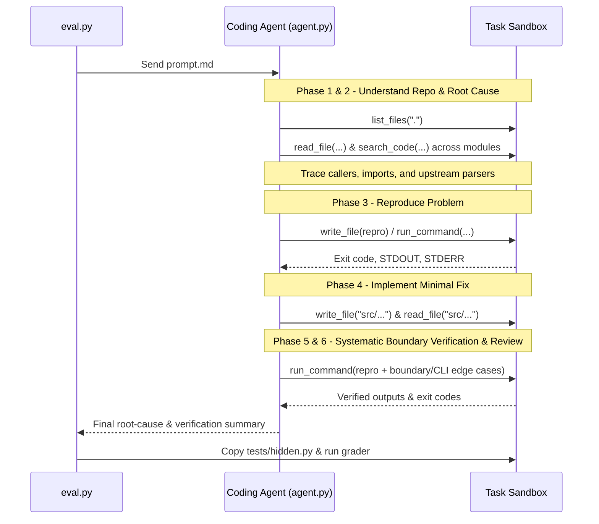

# Hill-Climbing a Coding Agent — Lab Runbook

A step-by-step operational runbook, system architecture, and iterative hill-climbing workflow for building, diagnosing, and improving a Google ADK coding agent (`agent.py`) evaluated against hidden test suites (`eval.py`).

---

## 1. System Architecture

The project separates the **agent under test** (`agent.py`) from the **evaluation harness** (`eval.py`) and **task specifications** (`tasks/`). During evaluation, each task runs inside an isolated temporary sandbox so the agent never has access to `tests/hidden.py`.



### Repository Layout

| Path | Role |
|---|---|
| `agent.py` | Defines `DEFAULT_MODEL`, `SYSTEM_INSTRUCTION`, sandbox-safe tool implementations, and `build_agent(sandbox, model)` |
| `eval.py` | Discovers tasks, seeds isolated sandboxes, runs `agent.py` asynchronously in parallel, records ADK trajectories, and grades shipped code |
| `tasks/<task_id>/prompt.md` | Problem statement or CLI specification sent to the agent |
| `tasks/<task_id>/src/` | Optional starter package containing an upstream defect (`invoice_report`, `reminder_time`) |
| `tasks/<task_id>/tests/hidden.py` | Out-of-band test suite copied into the sandbox only after the agent finishes |
| `runs/<timestamp>/<task_id>/` | Per-run observability artifacts (`trajectory.evalset.json`, `tool_uses.json`, `src/`, `repro.sh`, `run.json`) |

---

## 2. Workflows

### 2.1 Outer Loop: Hill-Climbing Engineering Workflow

Model capability and thinking budget remain fixed (`gemini-3.1-flash-lite`, `ThinkingLevel.LOW`), so improvements come strictly from **better tools** and **stronger system instructions** grounded in trajectory evidence.



### 2.2 Inner Loop: 6-Phase Agent Execution Workflow

Inside each task sandbox, `SYSTEM_INSTRUCTION` directs the coding agent through six explicit phases before finishing:



---

## 3. Step-by-Step Lab Runbook

### Step 1: Initialize the Virtual Environment and Dependencies

Create a local `.venv` and install the Google ADK and GenAI SDK packages:

```bash
python3 -m venv .venv
.venv/bin/pip install -r requirements.txt
```

Verify the environment:

```bash
.venv/bin/python -c "import google.adk, google.genai; print(google.adk.__version__, google.genai.__version__)"
```

---

### Step 2: Configure Vertex AI Environment Variables & Smoke-Test `agent.py`

Ensure Google Cloud Application Default Credentials (ADC) are active and point GenAI at Vertex AI:

```bash
export GOOGLE_GENAI_USE_VERTEXAI=TRUE
export GOOGLE_CLOUD_PROJECT="<YOUR_GCP_PROJECT_ID>"
export GOOGLE_CLOUD_LOCATION="global"
```

Run `agent.py` standalone (writes into `./out` and executes generated scripts):

```bash
.venv/bin/python agent.py "Write a hello world python script"
```

---

### Step 3: Run the Baseline Evaluation

Execute the evaluation harness across all five tasks (`expense_report`, `interval_set`, `invoice_report`, `range_list`, `reminder_time`):

```bash
.venv/bin/python eval.py
```

To run a single task during targeted debugging:

```bash
.venv/bin/python eval.py --task invoice_report
```

Note the timestamped output folder printed at the end of the run (`runs/<timestamp>/`).

---

### Step 4: Inspect Trajectories and Reproduce Failures

For each failed task in `runs/<timestamp>/<task_id>/`:

1. **Re-run the hidden grader against the shipped code** to see the exact failing assertion:
   ```bash
   bash runs/<timestamp>/invoice_report/repro.sh
   bash runs/<timestamp>/reminder_time/repro.sh
   bash runs/<timestamp>/range_list/repro.sh
   ```
2. **Inspect tool calls and model turns** in `tool_uses.json` and `trajectory.evalset.json`.
3. **Identify the baseline agent's capability gaps** (rather than just the task's code bug):
   - **No repository discovery (`list_files`) or code search (`search_code`):** In multi-file bug-fix tasks (`invoice_report` and `reminder_time`), the baseline agent only had `read_file` and `write_file`. It anchored on the file named in `prompt.md` (`report.py` or `core.py`) and missed upstream defects in sibling modules (`load.py` truncating floats with `int(float(raw))`; `parsing.py` stripping `tzinfo` with `.replace(tzinfo=None)`).
   - **No command execution (`run_command`):** The agent wrote helper scripts (`repro.py`, `list_files.py`, `run_test.py`) via `write_file` that it could never execute, shipping unverified edits.
   - **No structured verification or edge-case checklist:** With a one-line prompt and `temperature=1.0`, the agent one-shotted CLI tasks without testing unstated boundary conditions (such as descending ranges like `9-7` in `range_list`, empty stdin, `ROUND_HALF_UP` decimal formatting, trailing-zero trimming, and stderr exit codes).

---

### Step 5: Upgrade `agent.py` (Tools + System Instructions)

Keep the required model constraints intact:
- `DEFAULT_MODEL = "gemini-3.1-flash-lite"` (and pass `model=model` through `build_agent`)
- `thinking_level=types.ThinkingLevel.LOW`

Apply three targeted upgrades in `agent.py`:

1. **Add Sandbox-Scoped Discovery, Search, and Execution Tools:**
   - `list_files(path=".")`: Recursively walks the sandbox (ignoring `.git`, `.venv`, `__pycache__`, `node_modules`) using `_resolve` path traversal protection.
   - `search_code(query)`: Runs `grep -Rn` inside `cwd=sandbox` across source and config files to locate callers, imports, and symbol definitions.
   - `run_command(command)`: Executes shell/Python/CLI commands inside `cwd=sandbox` with a timeout and returns `Exit code`, `STDOUT`, and `STDERR` (enabling repro scripts and stdin CLI testing).
2. **Replace the One-Line Prompt with a 6-Phase `SYSTEM_INSTRUCTION`:**
   - **Phase 1 (Understand Repository):** Inspect structure with `list_files`, read before editing, trace imports and data flow with `search_code`.
   - **Phase 2 (Identify Root Cause):** Do not assume the file named in the prompt holds the bug; trace input parsing, conversion, normalization, and formatting upstream.
   - **Phase 3 (Reproduce Problem):** Run or create a minimal reproducer via `run_command` and observe actual stdout/stderr/exit codes before editing.
   - **Phase 4 (Implement Fix):** Apply minimal root-cause changes while preserving APIs, return types, and output contracts; re-read modified files.
   - **Phase 5 (Systematically Verify):** Enumerate and execute relevant boundary conditions — empty/single-element input, ascending/descending ranges, decimal precision and rounding, trailing zeros, malformed input, UTC offsets, and CLI exit codes/stderr.
   - **Phase 6 (Final Review):** Confirm the original failure and edge cases pass via actual command execution; never invent test results.
3. **Lower Sampling Variance:**
   - Reduce `temperature` (e.g., `0.2`) while keeping `ThinkingLevel.LOW` for consistent tool-use and formatting discipline.

---

### Step 6: Re-Run Evaluation and Verify

Run the full evaluation suite again and inspect the updated summary and trajectories:

```bash
.venv/bin/python eval.py
```

Confirm:
- `summary.json` reports `5/5` solved tasks (or inspect any remaining failure via `runs/<new_timestamp>/<task_id>/repro.sh` and `tool_uses.json`).
- Tool trajectories show `list_files` / `search_code` finding upstream modules and `run_command` executing reproduction and boundary tests prior to completion.

---

## 4. Troubleshooting Quick Reference

| Symptom | Likely Cause | Action |
|---|---|---|
| `DefaultCredentialsError` or Vertex 403 | Missing ADC or wrong project/location env vars | Run `gcloud auth application-default login` and verify `GOOGLE_CLOUD_PROJECT` and `GOOGLE_CLOUD_LOCATION=global` |
| Agent edits `report.py` or `core.py` but `repro.sh` still fails | Upstream parser/loader module was never inspected | Verify `list_files` and `search_code` are registered in `build_agent` and mandated in Phases 1–2 |
| Agent writes `repro.py` without running it | Missing execution tool or weak verification rule | Verify `run_command` is registered in `tools=[...]` and Phase 3/5 forbid unexecuted claims |
| CLI task fails on `9-7`, empty input, or exit code `2` | Unstated boundary or output contract missed | Ensure Phase 5 enumerates directionality, empty/malformed stdin, decimal rounding, and stderr/exit codes |
| Automatic fail in rubric grading | `ThinkingLevel` raised above `LOW` or model changed | Keep `DEFAULT_MODEL = "gemini-3.1-flash-lite"`, `model=model`, and `types.ThinkingLevel.LOW` |
