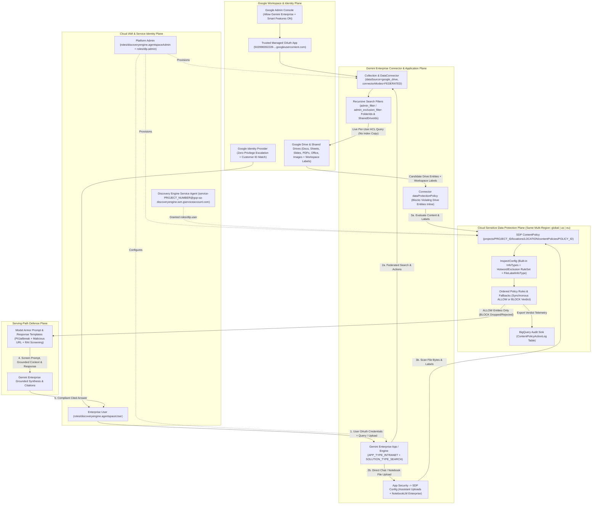
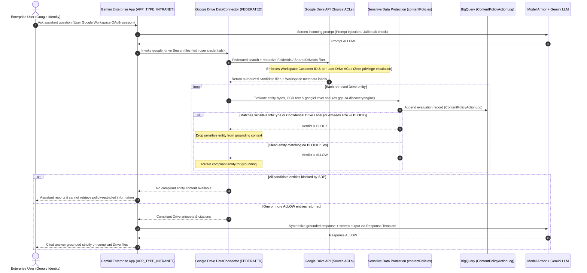
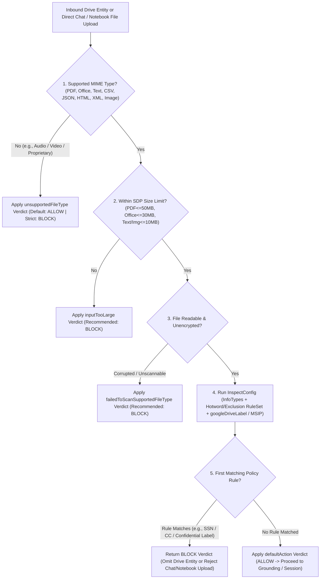

# Add Google Drive with Sensitive Data Protection to Gemini Enterprise — Lab Runbook

A step-by-step operational runbook, layered data-governance architecture, federated retrieval & synchronous verdict workflows, and verification guide for connecting **Google Drive (`google_drive`, `FEDERATED` mode)** to **Gemini Enterprise (Discovery Engine `APP_TYPE_INTRANET`)** protected by **Cloud Sensitive Data Protection (SDP) Content Policies (`contentPolicies`)** across inbound connector retrieval, **Assistant direct file uploads**, and **Gemini Notebook Enterprise**, paired with **Model Armor** serving-path guardrails and **BigQuery (`ContentPolicyActionLog`)** audit telemetry.

---

## 1. System Architecture

Connecting an enterprise **Google Drive** corpus directly to a generative AI assistant introduces four distinct data-exposure vectors that source-system ACLs alone cannot prevent:

1. **Authorized-User Over-Sharing ("ACL != AI-Safe"):** Even though Gemini Enterprise strictly enforces per-user Google Workspace ACLs with zero privilege escalation, employees routinely hold read access to Shared Drives or folders containing **regulated PII/PCI/credentials** (`US_SOCIAL_SECURITY_NUMBER`, `CREDIT_CARD_NUMBER`, `GCP_API_KEY`) or files tagged with **`Confidential` Google Workspace classification labels** that organizational policy forbids feeding into LLM grounding prompts.
2. **Scoping Filters Are Not a DLP Boundary:** Google Drive connector `FolderIds` and `SharedDriveIds` filters (`admin_filter` / `admin_exclusion_filter`) restrict **only** the `Search files` tool. If write or direct-read actions (`Read document`, `Read file content`, `Get spreadsheet`) are enabled—or if sensitive records sit inside an allowed Shared Drive—folder scoping alone cannot inspect payload sensitivity.
3. **Side-Channel Assistant & Notebook Uploads:** Blocking sensitive files on the Drive data connector still leaves an open side door if end users manually attach local files or pull Google Drive / OneDrive documents directly into a **Gemini Enterprise Assistant** chat session or **Gemini Notebook Enterprise** notebook without an upload-time content policy.
4. **Inbound Source Protection vs. Serving-Path Defense:** Inbound **Sensitive Data Protection (`contentPolicies`)** inspects retrieved Drive entities and uploaded files synchronously to return an **`ALLOW` or `BLOCK` verdict** before grounding, whereas **Model Armor** screens user prompts and synthesized LLM responses on the serving path against prompt injection, jailbreaks, and malicious URLs. Production deployments require **both** layers working in concert.

Lab 8 implements a **defense-in-depth Google Drive + Sensitive Data Protection governance architecture** across Google Workspace, Cloud IAM, Sensitive Data Protection (`dlp.googleapis.com`), and Gemini Enterprise (`discoveryengine.googleapis.com`):



### 1.1 Layered Governance & Security Boundary Matrix

| Control Layer | Primary Resource / Setting | Enforcement Point | What It Protects Against | Key Operational Constraint |
|---|---|---|---|---|
| **Source ACLs & Identity** | **Google Identity** + **Google-Managed OAuth App** | Live Google Drive API call (`FEDERATED`) | Unauthorized cross-user document discovery; enforces exact source-system Drive permissions | Consumer `@gmail.com` accounts and service-account search credentials return `403 Permission Denied`; requires matching Workspace Customer ID |
| **Connector Search Scoping** | `DataConnector.params` (`admin_filter` / `admin_exclusion_filter`) | `Search files` tool execution | Noisy or irrelevant Shared Drives and folders (matches recursively up to 10 folder levels) | **Not a DLP boundary:** applies only to `Search files`; other enabled Drive actions can still access permitted out-of-filter files |
| **Inbound Connector SDP** | `DataConnector.dataProtectionPolicy` (`contentPolicies`) | Post-retrieval, pre-grounding entity gate | Regulated PII/credentials (`US_SOCIAL_SECURITY_NUMBER`, `CREDIT_CARD_NUMBER`, etc.), OCR image text, and restricted **Google Workspace / MSIP labels** | Must reside in the **same multi-region** (`global`, `us`, or `eu`) as the connector; Discovery Engine SA requires `roles/dlp.user` |
| **Assistant & Notebook Upload SDP** | **App $\rightarrow$ Security $\rightarrow$ Sensitive Data Protection** (`Assistant` & `NotebookLM` settings) | Synchronous file-upload admission gate | Users bypassing connector rules by uploading local, Google Drive, or OneDrive files directly into chat or notebooks | Assistant policy applies immediately; NotebookLM Enterprise applies project-wide across all notebooks in that region (~10 min propagation) |
| **Serving-Path Guardrail** | **Model Armor** (`Inspect and block` prompt + response templates) | Pre-LLM prompt & post-LLM response | Prompt injection inside allowed documents, jailbreak attempts, malicious URLs, and sensitive output leakage | Does not mask/redact inline—blocks violating requests/responses; `global` apps map to `us` or `eu` multi-region Model Armor templates |

### 1.2 Resource, Endpoint & Identifier Reference

| Component | Canonical Format / Official Value |
|---|---|
| **Supported Multi-Regions** | `global`, `us`, `eu` *(SDP Content Policy, Drive Connector, and Gemini Enterprise App must match)* |
| **Google-Managed Drive OAuth Client ID** | `502998392228-hpelhql0ouj9ckiu3l39lllsir24b02s.apps.googleusercontent.com` |
| **Discovery Engine Service Agent** | `service-<PROJECT_NUMBER>@gcp-sa-discoveryengine.iam.gserviceaccount.com` *(requires `roles/dlp.user`)* |
| **SDP Content Policy Resource Name** | `projects/<PROJECT_ID>/locations/<LOCATION>/contentPolicies/<CONTENT_POLICY_ID>` |
| **Drive Collection & Connector Resource** | `projects/<PROJECT_ID>/locations/<LOCATION>/collections/<COLLECTION_ID>/dataConnector` |
| **Generated Drive Data Store Entity ID** | `<COLLECTION_ID>_google_drive` *(passed in `Engine.dataStoreIds`)* |
| **Gemini Enterprise App (`Engine`)** | `projects/<PROJECT_ID>/locations/<LOCATION>/collections/default_collection/engines/<APP_ID>` (`appType = "APP_TYPE_INTRANET"`) |
| **Supported Editions** | All Gemini Enterprise editions **except** Gemini Enterprise Business *(no additional SDP surcharge)* |

### 1.3 File Type & Size Limits Across Google Drive Indexing vs. SDP Scanning

| File Category / MIME Type | Google Drive Federated Search Limit | SDP Content Policy Scan Limit | Recommended Fallback Verdict (`inputTooLarge`) |
|---|---|---|---|
| **PDF** (`application/pdf`) | Up to `30 MB` (`80 pages` / `50 MB` max for OCR) | **`50 MB`** | `BLOCK` *(prevents uninspected large PDFs)* |
| **Word / PowerPoint / Excel** (`DOCX`, `PPTX`, `XLSX`, `XLSM`) | `10 MB` (`20 MB` for `XLSX`) | **`30 MB`** | `BLOCK` |
| **Plain Text / CSV / TSV / HTML / JSON / XML** | Up to `100 MB` *(first `1 MB` extracted text searchable)* | **`10 MB`** | `BLOCK` |
| **Images with OCR / Object Detection** (`BMP`, `GIF`, `JPEG`, `PNG`, `TIFF`, `SVG`) | Indexed via Drive metadata & OCR | **`10 MB`** | `BLOCK` |
| **Audio & Video Uploads** | Metadata only | **Not scanned by SDP** | Use `unsupportedFileType = ALLOW` or `BLOCK` per risk posture |

---

## 2. End-to-End Workflows

### 2.1 Outer Loop: Provisioning, Policy Attachment & Multi-Surface Verification Workflow

```mermaid
flowchart LR
    S1["Step 1: Workspace Admin & Google Identity Prep (OAuth Allowlist + Smart Features)"] --> S2["Step 2: Enable APIs & Grant roles/dlp.user to Discovery Engine Service Agent"]
    S2 --> S3["Step 3: Author SDP ContentPolicy (InfoTypes + Labels + BLOCK Rules + BQ Audit)"]
    S3 --> S4["Step 4: Create Federated Google Drive DataConnector + Attach ContentPolicy"]
    S4 --> S5["Step 5: Create Gemini Enterprise App & Bind Assistant / NotebookLM Upload SDP"]
    S5 --> S6["Step 6: Run Positive (ALLOW) & Negative (BLOCK) Grounding + Upload Tests"]
    S6 --> S7["Step 7: Audit Verdicts in BigQuery (ContentPolicyActionLog) & Verify Posture CLI"]
```



### 2.2 Inner Loop A: Federated Google Drive Retrieval & Synchronous SDP Verdict Sequence

Unlike ingestion connectors that copy documents into a secondary index, the new **Google Drive connector** runs in **`FEDERATED` mode**: queries execute live against the Google Drive API under the signed-in user's OAuth identity, and Sensitive Data Protection evaluates candidate entities **synchronously** before Gemini Enterprise grounds its answer:



### 2.3 Inner Loop B: Content Policy Evaluation & Direct Upload Gate Decision Flow



---

## 3. Step-by-Step Lab Runbook

### Step 0: Prerequisites & Google Workspace Admin Readiness

Before creating the connector in Google Cloud, confirm the following organizational prerequisites for your Google Workspace domain (consumer `@gmail.com` accounts lack a Workspace Customer ID and are unsupported):

1. **Same Google Workspace Identity:** Sign in to the Google Cloud Console with a managed Google Workspace account belonging to the same organization (`Customer ID`) as the Google Drive data and GCP project.
2. **Enable Gemini Enterprise Workspace Access:** In the [Google Admin Console](https://admin.google.com), ensure a Workspace administrator turns **ON** **Allow Gemini Enterprise to access Google Workspace data** (*otherwise searches return empty results in the UI or `403 Permission Denied: Workspace access for Agentspace disabled by organization admin.`*).
3. **Enable Google Workspace Smart Features:** In Google Workspace user settings, turn **ON** both **Smart features in Google Workspace** and **Smart features in other Google products**.
4. **Allowlist the Google-Managed OAuth App (if API Controls restrict third-party/internal OAuth apps):**
   - In [Google Admin Console](https://admin.google.com), navigate to **Security $\rightarrow$ Access and data control $\rightarrow$ API controls $\rightarrow$ Manage app access**.
   - Click **Configure new app $\rightarrow$ OAuth App Name Or Client ID** and search for:
     ```text
     502998392228-hpelhql0ouj9ckiu3l39lllsir24b02s.apps.googleusercontent.com
     ```
   - Select the Gemini Enterprise OAuth app, choose **Trusted**, and click **Continue $\rightarrow$ Finish**.
5. **Configure Google Identity in Gemini Enterprise:**
   - In Google Cloud Console, navigate to **Gemini Enterprise $\rightarrow$ Settings $\rightarrow$ Authentication**.
   - For your target multi-region (`global`, `us`, or `eu`), click **Add identity provider**, select **Google Identity**, and click **Save changes**.

---

### Step 1: Set Environment Variables, Enable APIs & Grant Service Agent IAM

> [!IMPORTANT]
> **Mandatory CLI Syntax Check & IAM Authorization Note:** Before running any `gcloud` CLI command, validate leaf subcommand flags in your active SDK version using `gcloud help <command>`. Modifying project IAM policies and enabling APIs require explicit administrator authorization (`roles/resourcemanager.projectIamAdmin`, `roles/serviceusage.serviceUsageAdmin`, `roles/dlp.admin`, and `roles/discoveryengine.agentspaceAdmin`).

#### Option A — Google Cloud Console

1. Open **APIs & Services $\rightarrow$ Library** and verify that **Discovery Engine API** (`discoveryengine.googleapis.com`) and **Sensitive Data Protection (DLP)** (`dlp.googleapis.com`) are **Enabled**.
2. Open **IAM & Admin $\rightarrow$ Settings** and copy your numeric **Project number** (`<PROJECT_NUMBER>`).
3. Open **IAM & Admin $\rightarrow$ IAM**, check **Include Google-provided role grants**, locate the Discovery Engine service agent:
   ```text
   service-<PROJECT_NUMBER>@gcp-sa-discoveryengine.iam.gserviceaccount.com
   ```
   Click **Edit principal (pencil icon) $\rightarrow$ Add another role**, select **DLP User** (`roles/dlp.user`), and click **Save**.
4. Ensure end users querying the app hold **Gemini Enterprise User** (`roles/discoveryengine.agentspaceUser`).

#### Option B — Cloud Shell / `gcloud` CLI

1. **Validate leaf-level `gcloud` command syntax first:**
   ```bash
   gcloud help projects describe
   gcloud help services enable
   gcloud help beta services identity create
   gcloud help projects add-iam-policy-binding
   ```

2. **Export environment variables for your target project and multi-region:**
   ```bash
   export PROJECT_ID="<YOUR_PROJECT_ID>"
   export LOCATION="global"   # Supported values: global | us | eu
   export POLICY_ID="gdrive-enterprise-sdp-policy"
   export COLLECTION_ID="gdrive-governed-connector"
   export APP_ID="enterprise-workspace-assistant"
   ```

3. **Enable required APIs and initialize the Discovery Engine service identity** *(requires user approval if not already enabled)*:
   ```bash
   gcloud services enable discoveryengine.googleapis.com dlp.googleapis.com \
     --project="${PROJECT_ID}" \
     --quiet

   gcloud beta services identity create \
     --service=discoveryengine.googleapis.com \
     --project="${PROJECT_ID}" \
     --quiet
   ```

4. **Resolve `<PROJECT_NUMBER>` and bind `roles/dlp.user` to the Discovery Engine service agent:**
   ```bash
   gcloud projects describe "${PROJECT_ID}" \
     --format="value(projectNumber)" \
     --quiet
   ```
   Copy the returned numeric value into `PROJECT_NUMBER` and grant `roles/dlp.user`:
   ```bash
   export PROJECT_NUMBER="<YOUR_PROJECT_NUMBER>"

   gcloud projects add-iam-policy-binding "${PROJECT_ID}" \
     --member="serviceAccount:service-${PROJECT_NUMBER}@gcp-sa-discoveryengine.iam.gserviceaccount.com" \
     --role="roles/dlp.user" \
     --quiet
   ```

---

### Step 2: Prepare Test Files in Google Drive (Clean vs. Sensitive)

To deterministically test both positive (`ALLOW`) and negative (`BLOCK`) outcomes without risking real customer data, prepare two test documents inside a dedicated Google Drive folder (for example, `Gemini-Enterprise-SDP-Lab`):

1. **Clean Engineering Document (`Q4_Architecture_Roadmap.docx` or Google Doc):**
   - Content: *"Project Atlas Q4 Milestone: Migrate regional stateless microservices to Cloud Run and standardize OpenTelemetry tracing across staging and production."*
   - Contains **zero** PII, credentials, or restricted labels.
2. **Sensitive Customer Escalation Document (`Customer_Billing_Escalation_CONFIDENTIAL.pdf` or `.txt`):**
   - Content: *"Customer Escalation Ticket #4821 — Verification SSN: 999-00-0000 — Backup Card: 4111-1111-1111-1111."*
   - *(Optional)* Apply your organization's Google Workspace **Classification Label** (e.g., `Sensitivity = Confidential`).
3. **Copy the Folder ID** from the browser URL bar (`https://drive.google.com/drive/folders/<FOLDER_ID>`):
   ```bash
   export FOLDER_ID="<YOUR_GOOGLE_DRIVE_FOLDER_ID>"
   ```

---

### Step 3: Create the Sensitive Data Protection Content Policy (`contentPolicies`)

> [!WARNING]
> **Strict Multi-Region Alignment:** You **must** create the Sensitive Data Protection `ContentPolicy` in the **exact same multi-region** (`global`, `us`, or `eu`) as your Google Drive connector and Gemini Enterprise app. A `global` connector cannot attach a `us` or regional (`us-west2`) content policy.

#### Option A — Google Cloud Console

1. Go to **Security $\rightarrow$ Sensitive Data Protection $\rightarrow$ Configuration $\rightarrow$ Content Policies** ([console.cloud.google.com/security/sensitive-data-protection/landing/configuration/content-policies](https://console.cloud.google.com/security/sensitive-data-protection/landing/configuration/content-policies)).
2. Click **Create** and complete **Basic Information**:
   - **Display name:** `Gemini Enterprise Google Drive Inbound & Upload Guardrail`
   - **Policy ID:** `gdrive-enterprise-sdp-policy`
   - **Location:** Select **Multi-region $\rightarrow$ `global`** *(or match your app's `us` / `eu` multi-region)*, then click **Continue**.
3. In **Inspection Configuration**:
   - Click **Manage infoTypes** and select built-in detectors:
     - `US_SOCIAL_SECURITY_NUMBER`
     - `CREDIT_CARD_NUMBER`
     - `EMAIL_ADDRESS`
     - `PHONE_NUMBER`
     - `GCP_API_KEY`
   - Set **Minimum likelihood** to **`LIKELY`**.
   - *(Optional)* Click **Add a ruleset**, target `US_SOCIAL_SECURITY_NUMBER` and `CREDIT_CARD_NUMBER`, add a **Hotword rule** matching `(?i)(ssn|social\s+security|credit\s+card)` within `30` characters before, and boost confidence to `VERY_LIKELY`.
   - Click **Continue**.
4. In **Policy Rules**:
   - Click **Add policy rule**.
   - **Verdict:** Select **Block** (`BLOCK`).
   - **Condition:** Click **Add condition**, set **Condition type** to **Any infoType**, and click **Continue**.
5. In **Default Actions**:
   - **Unsupported file types:** `Allow` (`ALLOW`) *(or `Block` for strict zero-trust text-only environments)*
   - **Supported files too large to scan (`inputTooLarge`):** **`Block` (`BLOCK`)** *(overrides the permissive `ALLOW` default so oversized PDFs/spreadsheets cannot bypass inspection)*
   - **Files that failed to scan (`failedToScanSupportedFileType`, e.g., encrypted/corrupted):** **`Block` (`BLOCK`)**
   - **Default verdict when no rules match (`defaultAction`):** **`Allow` (`ALLOW`)**
   - Click **Continue**.
6. *(Optional)* In **Logging Configuration**, check **Log policy execution to BigQuery** and specify `<PROJECT_ID>.sdp_governance_audit.content_policy_verdicts`.
7. Click **Create**, open the newly created policy's **Details** tab, and copy the full **Resource Name**:
   ```text
   projects/<PROJECT_ID>/locations/global/contentPolicies/gdrive-enterprise-sdp-policy
   ```

#### Option B — REST API (`dlp.googleapis.com/v2`)

 Review [`configs/content_policy_pii_labels.json`](./configs/content_policy_pii_labels.json) (which also demonstrates a `googleDriveLabel` custom metadata label detector) or create a clean built-in PII policy directly via `curl`:

```bash
cat <<'EOF' > /tmp/create_content_policy.json
{
  "contentPolicyId": "gdrive-enterprise-sdp-policy",
  "contentPolicy": {
    "displayName": "Gemini Enterprise Google Drive Inbound & Upload Guardrail",
    "inspectConfig": {
      "infoTypes": [
        { "name": "US_SOCIAL_SECURITY_NUMBER" },
        { "name": "CREDIT_CARD_NUMBER" },
        { "name": "EMAIL_ADDRESS" },
        { "name": "PHONE_NUMBER" },
        { "name": "GCP_API_KEY" }
      ],
      "minLikelihood": "LIKELY"
    },
    "rules": [
      {
        "conditions": [
          { "infoTypeCondition": { "anyInfoType": {} } }
        ],
        "action": { "returnVerdict": "BLOCK" }
      }
    ],
    "unsupportedFileType": { "returnVerdict": "ALLOW" },
    "inputTooLarge": { "returnVerdict": "BLOCK" },
    "failedToScanSupportedFileType": { "returnVerdict": "BLOCK" },
    "defaultAction": { "returnVerdict": "ALLOW" }
  }
}
EOF

ACCESS_TOKEN="$(gcloud auth print-access-token --quiet)"

curl -sS -X POST \
  -H "Authorization: Bearer ${ACCESS_TOKEN}" \
  -H "x-goog-user-project: ${PROJECT_ID}" \
  -H "Content-Type: application/json; charset=utf-8" \
  -d @/tmp/create_content_policy.json \
  "https://dlp.googleapis.com/v2/projects/${PROJECT_ID}/locations/${LOCATION}/contentPolicies"
```

Verify the created content policy:

```bash
curl -sS -X GET \
  -H "Authorization: Bearer ${ACCESS_TOKEN}" \
  -H "x-goog-user-project: ${PROJECT_ID}" \
  "https://dlp.googleapis.com/v2/projects/${PROJECT_ID}/locations/${LOCATION}/contentPolicies/${POLICY_ID}"
```

---

### Step 4: Create the Federated Google Drive Data Store & Attach SDP Policy

#### Option A — Google Cloud Console

1. In Google Cloud Console, go to **Gemini Enterprise $\rightarrow$ Data Stores** ([console.cloud.google.com/gemini-enterprise/data-stores](https://console.cloud.google.com/gemini-enterprise/data-stores)) and click **Create data store**.
2. In **Source**, search for **Google Drive** and click **Select**.
3. In **Data (Optional Scoping Filters)**:
   - Under **Folder IDs**, select **Include** mode and paste `<FOLDER_ID>` from Step 2 *(configure either **Include** or **Exclude** mode per field, never both)*.
4. In **Actions**:
   - Enable **Search files** *(and `Read document` / `Read file content` if desired; leave write/destructive actions such as `Share file` or `Trash file` disabled unless explicitly required)*, then click **Continue**.
5. In **Configuration**:
   - **Multi-region:** Select **`global`** *(matching Step 3)*.
   - **Data connector name:** `gdrive-governed-connector` *(must be 1–63 chars, start with `[a-z]`, end with `[a-z0-9]`, and contain only `[a-z0-9_-]`)*.
   - **Tag (Optional, immutable):** `gdrive-prod`.
6. In **Sensitive Data Protection policy**:
   - Paste or select the full resource name from Step 3:
     ```text
     projects/<PROJECT_ID>/locations/global/contentPolicies/gdrive-enterprise-sdp-policy
     ```
7. Click **Create** and monitor the **Data Stores** list until the state transitions from **`Creating`** to **`Active`**.

> [!TIP]
> **Attaching SDP to an Existing Google Drive Connector:** If your Google Drive connector already exists, navigate to **Gemini Enterprise $\rightarrow$ Data Stores**, click the connector name, paste `projects/<PROJECT_ID>/locations/<LOCATION>/contentPolicies/<POLICY_ID>` into the **Content policy** field, and it takes effect **immediately** without re-indexing.

#### Option B — REST API (`setUpDataConnector` & `updateDataConnector`)

1. **Preview the validated payload offline first using the Lab 8 `--dry-run` generator:**
   ```bash
   PYTHONPATH=. python3 -m gdrive_sdp_governance.verify_posture \
     --project-id "${PROJECT_ID}" \
     --project-number "${PROJECT_NUMBER}" \
     --location "${LOCATION}" \
     --policy-id "${POLICY_ID}" \
     --collection-id "${COLLECTION_ID}" \
     --folder-id "${FOLDER_ID}" \
     --dry-run
   ```

2. **Provision the federated Google Drive `Collection` + `DataConnector` with inline `dataProtectionPolicy`:**
   ```bash
   ENDPOINT_PREFIX=""
   if [[ "${LOCATION}" != "global" ]]; then
     ENDPOINT_PREFIX="${LOCATION}-"
   fi

   cat <<EOF > /tmp/setup_gdrive_connector.json
   {
     "collectionId": "${COLLECTION_ID}",
     "collectionDisplayName": "Google Drive (SDP Governed)",
     "dataConnector": {
       "dataSource": "google_drive",
       "tag": "gdrive-prod",
       "params": {
         "admin_filter": {
           "FolderIds": ["${FOLDER_ID}"]
         }
       },
       "entities": [
         { "entityName": "google_drive" }
       ],
       "connectorModes": [
         "FEDERATED"
       ],
       "dataProtectionPolicy": {
         "sensitiveDataProtectionPolicy": {
           "policy": "projects/${PROJECT_ID}/locations/${LOCATION}/contentPolicies/${POLICY_ID}"
         }
       }
     }
   }
   EOF

   curl -sS -X POST \
     -H "Authorization: Bearer ${ACCESS_TOKEN}" \
     -H "Content-Type: application/json" \
     -H "X-Goog-User-Project: ${PROJECT_ID}" \
     -d @/tmp/setup_gdrive_connector.json \
     "https://${ENDPOINT_PREFIX}discoveryengine.googleapis.com/v1alpha/projects/${PROJECT_ID}/locations/${LOCATION}:setUpDataConnector"
   ```

3. **Poll `getDataConnector` until `"state": "ACTIVE"` and confirm `dataProtectionPolicy` is attached:**
   ```bash
   curl -sS -X GET \
     -H "Authorization: Bearer ${ACCESS_TOKEN}" \
     -H "X-Goog-User-Project: ${PROJECT_ID}" \
     "https://${ENDPOINT_PREFIX}discoveryengine.googleapis.com/v1alpha/projects/${PROJECT_ID}/locations/${LOCATION}/collections/${COLLECTION_ID}/dataConnector"
   ```

4. *(If attaching SDP to a pre-existing connector via `PATCH`):*
   ```bash
   curl -sS -X PATCH \
     -H "Authorization: Bearer ${ACCESS_TOKEN}" \
     -H "Content-Type: application/json" \
     -H "X-Goog-User-Project: ${PROJECT_ID}" \
     "https://${ENDPOINT_PREFIX}discoveryengine.googleapis.com/v1alpha/projects/${PROJECT_ID}/locations/${LOCATION}/collections/${COLLECTION_ID}/dataConnector?updateMask=dataProtectionPolicy" \
     -d "{
       \"dataProtectionPolicy\": {
         \"sensitiveDataProtectionPolicy\": {
           \"policy\": \"projects/${PROJECT_ID}/locations/${LOCATION}/contentPolicies/${POLICY_ID}\"
         }
       }
     }"
   ```

---

### Step 5: Create the Gemini Enterprise App & Protect Direct File Uploads

Connecting the Google Drive data store enables federated search, while binding the same `ContentPolicy` under **App $\rightarrow$ Security** closes the direct file-upload side channel across **Assistant chat sessions** and **Gemini Notebook Enterprise**.

#### 5.1 Create the App & Connect the Google Drive Data Store

- **Via Console:**
  1. Go to **Gemini Enterprise $\rightarrow$ Apps** ([console.cloud.google.com/gemini-enterprise/start](https://console.cloud.google.com/gemini-enterprise/start)) and click **Create app**.
  2. Enter **App name:** `Enterprise Workspace Assistant`, set **ID:** `enterprise-workspace-assistant`, and select **Multi-region:** `global`.
  3. Expand **Advanced options**, enter **Company name** (e.g., `Cymbal`), and **leave `Include cross-domain documents` unchecked** unless external-domain Drive sharing is explicitly required and risk-accepted.
  4. Click **Create**, then under **Connected data stores**, select `Google Drive (SDP Governed)` (`gdrive-governed-connector_google_drive`).

- **Via REST API (`engines.create`):**
  ```bash
  curl -sS -X POST \
    -H "Authorization: Bearer ${ACCESS_TOKEN}" \
    -H "Content-Type: application/json" \
    -H "X-Goog-User-Project: ${PROJECT_ID}" \
    "https://${ENDPOINT_PREFIX}discoveryengine.googleapis.com/v1/projects/${PROJECT_ID}/locations/${LOCATION}/collections/default_collection/engines?engineId=${APP_ID}" \
    -d "{
      \"displayName\": \"Enterprise Workspace Assistant\",
      \"dataStoreIds\": [\"${COLLECTION_ID}_google_drive\"],
      \"solutionType\": \"SOLUTION_TYPE_SEARCH\",
      \"industryVertical\": \"GENERIC\",
      \"appType\": \"APP_TYPE_INTRANET\",
      \"commonConfig\": {
        \"companyName\": \"Cymbal\"
      }
    }"
  ```

#### 5.2 Bind SDP Content Policy to Assistant & NotebookLM Uploads

1. In Google Cloud Console, go to **Gemini Enterprise $\rightarrow$ Apps** and click **`Enterprise Workspace Assistant`**.
2. In the left navigation menu, click **Security**.
3. Under **Sensitive Data Protection configuration**:
   - **Assistant setting:** Select `gdrive-enterprise-sdp-policy` from the dropdown *(or click **Enter manually** and enter `projects/<PROJECT_ID>/locations/<LOCATION>/contentPolicies/gdrive-enterprise-sdp-policy`)*.
   - **NotebookLM setting (Optional):** Select `gdrive-enterprise-sdp-policy` to protect all **Gemini Notebook Enterprise** notebooks in this project and region *(allow ~10 minutes for NotebookLM propagation)*.
4. *(Recommended Layered Defense)* On the same **Security** page, attach **Model Armor** prompt and response templates (`Inspect and block` mode) to screen live prompts and synthesized outputs against prompt injection and malicious URLs.
5. Click **Save**.

---

## 4. End-to-End Verification & Audit Matrix

Open the **Gemini Enterprise Web App** URL for `Enterprise Workspace Assistant`, authorize the Google-managed Google Drive OAuth prompt on first query, and execute the four validation tests below:

| Test ID | Test Scenario | User Action / Prompt | Expected System Outcome |
|---|---|---|---|
| **T1 — Compliant Federated Grounding (`ALLOW`)** | Query clean Google Drive document | Ask Assistant: *"Summarize the Project Atlas Q4 milestone from Google Drive."* | Google Drive connector retrieves `Q4_Architecture_Roadmap`, SDP returns **`ALLOW`**, and Assistant returns a cited summary |
| **T2 — Sensitive Connector Block (`BLOCK`)** | Query Drive file containing SSN / Credit Card / Confidential Label | Ask Assistant: *"What are the details and SSN in Customer Billing Escalation Ticket #4821?"* | Drive API finds file, SDP matches `US_SOCIAL_SECURITY_NUMBER` / `CREDIT_CARD_NUMBER` $\rightarrow$ **`BLOCK`**; Assistant refuses/reports inability to retrieve restricted source |
| **T3 — Direct Chat Upload Block (`BLOCK`)** | Attempt side-channel file upload into Assistant chat | Click **Attach / Upload from Computer or Google Drive** and select a `.txt`/`.pdf` containing `999-00-0000` | Upload fails immediately; file is rejected before entering chat session context |
| **T4 — NotebookLM Source Block (`BLOCK`)** | Upload sensitive file to Gemini Notebook Enterprise *(after 10 min)* | Add source containing `Mickey Mouse SSN 999-00-0000` to a Notebook | Source appears in source list with blocked banner: *"Unable to import this source. It violates policies"* |

### 4.1 Automated Posture Verification CLI

Run the read-only verifier included in this repository to confirm Discovery Engine service-agent IAM (`roles/dlp.user`), `ContentPolicy` existence, `DataConnector` `ACTIVE` state, attached `dataProtectionPolicy` parity, and `APP_TYPE_INTRANET` binding:

```bash
PYTHONPATH=. python3 -m gdrive_sdp_governance.verify_posture \
  --project-id "${PROJECT_ID}" \
  --location "${LOCATION}" \
  --policy-id "${POLICY_ID}" \
  --collection-id "${COLLECTION_ID}" \
  --app-id "${APP_ID}"
```

### 4.2 Inspecting Verdict Telemetry in BigQuery (`ContentPolicyActionLog`)

If BigQuery logging was enabled in Step 3, inspect `ALLOW` vs. `BLOCK` verdicts in BigQuery Studio:

```sql
SELECT
  TIMESTAMP_TRUNC(event_timestamp, SECOND) AS evaluated_at,
  content_policy_name,
  verdict,
  matched_rule_index
FROM
  `<PROJECT_ID>.sdp_governance_audit.content_policy_verdicts`
ORDER BY
  evaluated_at DESC
LIMIT 25;
```

---

## 5. Troubleshooting & Failure-Mode Playbook

| Symptom / HTTP Error | Root Cause | Remediation |
|---|---|---|
| `403 Permission Denied: Workspace access for Agentspace disabled by organization admin` *(or silent "no matching Google Drive files" in Web App)* | **Allow Gemini Enterprise to access Google Workspace data** is OFF in Google Admin Console | Have the Google Workspace Admin enable **Allow Gemini Enterprise to access Google Workspace data** in `admin.google.com` (for every participating Workspace org in cross-org setups) |
| `403 Permission Denied: Searching using service account credentials isn't supported for Google Workspace data stores` | Search API invoked with a GCP service account token instead of end-user OAuth credentials | Always invoke search/assist with end-user Google Identity credentials (`gcloud auth login` user token or Web App SSO) |
| `403 Permission Denied: Consumer accounts aren't supported for Google Workspace data stores` | Signed in with a personal `@gmail.com` account | Switch to a managed Google Workspace domain account with a valid Workspace Customer ID |
| `403 Permission Denied: Customer id mismatch for data store` | User belongs to a different Google Workspace org than the GCP project / Drive connector | Recreate the connector in a GCP project within the user's Workspace org, or request Cloud Customer Care allowlisting for cross-org Customer IDs |
| Connector fails to evaluate SDP policy or returns permission errors during retrieval/upload | Discovery Engine service agent lacks `roles/dlp.user` on the project hosting the `ContentPolicy` | Grant `roles/dlp.user` to `service-<PROJECT_NUMBER>@gcp-sa-discoveryengine.iam.gserviceaccount.com` (and verify both projects share the same **VPC Service Controls** perimeter if cross-project) |
| `400 Invalid Argument` during `setUpDataConnector` | `collectionId` violates RFC-1034 rules (e.g., starts with a digit `123-drive` or contains uppercase letters) | Use 1–63 lowercase characters `[a-z0-9_-]`, starting with `[a-z]` and ending with `[a-z0-9]` (validated offline by `validate_collection_id()`) |
| Keywords late in a large document are not found, or long PDFs are missing from search | Google Drive extracts only the first **`1 MB`** of text for search indexing and caps PDF OCR at **`80 pages` / `50 MB`** | Place high-signal summaries in the first `1 MB` or split large archives/PDFs into smaller modular documents |
| Sensitive file larger than `30 MB` (Office) or `50 MB` (PDF) was **not** blocked by SDP | `ContentPolicy.inputTooLarge` was left at its default (`ALLOW`) | Update the `ContentPolicy` and set `"inputTooLarge": {"returnVerdict": "BLOCK"}` and `"failedToScanSupportedFileType": {"returnVerdict": "BLOCK"}` |
| HTTP `401` / Context-Aware Access blocks Drive calls from Gemini Enterprise | Corporate IP-restricted Context-Aware Access rejects requests originating from Google's backend servers | Add an `OR` condition in Context-Aware Access allowlisting the Gemini Enterprise OAuth 2.0 Client ID (`502998392228-hpelhql0ouj9ckiu3l39lllsir24b02s.apps.googleusercontent.com`) |

---

## 6. Policy Detachment & Clean Teardown

When decommissioning a lab environment, detach content policies cleanly before deleting underlying resources:

1. **Detach from Assistant & NotebookLM Uploads:**
   - Go to **Gemini Enterprise $\rightarrow$ Apps $\rightarrow$ `<App>` $\rightarrow$ Security $\rightarrow$ Sensitive Data Protection configuration**.
   - Select **Enter manually**, clear the **Resource Name** field so it is empty, click **Confirm $\rightarrow$ Save** *(NotebookLM detachment propagates in ~10 minutes)*.
2. **Detach from Google Drive Connector:**
   - Go to **Gemini Enterprise $\rightarrow$ Data Stores $\rightarrow$ `gdrive-governed-connector`**, clear the **Content policy** field, and save *(or run `PATCH ...?updateMask=dataProtectionPolicy` with `"policy": ""`)*.
3. **Delete Connector Collection & Content Policy via REST *(only when authorized)*:**
   ```bash
   # 1. Delete the Google Drive Collection & singleton DataConnector
   curl -sS -X DELETE \
     -H "Authorization: Bearer ${ACCESS_TOKEN}" \
     -H "X-Goog-User-Project: ${PROJECT_ID}" \
     "https://${ENDPOINT_PREFIX}discoveryengine.googleapis.com/v1alpha/projects/${PROJECT_ID}/locations/${LOCATION}/collections/${COLLECTION_ID}"

   # 2. Delete the Sensitive Data Protection ContentPolicy
   curl -sS -X DELETE \
     -H "Authorization: Bearer ${ACCESS_TOKEN}" \
     -H "x-goog-user-project: ${PROJECT_ID}" \
     "https://dlp.googleapis.com/v2/projects/${PROJECT_ID}/locations/${LOCATION}/contentPolicies/${POLICY_ID}"
   ```
